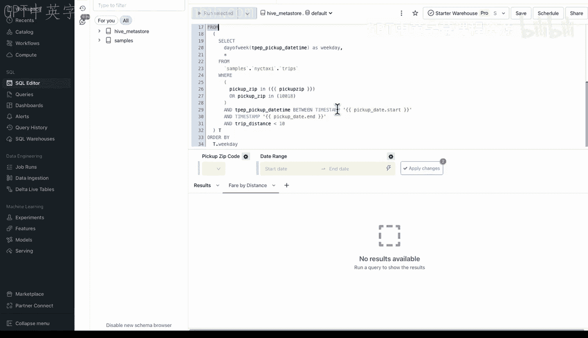

# 杜克大学《大型语言模型实践（高级数据工程、AWS、Databricks和本地LLM）｜Large Language Model Operations 》 - P140：39_02_08_使用仪表板.zh_en - GPT中英字幕课程资源 - BV1oi421Q7GT

Here we have the New York City Tax tripp Analysis dashashboard。

 which is using the Databricks sample data set on the New York City taxi trips。

Notice it's in this interface dashboard。 Let's point out some of the advantages of a tool like this so you're a data analyst or data scientist and you need to have important information that you share with people in your organization when you share a dashboard like this What's nice about it is that you're able to give people up to dateate information with any interval that you're looking at and you can also query and give them the ability in human knowledge to look at different ranges so they don't need to know SQL they don't have to actually know anything about writing code because they can toggle and search from different date ranges or they can look at different zip codes themselves。

 So this is very empowering and it's a democratization of data science and data analytics Now notice here as well that look it says five minutes ago So this was updated five minutes ago and the reason that it's updated is because I select。

if I select this again。You can see that this will show that it's instantly updated so you can actually have different states so it's really up to the user if the user wants to get the latest updates。

 they could click it again， likewise when you actually create this as a scheduled job。

Notice that you could say add schedule and you could say。

 look every hour I want this to update and that might be okay for the majority of people。

 you also have the ability to do this in Chron syntax as well and you can even add subscribers and this dashboard snapshot will be sent to subscribers。

 So really there's a nice scheduling interface here as well。 you can obviously share。And finally。

 if you click on refresh here， it will refresh every single window inside。

 which is also pretty helpful so you can see it refreshing and we see just updated right now and you can see that you if you wanted to as well。

 go into if you have the administrative privileges。Click on this menu。And you can also edit this。

 And what that means is that you can actually add new things。 so you could add a text box。

 you could add a filter。 So this is a filter right here。 you could add a visualization。

 you could do different colors。 But the other thing I think that is very useful is that you can learn a lot from using these as well。

 So if I select one of the visualizations here。 This is a nice little graph here that shows the fair amount and the trip distances。

 you can see there's a linear relationship。 But how did that SQL query get generated。 Well。

 pretty easy to figure out， I can just select this。 And I can look actually at the query itself。

 which is which is pretty awesome。 obviously I could also download the CSv， which could be useful。

 But let's go ahead and look at this query。😊，Now take a look at this， I'm inside of a query editor。

 you can see it the SQL query editor and we see that it says use catalog samples。

 select right here and we're able to actually look through all of the different SQL queries and I could tweak it if I wanted to So this is a great way both to learn when someone in your organization has created。

A dashboard for you， but also for you to edit this， if you have the privileges to do it。

 So the dashboarding interface is one of the more powerful interfaces of databricks and make sure you take advantage of it。

