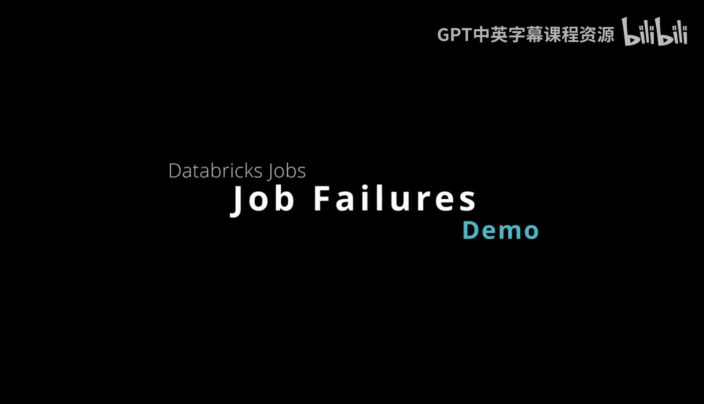
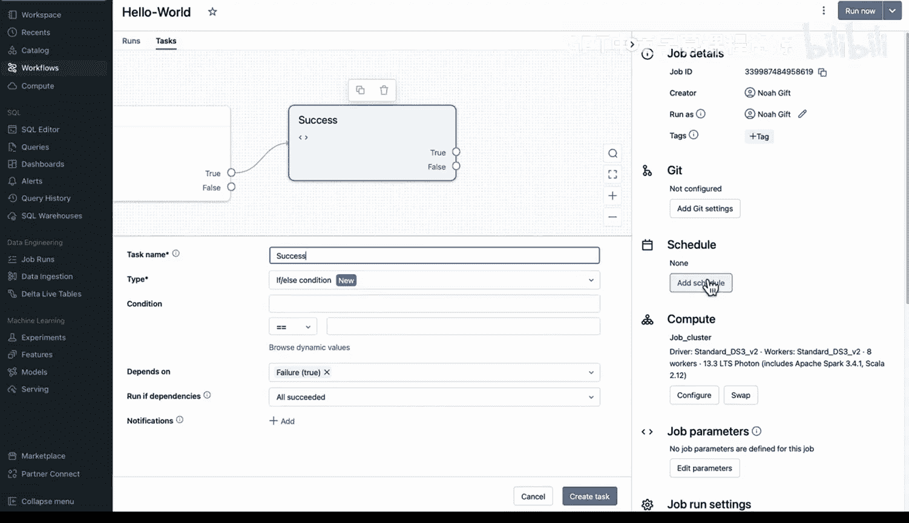

# 杜克大学《大型语言模型实践（高级数据工程、AWS、Databricks和本地LLM）｜Large Language Model Operations 》 - P141：40_02_09_故障处理.zh_en - GPT中英字幕课程资源 - BV1oi421Q7GT

Yeah。Debugging failed job runs can be tricky。 We see here in this workflows interface that I have a little bit of an issue in that this job is actually failing here。

 And we could actually look at the last run and say， oh oh what's going on。

 why is it failing and I even get the message and I could dive into it in more detail。

 But that doesn't really handle the case of what do I do next And can I actually solve this programmatically。

 So if we go back to the job itself， I go a task。You can see here that it's pretty simple this notebook。

 but maybe I could add some logic here to handle that condition and so what I could do is I could add another task and this task could be if else and this if else task could be failure and so maybe I need to clean something up or do some other thing here what we can say is run if dependencies。

Basically all failed。 So if this job fails， let's go ahead and do some logic here that cleans things up。

 And even I could add a notification as well。 This notification could go to email to teams。

 Pager duty Sck， etc ceter， and says look， this thing actually failed。I， I ran a cleanup job。

 but you should know about it。 So having the ability to customize your task here is a great way to handle those failures。

 And you can handle both a success condition。 if we， if we create this task。

And then if we want to add another task here as well， we could add a success， right， and so。

You're able to actually dive into this jobs based interface here and really navigate on a failure。

 do a cleanup on a success， maybe load it into the database and then send a notification that says everything was loaded successfully。

 so there are lots of different ways to handle problems if youre able to programmatically solve it。

 that's often the best solution。

