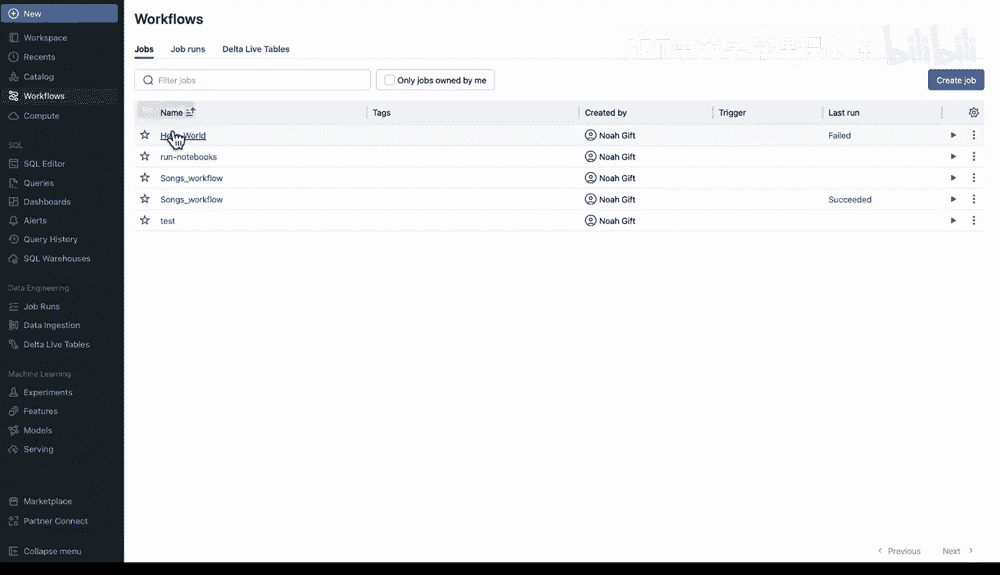
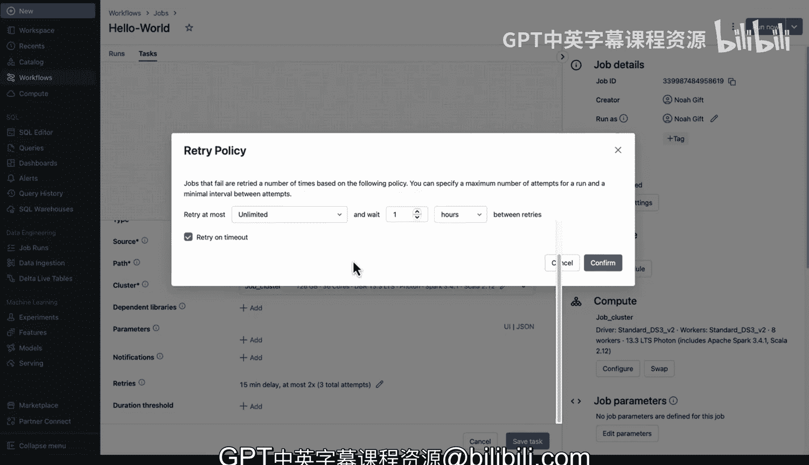

# 杜克大学《大型语言模型实践（高级数据工程、AWS、Databricks和本地LLM）｜Large Language Model Operations 》 - P142：41_02_10_配置重试机制.zh_en - GPT中英字幕课程资源 - BV1oi421Q7GT

Here we see that we have a job that is in a failed state。

 right we've had some problems with it and one of the things you can do though is enable a retry here。

 so you can do max retryries， you can do retry delay。

 you can also do triggering retryries you can also have monitoring for retryries。

 So let's go ahead and take a look here at this job go into the task and then look where we could set this。

 So notice here it says number of retry attempts and minimal interval between attempts if this task fails。

 So if we go ahead and we select this we can say， hey。

 I want you to try this at least three times because there could be network errors or there could be some other issue and we want to actually wait 15 minutes between each retry here。

 if we go ahead and say confirm now we can see that 15 minute delay and at most three times a total attempt。

 So this is a great way to handle problems where there could really be some issues。

In terms of resources like an API where you don't control it and instead of blowing up your entire data pipeline。

 you could at least try to do these retries here and get this working Now the other thing to mention here as well is that if you're very confident and you have something that needs to run quite a bit。

 you could even go all the way down to unlimited， which is another option。

And maybe this is like a web scraping tool that you want to scrape， for example。

 every hour and you know that web scraping is very tedious and also if there's a time out as well。

 you want this to actually know keep going over and over and over again。

 so there are some scenarios as well depending on the kind of job you create if it's you know basically a nondeterministic job by itself like web scraping。

 then you may want to do unlimited retryries， but potentially wait for a long period in between those retryries and even retry on a timeout。

