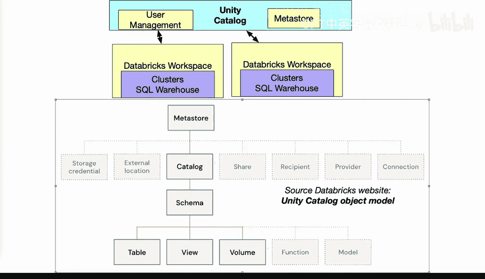

# 杜克大学《大型语言模型实践（高级数据工程、AWS、Databricks和本地LLM）｜Large Language Model Operations 》 - P143：42_02_02_使用Unity Catalog实现统一数据访问.zh_en - GPT中英字幕课程资源 - BV1oi421Q7GT

。Dataricks Unity catalog provides centralized access control， auditing。

 lineage and data discovery capabilities across。Not just one。

 but even multiple Databricks workspaces。 Let's take a look here first at this unity catalog where we have user management and metastore inside and it's connecting to more than one Databricks workspace inside theres clusters。

 their SQL warehouses and the idea here is that you can define once but secure everywhere。

 and this allows for comprehensive data governance also you can have a standards compliant security model。

 and this is based on ansSQL and you can allow administrators to grant permissions in their existing data lake using a familiar syntax。

This means catalogs， databases， tables and views it also has built in auditing and lineage so you can capture userle audit logs and data discovery so the data discovery lets you tag things document data assets and you can even look at system tables as well so you can look at things like audit logs billable usage etc。

 Next up we have the unity catalog object model you can see that the metastore is the toplel container for metadata it exposes a threelevel namespace so catalog schema table organizes the data and then below in the data catalog here we have the first layer of object hierarchy and it's used to organize data assets and then the schema is going to be known as a database and the schemas are the second layer of the object hierarchy and contains tables and views and of course you can create these tables and views in SQL。

You can create them with catalog Explorer and then finally in the tables。

 views and volumes at the lowest level， this is where you would have governance for non tabular data so in a nutshell here。

 the five key characteristics of the Unity catalog are the centralized metadata store。

 which would capture technical metadata， the unified access controls。

 which allow you to set fine grain access controls using SQL。

 the data lineage tracking right data governance， auto capture and end end lineage at query time。

 the discovery and organization， so searchable catalog for easy discovery of data。

And also using browser and RE APIs， and then finally it's multicloud friendly。

 so you can even do this across multi cloud vendors and you can federate for unified access。

