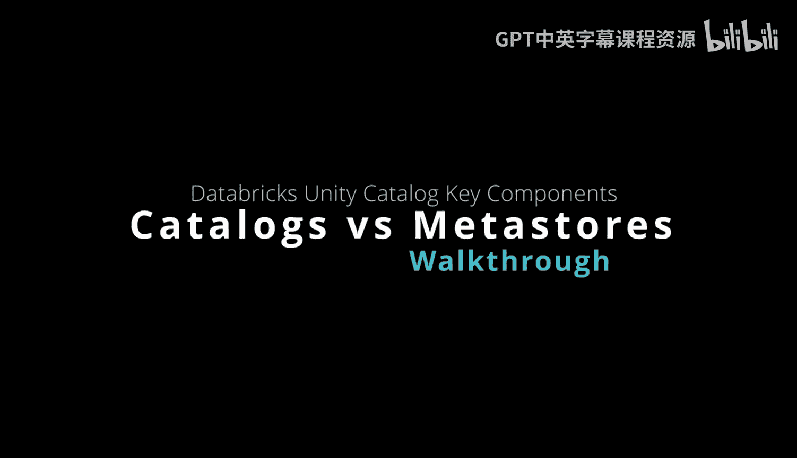
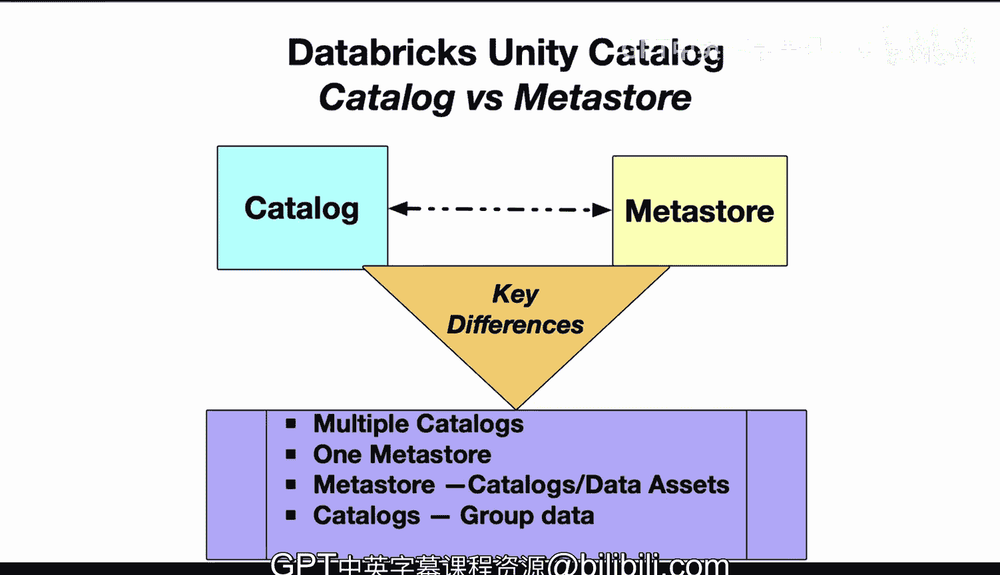

# 杜克大学《大型语言模型实践（高级数据工程、AWS、Databricks和本地LLM）｜Large Language Model Operations 》 - P144：43_02_03_目录与元存储对比.zh_en - GPT中英字幕课程资源 - BV1oi421Q7GT

Okay。Dataricks Unity catalog has many different components， but let's take a look at first。

 the catalog itself versus the metastore。 There are some key differences。 First。

 the metastore is the top level logical container for metadata。

 It stores information about data assets like tables or models。

 and it also defines the namespace hierarchy of catalog。And the catalog would then proceed to schema。

 which would then proceed to table， so the hierarchy is catalog schema table。

 and it also handles access control policies and auditing。Likewise。

 the catalog is the first level organizational unit within a metastore。

 and it's used to group related data assets like tables， views， etc cea。

 and the access controls can be defined at the catalog level So in a nutshell。

 what are the key differences there can be multiple catalogs within one metastore。

 but only one metastore per databricks deployment The metastore contains all the metadata for catalogs and data assets and the catalogs help group data objects based on apps。

 teams and more。 So in a nutshell。A metastore is the overarching metadata Store and root data governance layer in Unity catalog and catalogs provide the first level organization and boundaries within the metastore metadata。

