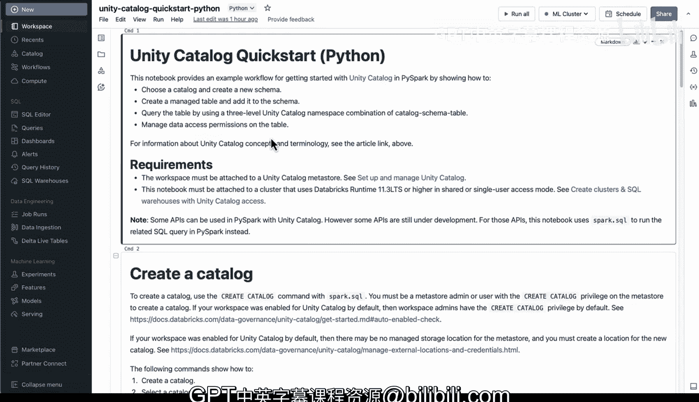

# 杜克大学《大型语言模型实践（高级数据工程、AWS、Databricks和本地LLM）｜Large Language Model Operations 》 - P145：44_02_04_Unity Catalog快速入门（Python版）.zh_en - GPT中英字幕课程资源 - BV1oi421Q7GT

。Let's take a look at how to do a Unity catalog quick start in purere Python here。

The key overview is that we're going to look at the workspace setup so you'd want to have a workspace that has the unity catalog metastore。

 It's got to also support the runtime like 11。3 or higher。

And then you're going to do a catalog creation a schema creation， table management。

 security best practice， and then metada metadata discovery。

 So one of the things you can do when you look at a notebook like this is actually go over to the table of contents。

 This is a great way to get a nice clean way to break down you know。

 a notebook that may contain many cells and it could be hard to read is we can actually look at it from the table content。

 So here we go。 Here's some documentation。 and then we have the actual code。

 which is going to say create a catalog。😊，Then create a managed schema， which is the database。

 create a managed table and then use the unity catalog in the pandas API on Spark。 right。

 So those are the key steps here。 So let's go ahead and take a look here。 So we see this is step 1。

 And then when we go to create a catalog here。 It's going to create a catalog， select， show， etc。

 let's take a look at how this code works。 So pretty simple is a spark SQL statement that says create catalog If it doesn't exist。

 And that's a quick start catalog。 Next up， you would go ahead and set it。

And then you would show all the catalogs。Finally， the last thing you want to do is you'd want to say。

 let's go ahead and grant， create and use catalog permissions。

And then you can actually go ahead and verify that that works Now again。

 we can just toggle right down to the next step here， which is okay。

 let's create and manage schemas and in this step here this would be create a schema if it doesn't exist。

 show the schemas extend it。And then again， do the permissions。Next step would be to manage a table。

 and this case would be again， use the schema。That we already created earlier， show the database。

Create a managed Delta table。In the catalog。Go ahead and set the permissions。

 go ahead and show the tables， and then insert a few rows into the table， finally show the table。

And then show all available tables。 Now， finally， this is the part that probably most Python programmers are interested in is okay。

 let's go ahead and use it。 And what's nice is that there's a pandas API available for Spark。

 And so you would import Pipark do pandas asPS。 So instead of doing import pandas SPD。

 you would say import Pipark do pandas S and it's going to work in a roughly similar way as pandas。

 which a lot of Python programmers are used to， you would just show the table。

Write the table to Unity catalog again grant the permissions and then show the table so pretty straightforward and you can actually find this quick start in the official documentation for Databricks it's a great way to get a feel for this and also to be able to toggle back and forth with the key steps inside of the code。

