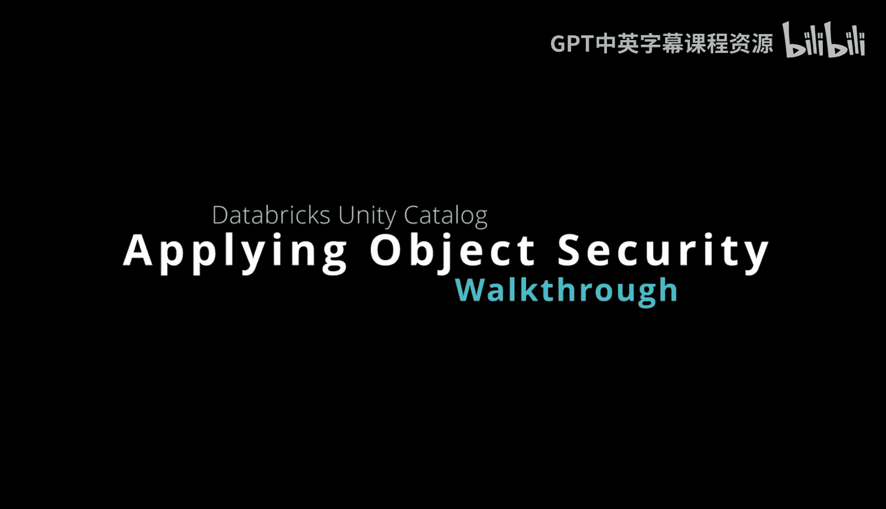
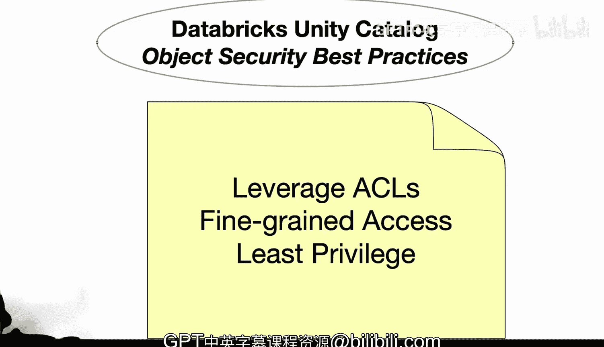

# 杜克大学《大型语言模型实践（高级数据工程、AWS、Databricks和本地LLM）｜Large Language Model Operations 》 - P146：45_02_05_应用对象安全策略.zh_en - GPT中英字幕课程资源 - BV1oi421Q7GT

Okay。Applying object security best practices with the Unity catalog system involves several characteristics First we have leveraging access control lists or ACLs ACLs allow granting or restricting access to specific users and groups on secable objects like tables views and more they also provide fine grain control so you can secure access to sensitive data you can go beyond this by also having fine grain access as well to objects。

 so you can have database schema level permissions， you can secure access to individual tables。

 pipelines workflows but only based on what is necessary for that task and you can even control reading。

 writing and permission selectively。Finally， it all wraps up into lease privilege。

 The idea with least privileges only provide the minimum required access。

 Don't give someone abilities that they don't need because this creates a security breach。

 for example， if someone only needs to look at a dashboard。

 you wouldn't want to give them access to read the dashboard you don't use broad groups like all users unless there's a hard requirement。

 you would also revoke access once the purpose is served rather than letting it accumulate and you also review policies on a regular basis for relevance。

 So to wrap this up the key benefits with this best practice technique is you would enhance the data security and compliance。

 you'd avoid unnecessary broad access by leveraging precise ACLs and you're going to control a blast radius if credentials or policies are compromised because you've only given people the privileges are necessary to have if you have admin privileges。

 you could have a huge secure。ProblemBecause everybody has access to everything。

