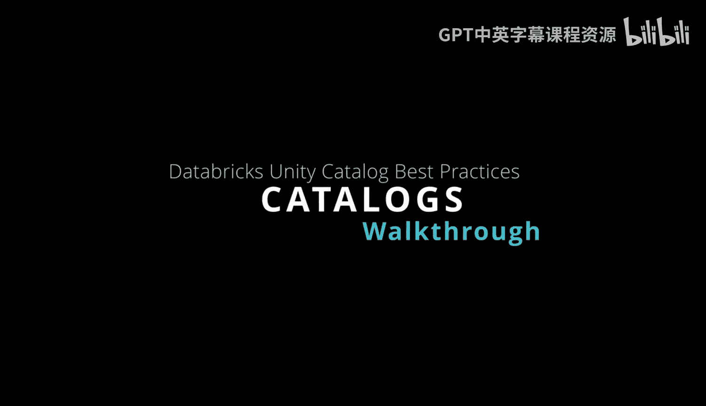
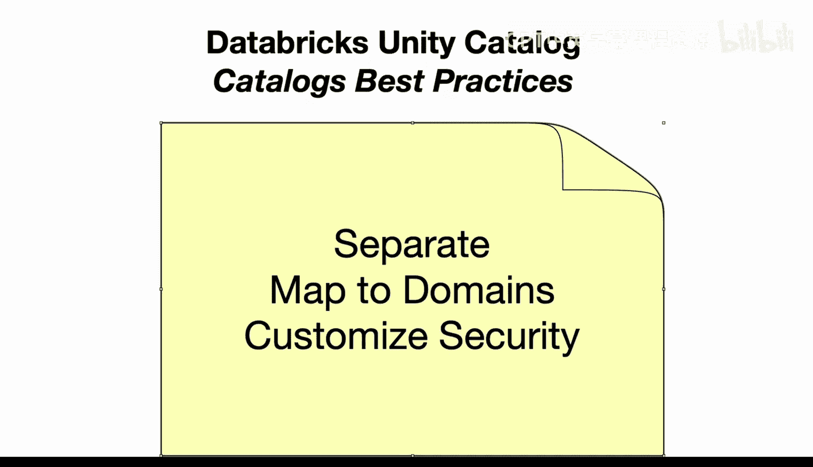
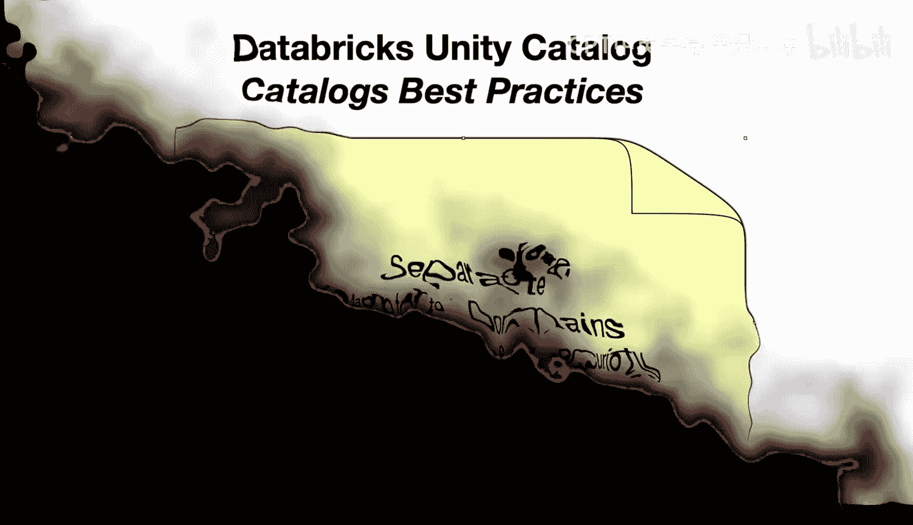

# 杜克大学《大型语言模型实践（高级数据工程、AWS、Databricks和本地LLM）｜Large Language Model Operations 》 - P147：46_02_06_目录最佳实践.zh_en - GPT中英字幕课程资源 - BV1oi421Q7GT

Yeah。Here are some best practices for catalogs with the Databricks Unity catalog system。 First up。

 you want to create a separate catalog for loose coupling。

This would mean you would want to separate the business functions。

 the teams and you'd have a dedicated catalog for each， you also would manage the access as well。

 you could have compliance at that catalog level， you could also change in one catalog and not have to worry about the impact in another。

Finally， in the last two we see map two domains and customized security， if we go to map two domains。

 this means aligning the catalog boundaries with business domains or applications， a good example。

 this would be a catalog for marketing analytics， maybe a catalog for HR。

 maybe a catalog for monitoring the observability of a data pipeline。

And then finally you would want to have the security policy and governance as well as a component of that catalog so you're able to really drill down into a particular domain and understand exactly what's happening finally with the security if you look at the security policy per catalog。

 this means creating access control groups and rules specific to a catalog also fine tuning the readrite and you would want to grant those independently so in many scenarios you would only want to read for example to a dashboard you don't want to give people privileges to that and then also customizing the settings like resource quotas and then even scrubbing the rules after a certain period of time so the fine grain policies per catalog are a best practice that are going to allow you to have the best of security while also getting the best of functionality。

