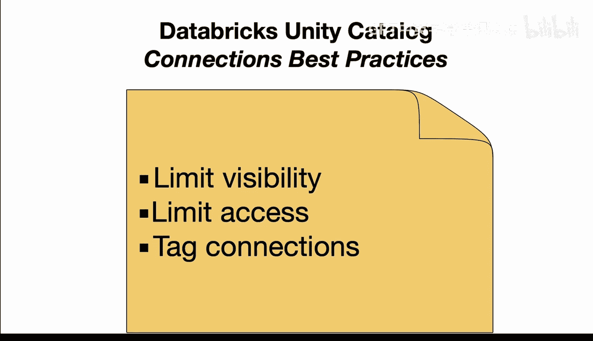

# 杜克大学《大型语言模型实践（高级数据工程、AWS、Databricks和本地LLM）｜Large Language Model Operations 》 - P148：47_02_07_连接配置最佳实践.zh_en - GPT中英字幕课程资源 - BV1oi421Q7GT

。The best practices for connections are first to limit the visibility。

 What this means is you want to limit the visibility of external connections so avoid exposing connection secrets to all users。

You also want to grant access only to specific users， groups， and role。

And then set least privileges like Read only permissions in many scenarios。

 there isn't a need for everybody to have access to all of your external connections。

Let's look at the next thing which is limiting access in general。

 so provide access only to the required users and groups。

 and this means you could add granular access control lists or ACLs on a connection and you can ensure only intended teams or jobs can use those external resources and then you could revoke them if the team or group doesn't need those resources again。

 so it's important to actually be aware of what is actually happening in a team。

And make sure that you're not giving them access to external resources they don't need。

In terms of tagging connections effectively for discovery。

 you can use tags like source categories or data classifications。

 and you can also allow an ability to discover connections by use case and then tag consistently for organizational wide visibility so some of the benefits here would include enhanced security by restricting exposure。

 preventing unintended data access or leaks， and also looking at a way of easing the discovery and management of external connections。

