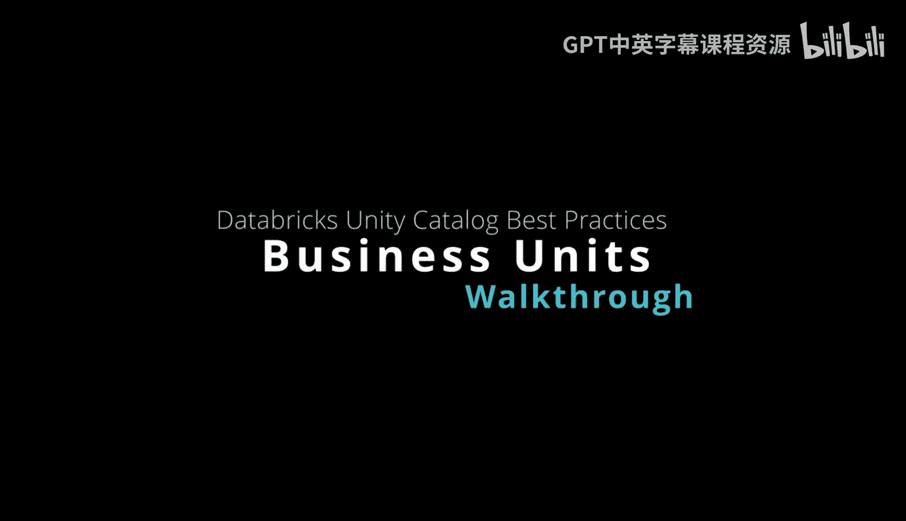
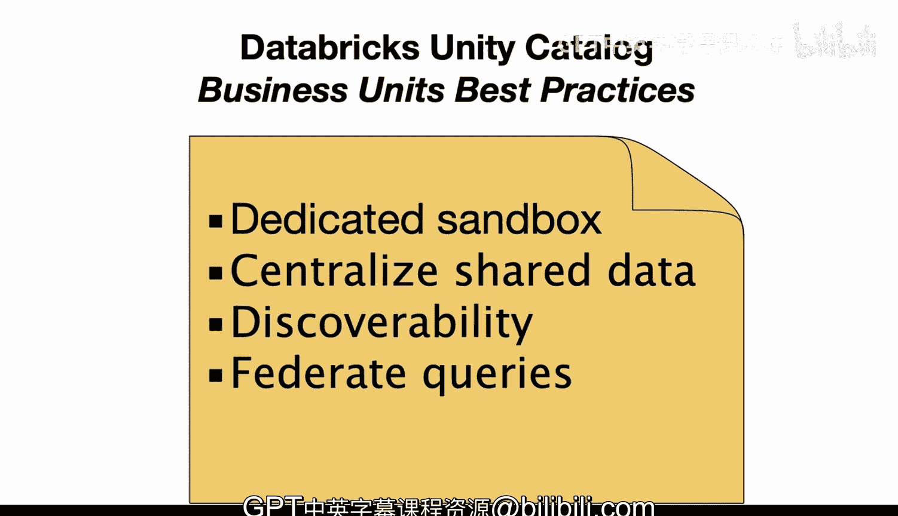

# 杜克大学《大型语言模型实践（高级数据工程、AWS、Databricks和本地LLM）｜Large Language Model Operations 》 - P149：48_02_08_业务单元最佳实践.zh_en - GPT中英字幕课程资源 - BV1oi421Q7GT

Yeah。Here we have Databrick's Unity catalog business unit Best practices。First up。

 you want to provide a dedicated sandbox for each of your business units。

You want to allocate an independent development environment as well。

You also want to allow safe experimentation with data at ML and you want to prevent interference between different workflows。

 so the dedicated sandbox is ideal so that you don't mix different security parameters between two organizations。

 there could be a really restricted data in one business unit。

And there could be more of a open ended research based environment in another。

 and it's going to be much better to provide sandboxes for each of those business units。

Centralized shareable data into production catalog。

 so in this scenario you would want reusable data sets like customer and product data。

 also the ability to manage the access centrally rather than duplicate things。

Because the size of the data could quickly become a huge cost center。

And you also want a single source of truth to remain consistent as well。

 so that's really the centralized sharing model so that you're not having multiple different versions of a key table that is slightly different in one department than another。

Now if we get into discoverability， this is another one。

 that's important is you need a meaningful naming convention like glossaries。

 you also want to do metadata best practices as well。

 so that includes logically structuring catalogs and folders and assets。

 making a meaningful hierarchy and then also have collaboration across different units。Finally。

 with federated queries， this would be via the lakehouse architecture。

 you would unify the data access across silos。 You would govern securely via contracts and permissions。

 and then you' would want to enrich the local data with shared self service access。

 So some of the key benefits include。Supporting autonomy for units via domains。

 increasing productivity through reuse， and then also maintaining consistency with collaborative governance。

