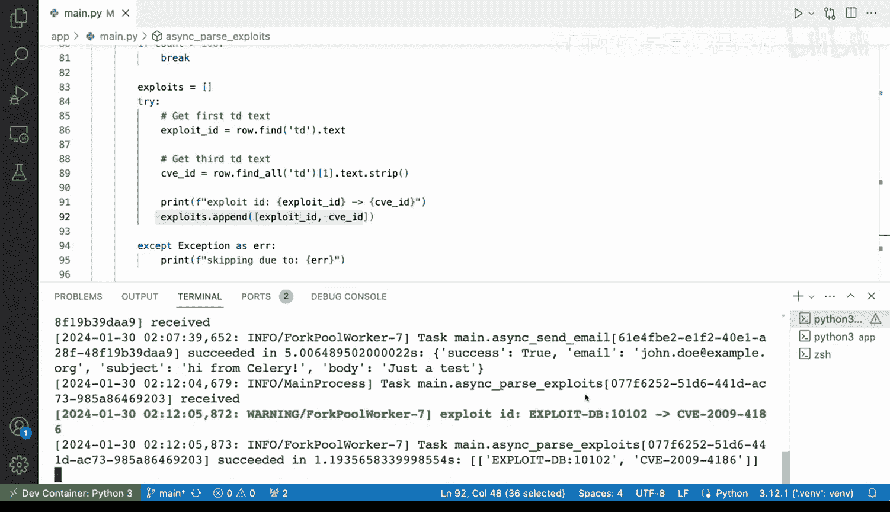

# 杜克大学《大型语言模型实践（高级数据工程、AWS、Databricks和本地LLM）｜Large Language Model Operations 》 - P14：14_01_09_从异步任务中检索值.zh_en - GPT中英字幕课程资源 - BV1oi421Q7GT

Right， so we already saw how we could do a fire and forget type of request and processing。

 So what do we do if we want to do actually some processing well。

What we what we can do here and this is what we had before。

 what we can do here is we're going to do the par the exploits and instead of returning something empty。

 we're going to return the ID the ID can be used later for requesting the information later。

But you will see here that that is stored internally because that ID can be used to store that information。

 it will go to a backend store we haven't configure that in this application because it will be way more involved to try to set something up but it will give you a solid idea。

 a good understanding a good foundation so that you can build upon that in order to start storing and it will give you kind of like just enough information so that you can understand how that that might work so let's start that we're going to do parse exploits。

 it's going to be a post， this seems to be like it's going to be an easier post because it doesn't take a payload it' we're not going to submit information we're going to trigger that just by sending a post request to slash parse exploits endpoint and that's going to go to the CV。

That micro do org not database， but website。 Alright， so let's go ahead and do that。 And for that。

 we're going to go here and we're going to say we're going to say clear。And actually。

 let's make these beer。And then we're going to immediately change back here so that we can see the processing。

 So' going to say curl dash X post H T TP。 and we'm going to do local host。

or 5000 we're going to say parse underscore exploits so we're I do that we're going to get a task ID and we are going to get this only took a second but you can see here that it was able to process the information it submitted the request it went all the way all the way to that external website it did some parsing and we can see here that CV 20094186 was able to be attached to an exploit so behind the scenes that's the type of processing that we're doing if you're looking here you will see that we're crafting the exploits right here and in the exploits then you we're appending anything that we' finding were app that into like we're pending a list of lists。

 an exploit ID and a CV ID no problem。There you go。

 that is how you would do some more processing and you will have like this specific ID in this case。

 I believe the ID would be this one。And if we go back to the curl request， not this one。

 it would be the same one，077 F6 let's take a look at here， that would be there you go。

 that's again the same one，077 F6 so returning that ID is a way to correlate the workload。

 the information and everything that was captured when when that action when that request was getting processed。

