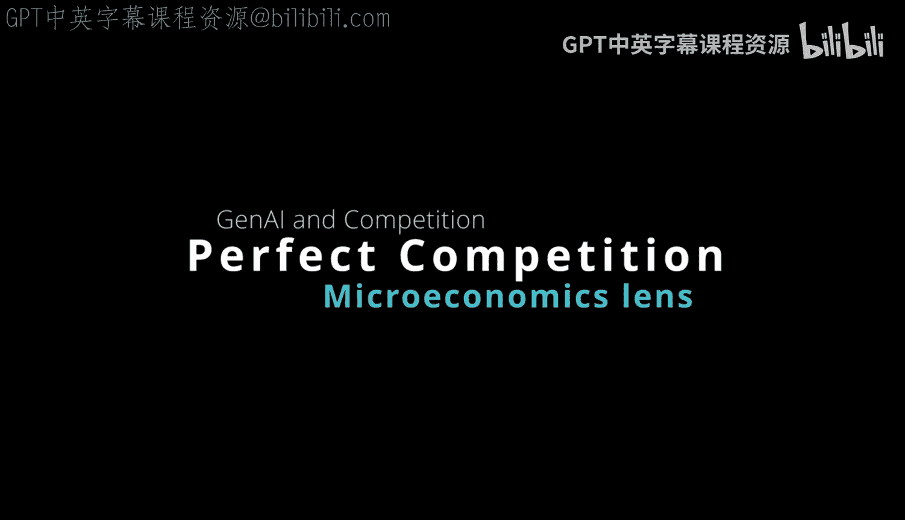
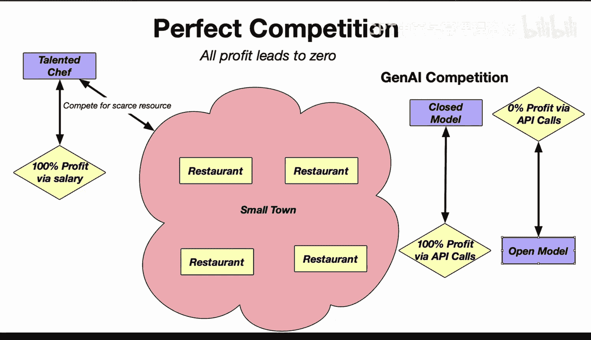
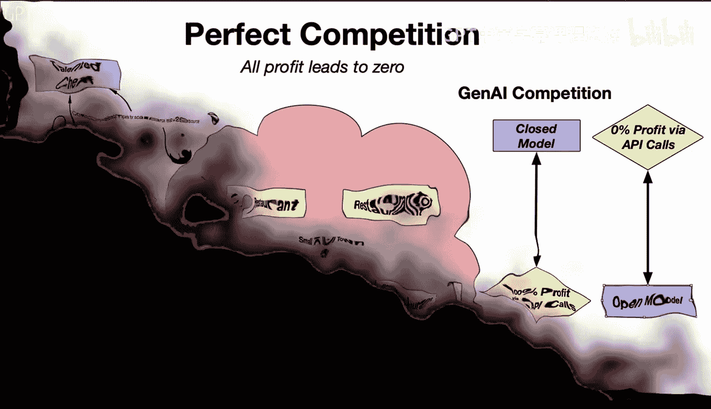

# 杜克大学《大型语言模型实践（高级数据工程、AWS、Databricks和本地LLM）｜Large Language Model Operations 》 - P153：52_03_05_完全竞争市场.zh_en - GPT中英字幕课程资源 - BV1oi421Q7GT

In perfect competition， all profit leads to0。 But what does this really mean， Well。

 we can look at this from the perspective of a small town that has many restaurants。

 Let's say there are four restaurants in town。And there's no real way to compete against another restaurant until a talented chef comes into of town。

 Now， everybody in the restaurant has to compete for this scarcece resource to be the chef because they're so talented。

 they bring in all of the customers to the restaurant so what they do。

It they keep out competing each other and paying more and more salary until eventually the chef takes all of the profit because the chef is a limited or scarcee resource。

 So this chef has rare and in demandd skills。 There are many restaurants They are bidding for the chef service。

 And then eventually， the chef will negotiate a very high salary。

 And they'll capture all of the economic profit。 So what does this mean economic profit。

 It means that the total revenue minus the total economic cost。 So this is the normal profit margin。

 And then the normal profit is the costs of attracting investment。

 and then the economic profit is the above normal profit。 So essentially。

This perfect competition could lead to eventual bankruptcy because whoever actually is employing the chef has to give all of the profit to the chef。

 and there is no way to compete。 Likewise， we can look at a AI example where a similar thing could occur。

 Let's say that there is a closed model and that everybody has to use this closed model because it has superior performance。

 Well， there is no competitive advantage now， just like the chef。

 everybody has to use the same closed model All the profit of these companies will go to the API calls。

 just like the chef in the restaurant example on the flip side。

 we could see another scenario where if all of the models are open。

 there is no way to make a profit because you can equally use any model and so the companies that are training models will eventually go out of business because there's no way to make money。

 So this is a hypothetical situation but it is important to think about this from an economics。

pect when you're evaluating what your AI strategy is。

 do you think that going all in on closed model is going to give you a competitive advantage。

 or do you think in the future if there's a essentially unlimited amount of models。

Will eventually the models become like Linux， where it's a commodity， it's free。

 and you'll have to compete on some other form of technology。

