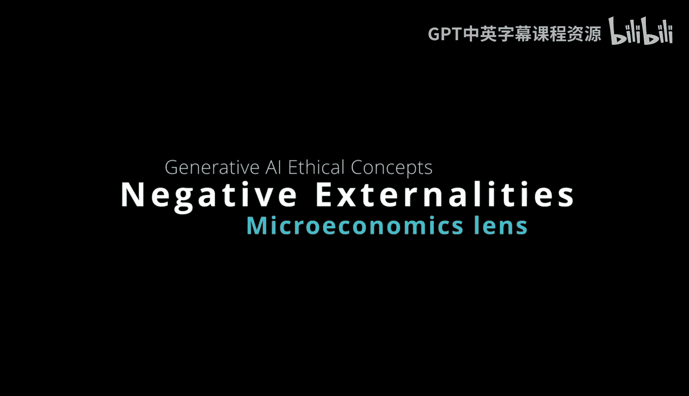
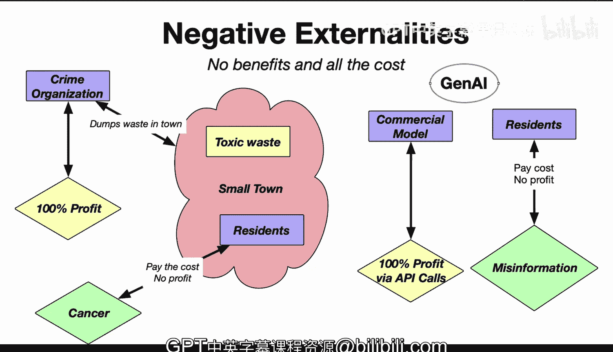

# 杜克大学《大型语言模型实践（高级数据工程、AWS、Databricks和本地LLM）｜Large Language Model Operations 》 - P154：53_03_06_负外部性.zh_en - GPT中英字幕课程资源 - BV1oi421Q7GT

Negative externalities are about getting no benefits but still having to pay for the cost。

 and this is a common problem with many tech companies。

 many for profit companies is that we talk about profit and loss。

 but we're not thinking about the negative externalities。A really easy one to understand。 In fact。

 it's based on real world examples is a crime organization that goes and dumps toxic waste。

 Let's say nuclear waste or some other toxic chemical a pesticide into a small town illegally and they're getting paid by a company to do that。

 Well， the crime organization gets 100% of the profit。 And because they。

Don't have the ethical components in place to really think through the problem。

 They're also giving all of the negative externalities to the small town。

 so the residents didn't make a profit from the toxic waste that was dumped in town but they're paying the price and the price could be cancer。

 it could be illness。 it could be people are less able to maybe grow things in the town， etc ce。

 and so there's all of these negative externalities that are the result of this criminal action。

 so this is an extreme example but if we take a look at generative AI。

 we can see also potentially some negative externalities here。

 so let's take a commercial model that someone is publishing and let's say that that company is getting 100% of the profit and this is occurring via API calls well this is great for the company they've got the profit but are there any potential negative externality so。

People that aren't getting the profit are they actually going to pay a cost for what has actually been produced So in the case of。

A generative AI company， they may be producing content that could later down the stream to misinformation。

 let's say that there is you know a voice that sounds like a famous politician and it leads to an election being changed or there is some misinformation about a particular individual that causes harm to their company or to the reputation or there's misinformation that leads to health problems。

 these are all things that could theoretically happen from irresponsible use of generative AI and the commercial company gets all the profit。

 but the people that are actually going to pay the price or the people that are getting these negative externalities。

 So it's an important framework to consider and it doesn't mean that there's always negative externalities that are extreme。

 but it is important to at least consider this when when you're proposing a technical solution is to look。

At the profit， of course， but also to look at the negative externalities， what is your impact？

Even if it's unintentional， what is the actual real impact on the technology that you're implementing。

 and this is a responsible way to think about deploying AI solutions。

