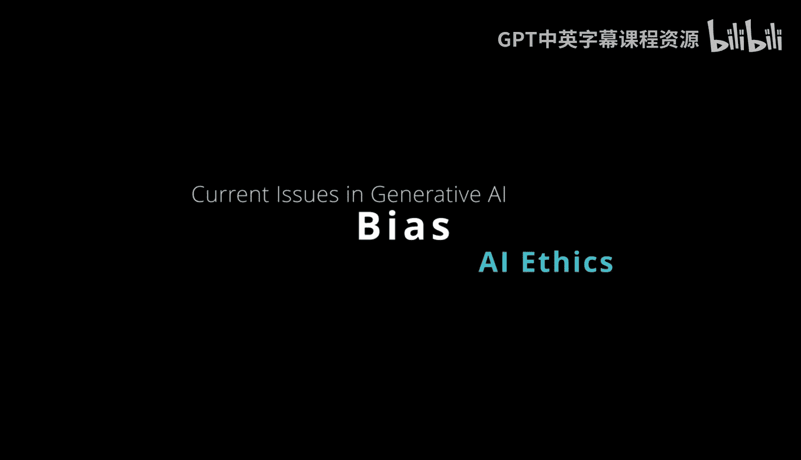
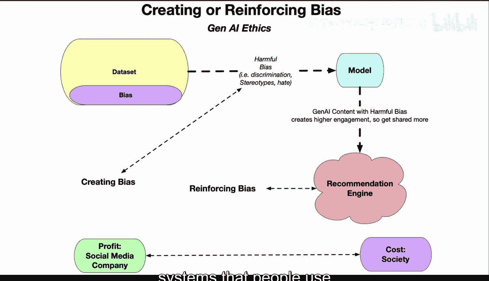

# 杜克大学《大型语言模型实践（高级数据工程、AWS、Databricks和本地LLM）｜Large Language Model Operations 》 - P156：55_03_08_创建或强化偏见.zh_en - GPT中英字幕课程资源 - BV1oi421Q7GT

Yeah。Creating or reinforcing bias is an issue that must be addressed with generative AI in terms of ethics。

Here we have a data set that has some bias included inside of it， it could have stereotypes。

 discrimination， could have some hate。Embedded inside of this information。

 And if you're training on this model and not addressing it。

 you're then going to put it into a system that can generate even more of that bias。

 So you're reinforcing the bias。 A good example would be in the case of generative AI content that is being put onto a recommendation engine that harmful bias could actually have higher engagement。

 So there's a profit that is actually achieved by this model that was trained on bias data。

And it's actually the profit is even amplified by this harmful stereotype that's being propagated misinformation and the recommendation engine is fed on only that metric。

 so as a result， not only did you originally create the bias so that's the creation you've also reinforce that bias by recommended it to millions of people or even billions of people and this is a real problem because on the one hand the social media company could actually earn those profits。

 but society is actually going to pay for that cost So there could be further discrimination。

 there could be hate crimes there could be all kinds of implications to society that occur from this reinforcement of bias so this is an important thing to consider a few of the things that we can think about is that if we go to the beginning here。

 how does this work Well， let's say you collected a biased data set that was tied to past user engagement So again that was maybe some harmful behavior that occurred。

Previously， you then optimize for clicks and shares and outrage， and this could involve again。

 harmful content， and then it will create a filter bubble and toxic personalization。

 So people are gravitating towards this toxic content。 And again。

 it makes the company lots of revenue。 And so as a result that company profit is increased by outrage and misinformation and overall engagement。

 And then the more time a user is spent。Spending really on the site。

 you'll get more ads and you'll be able to sell higher prices。

 maybe in the short term and then those short termm growth and profit rise will feel like things are going in the right direction but again。

 as we mentioned earlier the discrimination from the data that's being propagated and the stereotyping of marginalized groups。

 these are costs the society has to pay and it could further entrench and divide and even erode understanding with a complex topic and so long term this could cause a rise in extremism。

 violence and stability So in a nutshell here， it isn't a theoretical issue it's a real issue that has to be dealt with with gen systems and you have to think about oversight on optimizing engagement algorithms and even changing what's required to incorporate the ethical considerations and also have policy reforms to address these toxic business model。

 So just because the company is making profit。All profit doesn't mean that it's always good。

 There could be harmful stereotypes that are the result of this profit。 And as a result。

 society has to deal with the consequences。 So there could be taxes that could address this issue。

 There could be a legislation that could address this issue。

 There could be ethics training that could address this issue。 In fact。

 all of those together could be the start of really thinking carefully about。

Going beyond just profit， but thinking about a holistic picture of what it's like to build systems that people use and what are those effects on society。

