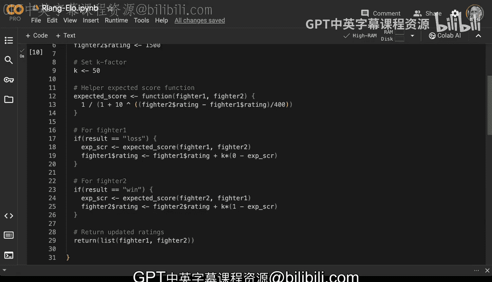

# 杜克大学《大型语言模型实践（高级数据工程、AWS、Databricks和本地LLM）｜Large Language Model Operations 》 - P159：58_03_04_R语言实现ELO算法.zh_en - GPT中英字幕课程资源 - BV1oi421Q7GT

Here we have coab Pro， which has a lot of interesting features that you may not be aware of for a Jupiter notebook that's hosted。

 One。 the runtime is managed for you， which is great。

 It means you don't have to worry about package management dependency hell。

 If we take a look at the runtime here， first see that if you go to change runtime type。

 there are some surprises， right， So one of them is that you can use R inside of coabab。😊。

This is a great feature of CoLab because it means that if you want to just do statistical programming。

It's hard to beat R because it's a language that was designed for statistics so you can go in here and start to experiment with a language that is a little bit more difficult potentially to develop with and that's one of the advantages of Collab Pro also see we have the hardware acceleration so we can use CPUUs we can use an A100 GPU V100 GPU so there's the traditional NviIDdia GPUs as well as the TensorF processing unit。

 the TU， this is the homegrown accelerator from Google and you also can toggle on and off highRA which is very useful if you're dealing with larger data。

We also can see here that there's collab Pro and what's neat about this is I could say， you know。

 hello world。In R and we can get some feedback here that gives us advice。

 So this is pretty cool that we've got a full fledged， I would call this like a data science type。

 you know IDE and one of the other things that we can do with it is actually dive into programming EO。

 which is a strength of schedule metrics so。😊，If we take a look at this， the elo rating function。

 it's pretty straightforward to understand RF， even if you're not familiar with it。

 we have a function here and it takes two things， it takes a fighterer one。

 fighter2 and the results and so what happens here is that we set a default here， F1 and F two。

 they're both set to 1500， we set a K factor which is one of the components of the metric and then we have a helper expected score function and then we have a loss or a win。

AConditional statement that tells us how to actually update the metric and then finally at the very end。

 we return back the updated ratings so a pretty straightforward piece of code here。

 let's go ahead and run it There we go and now in order to initialize it what we can do is set these two fighters。

 Fer one fighter2， we've got Connor kbibe and we can go ahead and run that。

And then we can calculate a new rating。 so we can just say fighters is going to return back both fighters and we can print out the result here。

 and we can see that the rating is Connor1475 because he lost and Kabi is 1500 because he won。

 So this is one of the cool things that you can do with the R。

Languages actually build a solution inside of collab share with other people。

 and it lets you focus on some of the things that R does well。

 which is you know statistical programming versus only focusing on you know maybe getting it set up and libraries。

 etc cetera。 So there's some I think big advantages to doing R programming instead of collab Pro。

