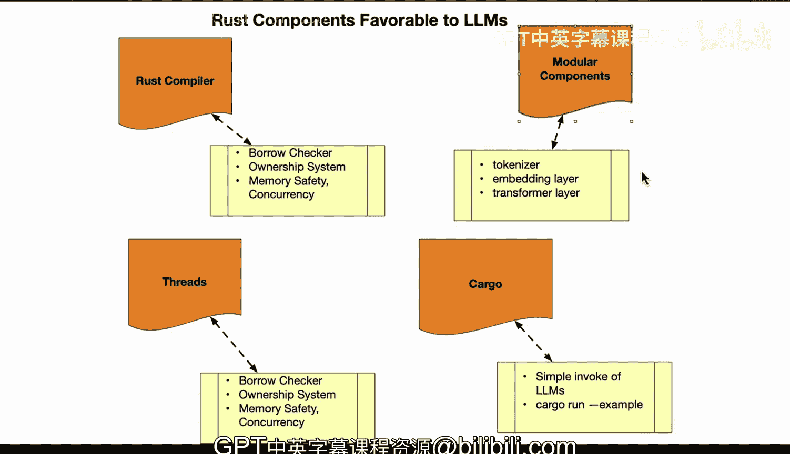

# 杜克大学《大型语言模型实践（高级数据工程、AWS、Databricks和本地LLM）｜Large Language Model Operations 》 - P169：68_04_01_LLM开发中的Rust应用.zh_en - GPT中英字幕课程资源 - BV1oi421Q7GT

Rust components are very favorable to using large language models。

 let's go ahead and talk about these particular components step by step。In a rust compiler。

 the borrow checker is going to prevent race conditions and unsafe memory access bugs。

 It also is able to have ownership system automatically free memory when the objects go out of scope。

 So there's no need for manual memory management。 and also the compile time checks will find errors before the code is deployed making sure that you have a very robust large language model deployment in terms of the modular components here next。

 The tokenizer is going to convert the text into a numerical I for word embeddings。

 the embedding layer would map the words to high dimensionional dense vectors and the transform layer is going to use neural network models for processing text。

 And so this modular design allows the rust traits to mix and match particular components。

 If we get into threads here next。 lightweight rust threads allow concurrent and parallel execution。

 the channels will。😊，Safely pass the data between the threads without a risk of a race condition。

 and it enables leveraging multicore CPUs for performance and scalability in terms of cargo itself。

 This is really where a lot of the secret sauce comes in is that Ru built in package manager is going to stream application dependencies and a large ecosystem of packages allow you to extend capabilities。

 let's say a commandlan tool or a web framework， you also can easily share code between projects and teams and it enforces semantic versioning for stability。

 So this is really an easy way to invoke a large language model and we see this with rust candle。

 All you have to do is cargo run dash example。

