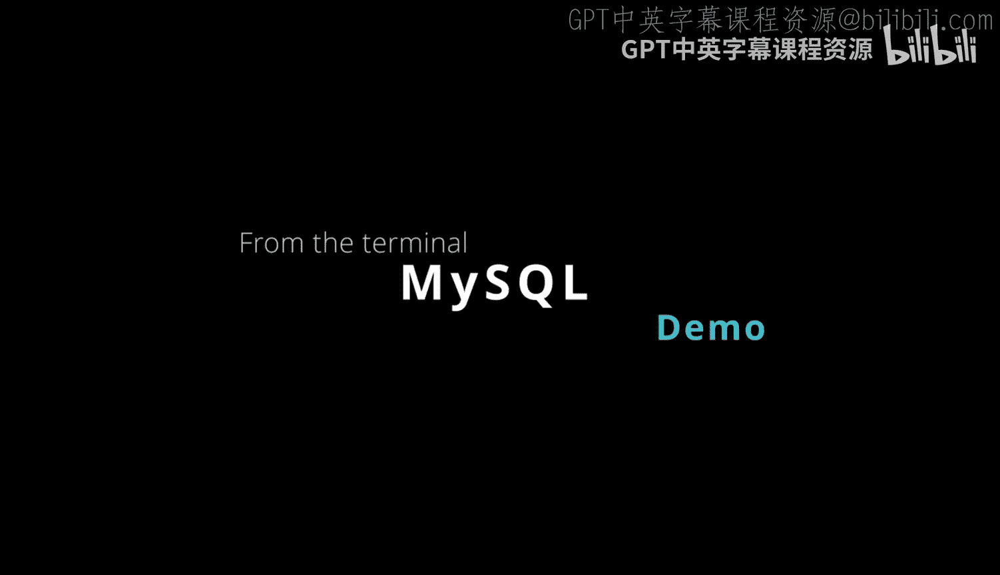
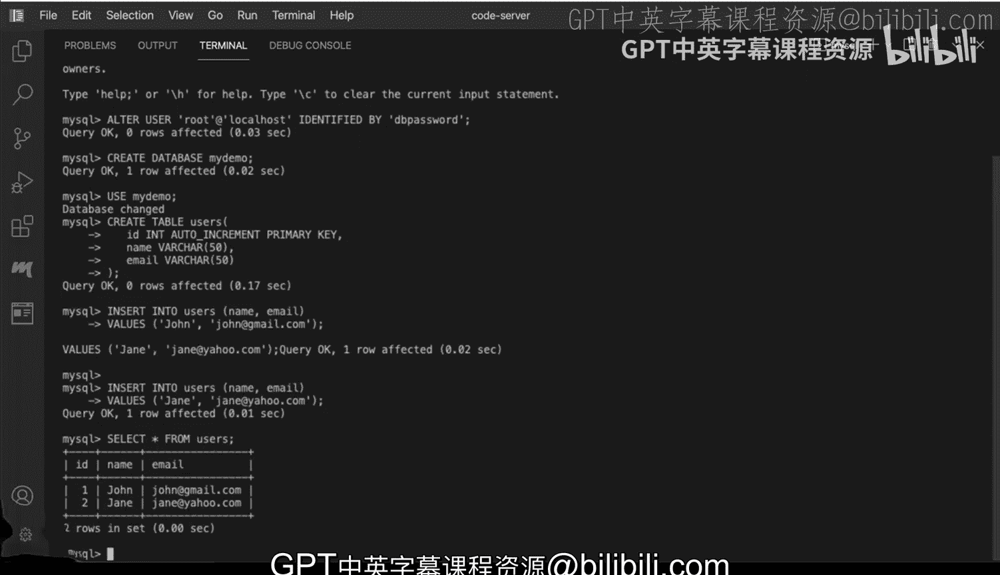

# 杜克大学《大型语言模型实践（高级数据工程、AWS、Databricks和本地LLM）｜Large Language Model Operations 》 - P17：17_01_04_从终端使用MySQL.zh_en - GPT中英字幕课程资源 - BV1oi421Q7GT

Yeah。Let's get started with My SQL from the terminal here。

 first up what I'm going to do is log into MySQL， the prompt。

 well go ahead and type in My SQL dash U root。So the idea here is that I log in as the root user for a new installation and from here I can actually do other things like for example。

 I could even do a alter user， so let's say I wanted to you know change things up here and actually make a new password what I could do is do this。

 go ahead and paste this。Say alter user identified by Db password。There we go。

 And then next I could create a database。 So this is a next step here because we don't have any databases by default。

 Let's go ahead and say create database。 We'll call this my demo perfect。

 And then I'm going to want to use that database。 So let's go ahead and say use my demo。There we go。

 now I've actually selected that database。It's not going to give us anything until we create the table structure。

 So again， thinking of a table。You know， potentiallyten a spreadsheet could be a good example。

 and in this case， we would go ahead and create an ID a name， an email。

 so let me go ahead and copy some code that I've got to make this a little bit easier to type。

And if I paste this in， we can see create table users and then each of these is actually labeled by type so this is something that's important to be aware of is that we have to have the types for the table so that we know when we insert things exactly what it is there we go and next now that I've got this structure which is a very simple structure ID name and email I'm going to actually insert some data inside so let's go ahead and create some users。

 so a couple users that would be we good to create would be these two users here we'll go ahead and paste this in we can say insert into users that's the table I created and we'll say the values they'll be John。

We'll say John at Gmail， Jane， Jane at Yahoo dot com。 And let's go ahead and paste these in。

 There we go。 And we see that there's one row selected。 Now， if we go ahead and。Do a query now。

 this is where we could。Now start to use the database。 It's finally in usable place。

 So we'll go ahead and say select。Star。It will say from users basically。

Let's select everything from that table which we know there's only two things inside。

 but let's go ahead and do that and we're going to get the results back here so it's good to practice doing these things where you're able to start from zero change your password。

 go into the database， create your initial table make sure that you're understanding what the types are for the table and then also insert new data into the table and then select it out。

 this is a very good workflow to get the I guess essentially the practice in and the terminal is actually one of the better places to do this because there's nothing standing between you and the database and you get a firm understanding of exactly what's happening。

