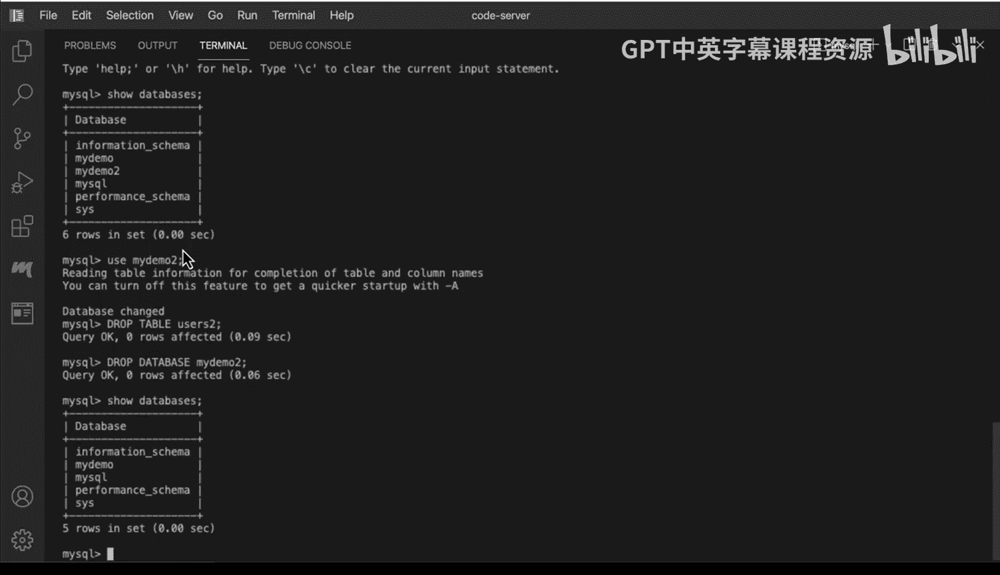

# 杜克大学《大型语言模型实践（高级数据工程、AWS、Databricks和本地LLM）｜Large Language Model Operations 》 - P18：18_01_05_归档与删除数据库.zh_en - GPT中英字幕课程资源 - BV1oi421Q7GT

Here we have a terminal and what I'm going to do is back up an existing database before I do some real heavy lifting to it。

 this is a good practice to be aware of is how do you actually back up a MySQL system so first up I'll type in MysQL dump this is a command that allows you to do a full backup and we're going to connect as the root user and then from here I'm going to type in password and then the database I'm going to connect to is called my demo and then what I'm going to do is I'm going to actually pipe the output into a file so we'll call this backup and it will be my demo dosqL right so kind of a straightforward process to run this command and if we run it the next thing we're gonna have to do is type in the password。

 so I'll go ahead and type in that password。And what I would do first because as a ciss headmin。

 this is something that I learned in my career early is to always check right so let's go ahead and say let's look at the human readable size So do S back up here and we see that it's2K so it's not zero right so we know that there's probably something in there。

 but we're not done yet what we want to do as well is just look at the output of the file Now if it's a huge database CA is not a good idea because it'll consume everything so in fact。

 maybe what we can do instead is just type in head so you get used to that and you'll see just the first few rows of what's happening there we go we see that we've got some stuff there and if we want to look at more what we could do is we could just type in number。

 let's just say the first 100 lines。And this will show us everything that's happening。

 Drop the table if it exists。 Great table。 So we have a full backup of exactly what's gone into this table。

 including the raw data for the database。 So this is a very useful technique to be aware of。 Now。

 the next thing that we're going to do is we're going to do a do a alteration of this database。

 So what I'm going to do is I'm going to type in MysQL dash U。Root and SP。

 so let's go ahead and connect as the route and prompt for the password。

 we' type in the password here。 Now I'm inside。 Now what I would want to do next here is actually say。

 say show databases。And what that will show us is that， in fact， yes。

 there's my demo database inside of here， including some default databases that are included with MySQL。

 And so what I'm going to do next here is I'm going to create a new database。

 so let's go ahead and type in create database。And this time we'll call it a similar name like my demo 2。

And then I'm going to go ahead and use that database。 Let's type and use my demo to。

Now we're in a new database。And what I'm going to do is I'm going to create a table that is similar to the table。

 let's in another database。 we'llll go ahead and say create table users to。

 and then we'll say as select。Star from and then we can connect to the previous my demo database here right and we can basically slurp that in。

 So this is the nice little technique if you're going to maybe subselect some of the data from an existing database or archive it etc。

 So we go through here and we say， oh， look at this we're able to actually pull it in。

 there's no duplicates， we we pull in two records and then what we can do next here is is actually verify that everything exists。

 So if I go ahead and I exit out if you。And we connect again。And we say show databases。

We should see exactly my demo and my demo too and what's nice about this is that that's showing us how easy it is to actually transfer information between one database and another database Now we also can additionally drop the tables as well so let's go ahead and do that with this My demo to here so we can do is we can actually use this demo to again so we'll say use my demo。

2。😔，And then from here， we can say drop table。Users。2u。😔，There we go。

 and then we can also say now drop the the database。 Now。

 this is obviously a very dangerous command to do。In our case。

 we created this intentionally to damage it。Right， so now there's nothing left。

 And if we type in show databases。There's one less database。

 but this is why at the very beginning I backed it up so that we were able to do these kinds of operations。

 so these are some really good things to be aware of if you're working with MySQL。

 how to back it up initially always a good idea before you make big changes。

 how to then copy something to a new database， and then finally when you're done。

 maybe cleaning up the experiment that you created。

