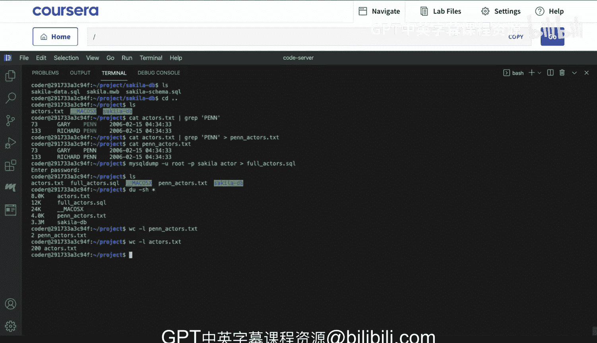

# 杜克大学《大型语言模型实践（高级数据工程、AWS、Databricks和本地LLM）｜Large Language Model Operations 》 - P21：21_01_08_使用MySQL的Bash管道.zh_en - GPT中英字幕课程资源 - BV1oi421Q7GT

Let's take a look at how we can actually interact with an existing database and use the shell at the same time。

 This is a great technique for a data engineer because it gives you the best of both world SQL。

 but also not needing to necessarily get into a bunch of language specific things。 So first up。

 what I'm going to do is I'm going to type in my SQL dash U root dash P。😊，Get into this system。

And then the next thing I'm going to do is I'm going to say show databases to see what I got。Okay。

 we have the Seula that I'm going to use， which is the actor film database。The database。

AndThen we can run that select， perfect。But what would be even more fun is actually to pipe this into a file so that we could actually take subsets of the data and then later do things with it。

 Allright， so what I'm going to do is if I look at this select star from actor limit5 right。

 we can see these different actors， but I want to actually pipe this out and put this into another list here。

 so what I can do is I can just say instead of the limit， I want to say into out file。

And then I can put a location on disk。 and so in order to do that。

 we'll just type in a path that I have here called codeder。Project。😔。

And let's just put it right here and we'll call it actors dot Txt。There we go。

 So now what I can do is if I wanted to， I could do some things from here。

 but I'm actually going to exit out real quick and then I'm going to go to that location next。

 So what we will do is just。嗯。Do this， we'll say。CD E directory。 and we see this actors do TxT here。

 So in order to use it， what we can do is actually type in， let's say cat actors and we can do a rep。

And we can do pen。And now we see that there's two。Instances of that last name here。

And we see Gary Penn， Richard Penn。And maybe we would do some kind of other operation like maybe we would write write that out to a file。

 right， so we could say， you know， pen。Actors。txD。Or， in fact。Some other thing。

 And then now that I've got that， I could actually load that into maybe some new table。

 and that could be something that that we would do inside of MysqL。

 So there's a lot you can do by just manipulating things inside of SQL then piping it out to a file and then doing further operations。

 now you can kind of dive into bash。 Now， there's more， though。

 that we can do that that is kind of interesting。 So let's also see how you could not even log into MysqL and and handle something similar。

 So what we could do is actually type in MysQqL。Dump， dash you。And we can actually say。

 I want the table that has all this information into it。 and I'm going to actually grab。

The database Sequila， the actor table， and then I'm going to write it out to full actors。Dt sequel。

And so we'll have to go ahead and type in our password。And then if we take a look here。

 but what'll be interesting is we can actually do a D。Does S H for everything。Here we go。

 and then we see that in fact， the actors is 8K。But the full actors is 12 k。

 and then the pin actors is actually is actually 4 k， right。

 so we can see that I've been able to subset the data。In more than one way。

 So that's what's really powerful about something like this。 And even if I wanted to。

 I could do other things like you know， run word count， for example， word count。

 L on the pin actors right， we see there's two rows。

 we do word count dash L on the actors we can see there's 200 actors right So there's a lot of synergy in in actually not necessarily needing to drop into a powerful language like Python or Ru or Ruby。

 etc ceter， but actually to use the shell， do some operations and then pipe it out。

