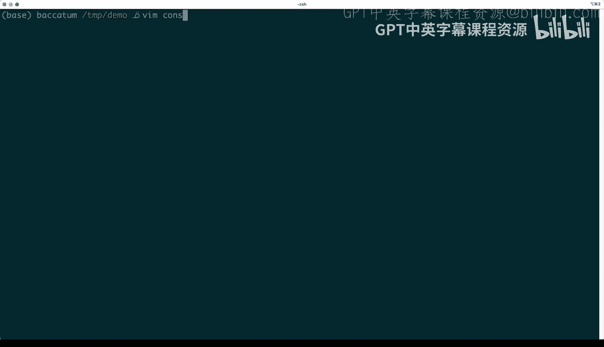
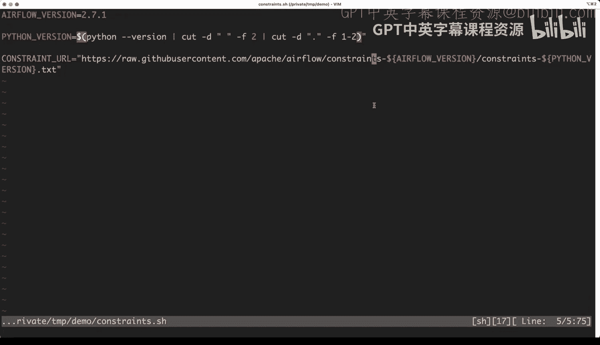
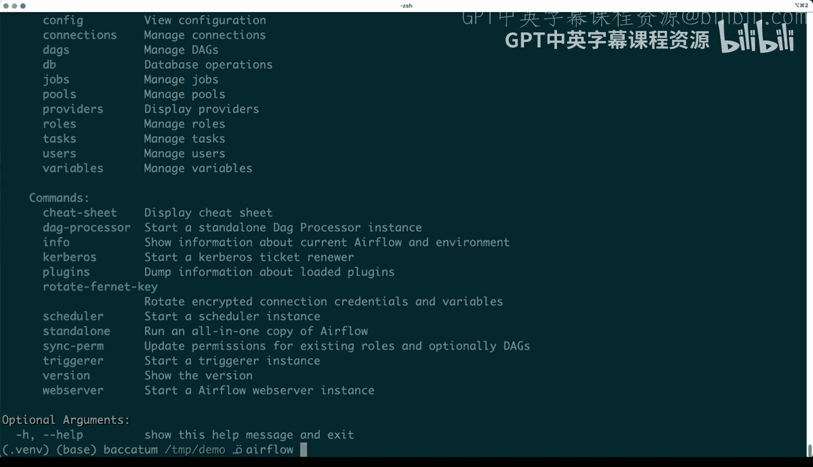
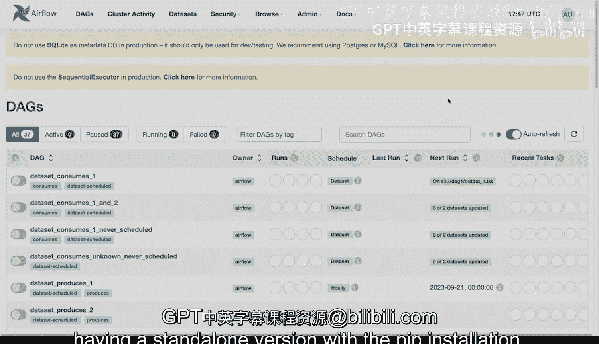

# 杜克大学《大型语言模型实践（高级数据工程、AWS、Databricks和本地LLM）｜Large Language Model Operations 》 - P25：25_02_05_从PyPI安装Apache Airflow.zh_en - GPT中英字幕课程资源 - BV1oi421Q7GT

There are several ways where you can install Apache airflow。

 and we're going to do an overview on how to accomplish that with Pip and Python installation tools that are going to retrieve Apache airflow from the Python package index also known as P P。

 So the first thing that we're going to do is we're going to create a constraints file。

 So let me quickly create a file called constraints that Txt。 So if I。And actually we can do this。

 we can do this actually either by setting some commands or by doing it in a file。

 but let's take a look at constraints that S we're going to do that So I prefi these constraints that S file let's quickly go through some of the things that we looking here we have the Apache airflow version and that version is 2。

7。1 then I'm retrieving the python version， I am doing this command that will give me an accurate representation of the Python version that I want and then it will build a constraint URL in this way So what this is doing is it will retrieve these constraints that the Xt file What that means is that if I go and look at that file poke around the file it will be depend penencies So Pip can use that to try to make sure that there's some constraints on the versions installed when you are working with some of these。

Filees， so let me quickly exit out of here and source it。 I'm going to source constraints data S。

 and then I can do， for example， echo Python version to check what with it here and I have Python 39。

 So if I say echo the constrained。

The constraint URL， you will see that the Apache airflow version is there and the constraints is there as well。

 if if I wanted to like like let's very quickly poke around what we have here。

And we're going to get the access to that file and you can see it looks very much like a requirement that text file。

 but these constraints is basically pinning all of the various different dependencies。

 So Apache airflow is making it very very good work here trying to ensure that everything is going to be working。

 Alright， so now what we can do is to a create a virtual environment first so let's create a virtual environment。

 I'm going to do Python3 and Vm that Vm So that means I'm going to run Python 3 I'm going to use the Vm module。

 create a virtual environment on do Vm directory。 I'm going to do that and that's going to create a virtual environment for me and then I have to source it and I'm going to do in activate and once it's activated you can see my prompt change and you can see Vm there and now I can do Pip install because I know Pip will come from the virtual environment so I can do Pip install。

Apache， airflow。And I'm going to pin that to the Apache airflow version。 As you remember。

 we set this。Before by sourcing the constraints， that S file here。And I am going to use。

 I actually have to use curly brackets here， not not the other parentheses。

 So I'm going to do quotes， and then I'm going to say constrain。

I'm going to use the dollar sign constraint， which is again， the constraint URL that we did before。

 So these should allow me to install the dependency。 so I'm going to run these。

This is going to take a quick second。 And the reason it took it was so fast。

 really is because I had pre installed everything already。 Okay， great。

 So we have everything installed。 and now we should have。An airflow binary executable rather。

 So we do help。 let's take a look and we'll have all of these commands。

 Apache airflow has been confirmed to get installed。 So that is very good。

 So let's see what happens if we run standalone。

If we run airflow standalone， it will run the migrations。 it will set everything up for us。

 lots of logging information will come up and it will tell me that airflow is ready to be used and the admin the username is admin with the password of this one。

 All right so that looks correct and is going to be running on local host on port 8080。

 So let me quickly open my browser and check that out。

 So this is local host port 8080 And again it will promise for my username right there I'm gonna paste what I got which is that password that came from the terminal and then if I sign in everything will be there ready for me。

 So that is how you not only install with Pip but you also verify that installation actually work by having a standalone version with the Pip installation。

