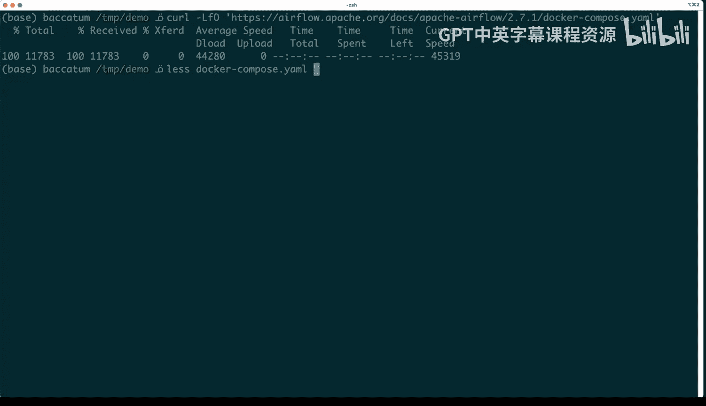
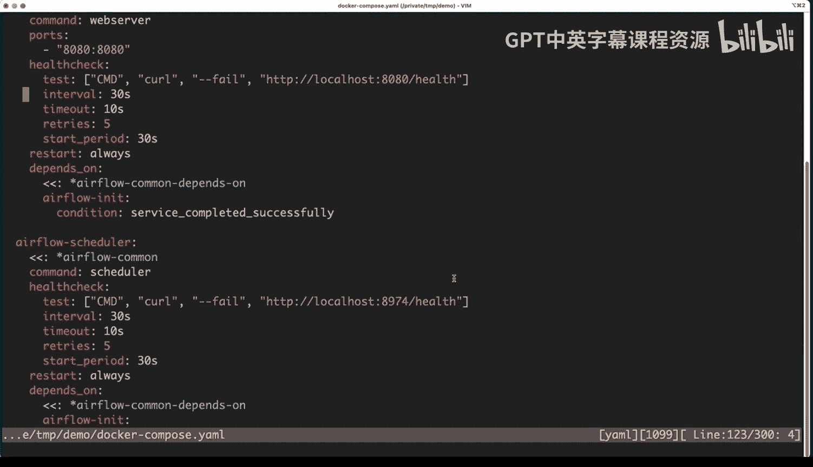
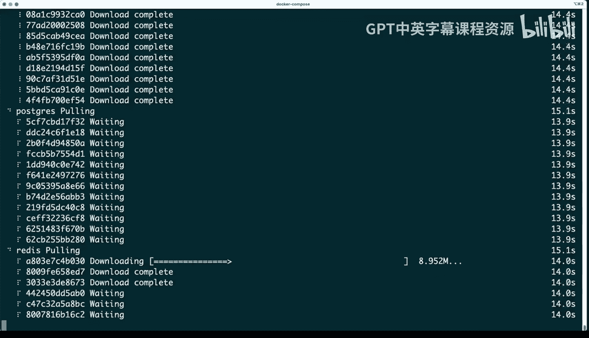
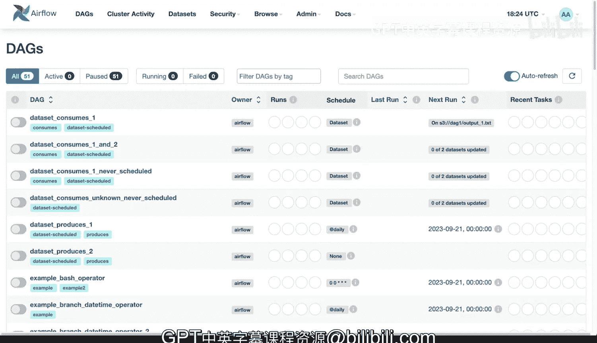

# 杜克大学《大型语言模型实践（高级数据工程、AWS、Databricks和本地LLM）｜Large Language Model Operations 》 - P26：26_02_07_在Docker中使用Apache Airflow.zh_en - GPT中英字幕课程资源 - BV1oi421Q7GT

Using Docker composeose is another way that you can try to try out Apache airflow and work around a little bit with the scheduler and have like a local development environment。

 but also to investigate more and find out more about all of those great feature So I have my terminal here again and I'm going to download a Docker composeose file that is ready for me this is noteworthy is that this is not for production environments。

 but more to like try out a containerized environment that you can of course run locally if you have your setup already good to go with the Docker tool So first I'm going to download that file and this is the commander'm going to use I'm going to use curl I'm going to download the file from this location which is airflow。

appache。 org is from the documentation and it is something that you can 100% get from the browser as well but I'm choosing to do it all in the terminal。

This is going to be using Apache version 2。7。1 if you're trying to fetch a different version well you would need to be able to change that number right there All right so let's go ahead great that finished and now let's take a look at our compose file and what we have here is basically all of the things that we need and you can see that there's a lot of things trying to get defined here you have like lots of flexibility to change the ports and do all kinds of different things like the password and username those are things that you can said100 percent so there's a lot of different pieces to Apache airflow as you know it has a UI but it also has a database connection and beyond the database connection but you have to deal with a SQL alchemy this is all abstracted a away when you are trying to define something like these like say for example in a Docker compose but you start seeing a little bit。

Now of how everything is put together because you see that SQL alchemy， Postgre SQL psychooppG2。

 which is the driver so that Python can talk to Postgre SQL let's go here and keep us scrolling down。

 you can see there's a little bit of salary which is a tool used to send messages and consume them and it going to be using Redis there for the broker the backend is going to be using Postqre SQL so a lot of things here that are going to be defined for us。

So great， let me keep scrolling this is a very this is actually 300 lines long。

 so I'm we're not going go through absolutely everything but we'll check the services that are getting instantized Postq SQL the volume is going to be mounted that theres a test to make sure that everything is ready the CI will also for Redis will indicate that this is good to go there has some timeouts there's the web server that is going to be running and it's going to make sure that it is running correctly in the local host for 8080 Great so there's all of these things and of course finally that the scheduler of course as well running on also local host but a different port with also a slash health endpoint so this is good to go and common the common way to launch these is with Docker compose up and Docker composeose up will allow you to get everything。

Running however， for Apache airflow， the actual instructions。

 I'm going to clear my terminal here so you can see more clearly what I'm typing。

 recommend that you do Docker composeose up airflow。

Dash in it and what this will do is we'll make sure that everything is prepopulated and everything is ready to go。

 so let's run this first and running these will produce a lot of output so let's take let's take a second here until this finishes pulling in all of these layers and instantiating everything that we need and we'll come back when it completes okay so airflow finished setting everything up so now we can actually try to bring everything ready。

 so that is exactly the message that you want to see the exit with code0 and airflow created with row admin So once that is good to go you can actually say Docker compose up and everything should just work So perfect is everythings getting brought up the containers are running and we'll see a lot of logging output them then we'll check later once it completes if the user in。

Face is running again so now this has completed and you will see that there's a lot of logs here。

 The web server is actually running correctly and we have the trigger if I scroll very quickly very very quickly all the way to the top willll see that Redis is there as well the web server more information about the web server was there as well you can see permissions were at it and this is you know very complete a lot of things were at it and started running now I'm going to very quickly change tabs over to my web browser and the web browser here will tell me like this is so good to go and this is going to be airflow and airflow is going to be also the password so I'm going to assign in and this is what you should be seen very similar to how you would try it out with P with the Python package index installed。

and everything from scratch， but the Docker composeos will allow you to have separate containers to do separate work and separate concerns rather than an all in one and it will actually be using PostgresSQL and services like Redis and celery which will look and feel well a little bit more production ready This is still not production ready so the recommendation is still there。

 we won't get into the details of the UI yet， but this is just a way of verifying that everything has worked correctly。

