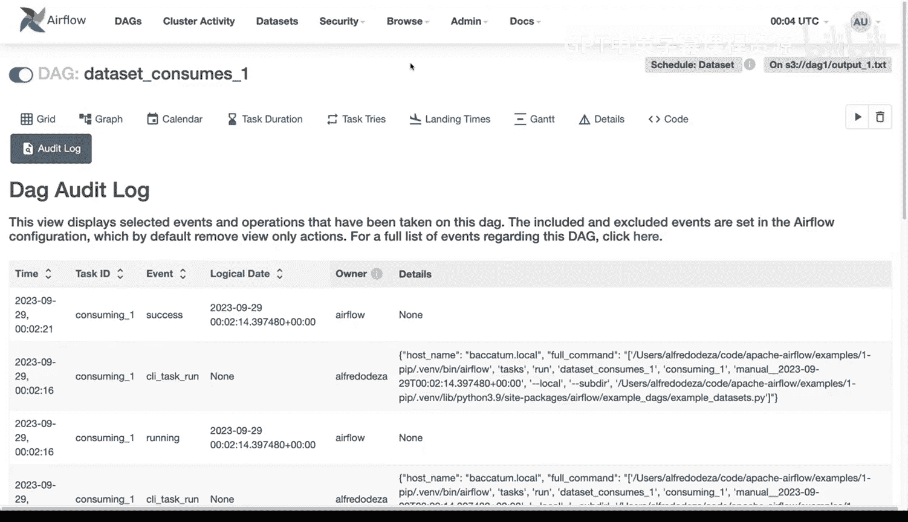

# 杜克大学《大型语言模型实践（高级数据工程、AWS、Databricks和本地LLM）｜Large Language Model Operations 》 - P27：27_02_08_探索Airflow用户界面.zh_en - GPT中英字幕课程资源 - BV1oi421Q7GT

Let's explore the user interface for Apache airflow。

 So I am running locally and this is not a production environment。

 and this is why if I scroll all the way up， you will see that I am using certain things that I shouldn't be using in production but for trying things out this is perfectly fine SQL light is an embedded database looks like a file in the file system。

 but it's essentially a database that will allow me to interact with it。

 but this is essentially not something that you would want to use in production。

 definitely Postre SQL or my SQL， even are decent choices similar to the sequential exor。

 So you will see those warnings while we're splunking here on the user interface。

 So let's take a quick look at the dags that are available and I've turned on this one right here。

 So what does it mean to turn on Well you have these switch here and that allows you to。

On or off certain dags as you want to and once you turn them on。

 well the schedule or the trigger will be able to move on Now you can see here that there's certain owners and there runs that are happening So if I hover over here you'll see this one's skewed but this one was a success running and failed so fail means like well I don't have anything that has failed I don't have anything that is running and I don't have anything that iskewed but I did trigger one and I was able to have a success So very useful to keep this in mind when you're seeing some of these empty circles over there all right so you have basic information like when this was running here you can see some timestamp and when that would next run would be now what's the next run well remember some of these runs。

On other runs and you'll see that these will be able to be able to display what would be the next next run now that's all good and you will see recent tasks if I make this a slightly slightly smaller and I know this is going to be kind of difficult to see otherwise you will see that there's recent tasks here and you can have some actions including this one right here which would allow me to trigger this or even send it to the trash and remove it Now let me zoom back in again。

And let's take a look。 if I hover here you will see pause unpas。

 which is essentially what I was explaining before。 We have one active。

 meaning I've only activated this， I've only unpased the data set underscore consumes underscore1。

And everything else is paused as you can see here， I don't have anything that is running I don't have anything has failed so let's take a look at this one which is data underscore consumes more metadata and more details。

 more granular details are displayed in this page and you can see that things like maximum running duration some of the averages in calculation of the runs。

 I've only run once so this is going to be pretty static but here's where you can get really accurate representations of your of your run different types of visualizations there。

 I don't have anything right there， one of the interesting things is this one right here the code and the code allows you to do some exploration I'm going to try to scroll here and you can look at the code that is actually executing this is an example da this is the actual Python file that will half all of the code。

Its a neat way to see and inspect exactly what is running。

 We haven't gotten into the details yet of how a daAg is constructed or what are all these things here but this is a good way if you know exactly what you're doing to inspect exactly what's being executed so this is I mean fairly involved like almost at 130 lines over there and you can inspect quickly inspect these as well from the UI which is something that I really like right here you have the durations and we have the ability to auto refresh and that would allow me like if I hit trigger or play it will allow me to do that automatically refresh so let's go back to the grid。

And if I click on trigger， you can actually hit a running。

 So now the auto refreshes on and this has actually started right here。 So this was my first run。

 which was done a while ago and now this is the other one so the tasks here are not very involved if I show you if I show you back on the code you will see that this is just running a shell command that is a sleeping for a few seconds before doing something else。

 So let's actually take a look here at what we're doing。

 So yeah so sleep5 and that is that is exactly what it's doing and it takes seven seconds to do that。

 the next one doesn't doesn't actually doesn't actually execute but that's fine that is because like that's how it's configured al right so those are some of the things that I really like about browsing you have all kinds of different。

Tings， task tries， landing times calendar the calendar specifically is a very good one you can see here I have two triggers right there and these are all color coded so really nice calendar visualization and it's all about giving you the power to understand exactly what's going on the audit log will have kind of like the log output you'll see here my username trigger and things that's what the owner will give you and it will give you some some things that are more information。

 more detailed information to explore and do more things all kinds of different things like enabling plugins and providers and pools and you basically have your full in control but this is meant to be more of like a quick overview of the user interface for Apache airflow and not ind but still like pretty useful to understand some of the basics。

