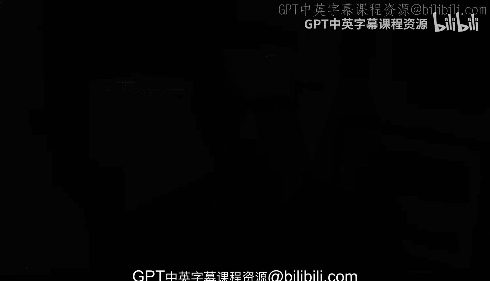

# 杜克大学《大型语言模型实践（高级数据工程、AWS、Databricks和本地LLM）｜Large Language Model Operations 》 - P28：28_02_02_引言_4.zh_en - GPT中英字幕课程资源 - BV1oi421Q7GT

Now， let's see directed cyclic graphs or dags for short will refer to as these。

 it's a mouthful that well refer to these as daAs throughout what are they what are the components how to put one together。

 Let's start by taking a look at the most simple approach possible so that we can build on that and we'll take the route of using Python and we install some dependencies that are that potentially our task requires and then we'll play a little bit with the user interface。

 the dashboard so that we can actually reflect on the action that we just got triggered And finally。

 we'll take a look at how we can do a backfi and what does a backfi actually mean。

 So let's take a step by step and starting by the most simple case possible using Python。

