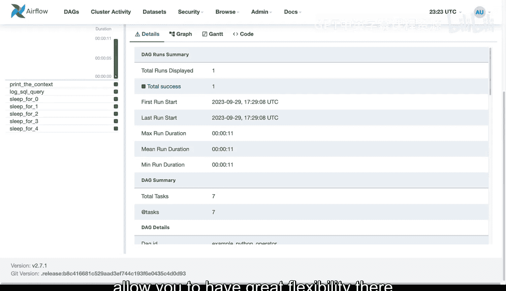

# 杜克大学《大型语言模型实践（高级数据工程、AWS、Databricks和本地LLM）｜Large Language Model Operations 》 - P29：29_02_03_探索有向无环图（DAG）.zh_en - GPT中英字幕课程资源 - BV1oi421Q7GT

Let's explore dags。 And we're going to start with。Some of the sample ones that are included with Apache airflow。

 and in this case this is going to be the example Python operator。

And we'll take a look at what that entails and we'll see that we've already run it once and successfully。

 but in addition to the example Python operator thatll go into a second I also want to touch on a little bit on what the documentation offers us so I'll go over to the documentation and we'll go and take a look at the tutorial D so that we can take a quick look so I'm going to change here websites and this is part of the documentation again and let's skip a little bit of the license。

And let's go through some of the components here that we're going to be dealing with so there are some imports and of course you will start importing everything anything that you need now operators are basically things that you're going to use depending on what you want to be building in this case a bash operator well that probably implies that we're going to do some bash some bash programming language。

 some bash， some shell commands that we're going to be issuing for these DAG so importing the DAG is essentially is critical like it's an actual requirement we have to do that and that that's it these all here are not absolutely required but these are getting used in this DAG specifically but these portions are essential for making it work。

So you start here by instantiating the Dg and you create these with a statement。

 so you're using the width statement and that will allow you to create these and do but perform certain actions that Apache or F is going to take care of like one of the nice things I like about the tutorial one is that it will give you that the arguments so there's tons of options that you can pass so see for example depends on past so if the past execution was a requirement you could set this to true otherwise in this case is false the email you can set all kinds of different addresses here so that you make sure that things are properly reported email on failure well you start getting sort of like an idea of what exactly is going on now the queue you can name the cues you can have like an end date like if you don't want this to be processing until the end of times。

What kinds of different things that will allow you to fine tune。

 So let me go very quickly here so that we can go back to the Python 1。

 which is also pretty interesting。So once that is defined remember the width the width statement at the beginning and you're gonna to say with all of these arguments and configuration you're going to create the DAG and then you this asdaAG statement means this is going to be a variable it's going to be created an object and we're going to be able to do things there and we're going to use here for the tutorial that t12 and T3 these are just examples and we're just defining them right like this is a variable and we're calling the bash operator so the task ID has to be unique and you have to define here something that makes sense and what's the command the date command in the terminal should provide you basically the date of today and that is something useful like let's see that the second one is a sleep5 that will allow you to well not do anything for five seconds See that depends on past。

F so that's pretty pretty important。 And the task Id also remains unique。

 The T1 doc will allow you to document your D。 So this is a markdown。This is the markdown document。

 and this will all be basically kind of like made or rendered as something nice。

 This is the the markdown formatting。 and then you will be able to produce that。

 So this is entirely optional and just a way of implementing documentation for your da。Great。

 so now you also have the ability to have some sort of template。 In this case。

 these are Ginja templates， the Ginja template engine it's a library that you can use and it has a specific syntax in this case these uses these to demonstrateable you can use templates as well right and finally have the bash operator and then it ends that the template and then you have T1 and then T2 and T3。

 that means T1 starts and then it depends the T2 and T3 are going to run together after t1 completes So now let's take a look at how that looks for Python and we'm going take a look at the example Python operator and we're going to look at the code So I'm going to go here and start。

Scrolling all the way down。It is going to have something some operators imported from Python。

 so you can see here external Python operator， Python virtualr M operator。

And is going to say is a virtual M install。 So these are if you've ever used Python before。

 these are crucial because if you want to have external dependencies。

 you will want to have these ones doing some work for you。

 which is actually pretty useful and it will allow you to do things with the condition that things are in a virtual environment。

 All right， so it starts with Dg you pass in certain things here， Dg I， the example Python operator。

 there's no schedule， the start date， and then catch up false and then the tags you can actually a tags So this by the way。

 and I haven't mentioned it before these width statement if you're not familiar with this is a context manager。

 It's also referred to as the context manager iss creating some context So you can see this is the didn end it and it will create some things there。

 All right so moving on you're going to have print the context So this doesn't do anything other than。

In something else， it will print whatever you return， gets printed in the logs。

 So this is actually return as string and it will get printed over there。

Priringnt context that's fine。 It is assigned to this run these variable。

 remember this is decorated with a task so these won't execute right away。

 It will get executed as synchronously you will see here another task This is log sQL query。

 you have some some things here that you can pass in you can pass the templates。

 and then you're going to have this small function right there。

 This is going to do Python task decorator query is going to do something with you're going assign these this function。

 the logsqL function these function to the logsQL variable All right。

 and then this is going to do a four loop is going to do for I in range5 meaning five times you're going to generate five sleeping tasks。

 So this is just going to do time does sleep nothing out of the ordinary there。

 pretty straightforward。 not very useful because。You're doing tasks that are sleeping Well not they're not going to be doing something。

 but this is just to demonstrate that this can run for five times after the other tasks。

 And now you can see how this is getting put together So you're going to have run these then log this SQL and then the sleeping task。

Now remember we were seeing some of the virtual M imports now you can check here that is a VM installed。

 which will detect if you are under a virtual environment and in the case here like we're gonna to say hey if we're not under a virtual environment hey。

 this is this requires virtual M please install it otherwise it is going to create this task which you can see here that it will define some requirement so this is pretty useful because these requirements will get installed onto the virtual environment and you can see the task is no longer a plain task is a task that virtual M。

The virtual M function that is going to be decorator is going to now depend on colorama because that was a dependency as you see here。

 sorry about this one right there and that's going to be used in the imports So perfect this is why this is imported right here and that's not outside of the task and going all the way to the bottom we're going to have some external python that doesn't require the python virtual environment and is going to have required the path to the python binary which happen in the very beginning and then again some of the imports are going to happen right there。

 so then that ends and then you're going to do a couple of things。

 you're going to define the python coable， you can define functions if you want to call them and then you're going to say。

 hey Python virtual M operator， you're going to do you're going to set some requirements you're going to set up python coable and then you're going to always at the end you're going to be defining。

How this is going to run Alright so how does that look like。

 let's take a look at that graph So if I run it， we' got print the context。

 then log the SQL query and remember right here is where we have that four loop and we'll have that those five tasks that are sleeping。

Right so we're going to have0，1，2，3 and 4 giving us five five tasks that are going to be doing that so pretty useful well this one wasn't recent and then the details are right there and then you can see also that I have it right here print the context like the SQL query and then the five tasks so that's in essence a Dg and some of the components and of course you can you can start already seeing that there's plenty of options for you to expand and add more and essentially keep building on these options that allow you to have great flexibility there when you're dealing with certain tasks and how they're going to behave。

