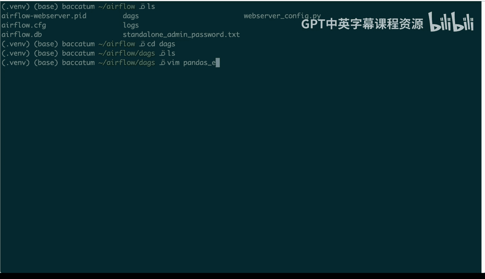
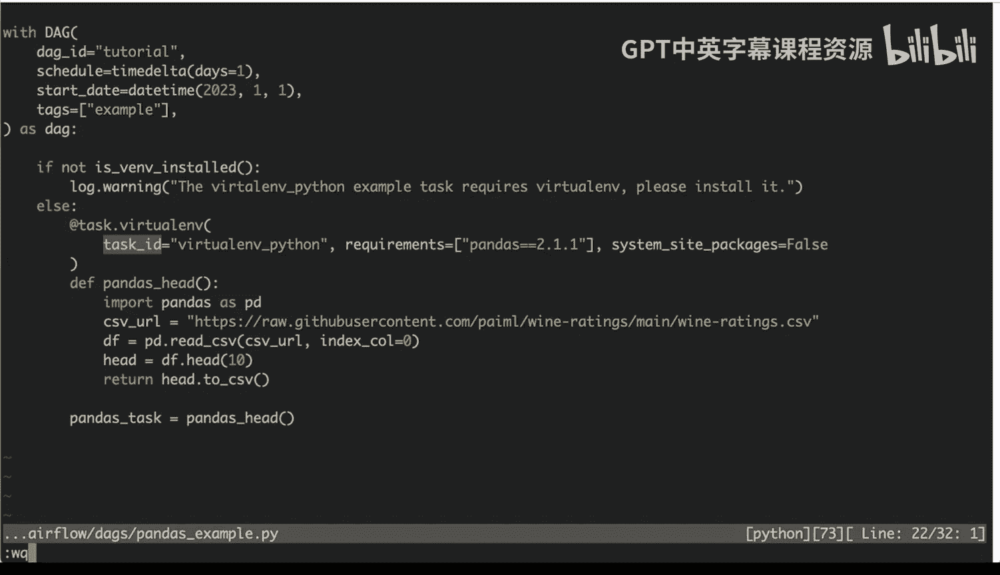
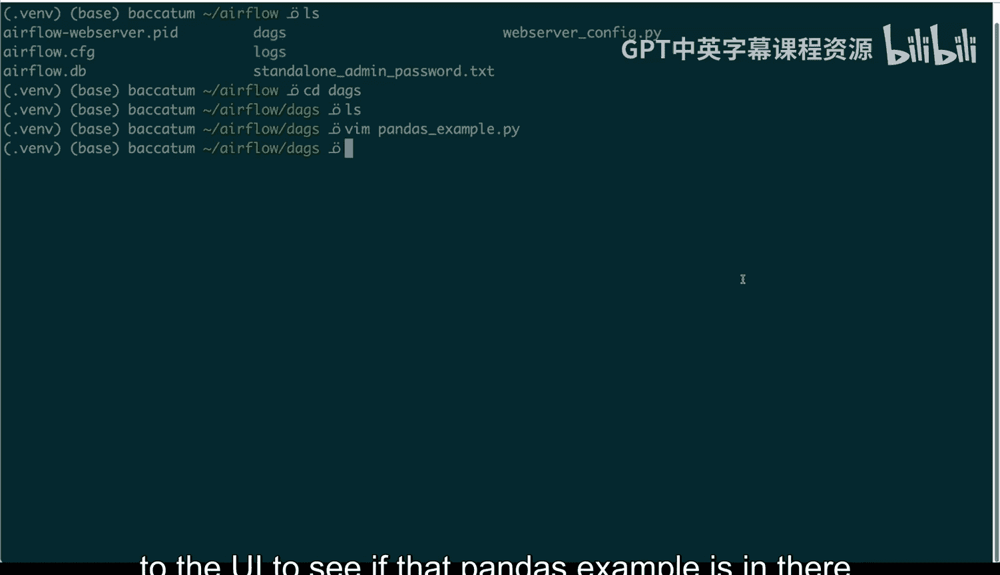
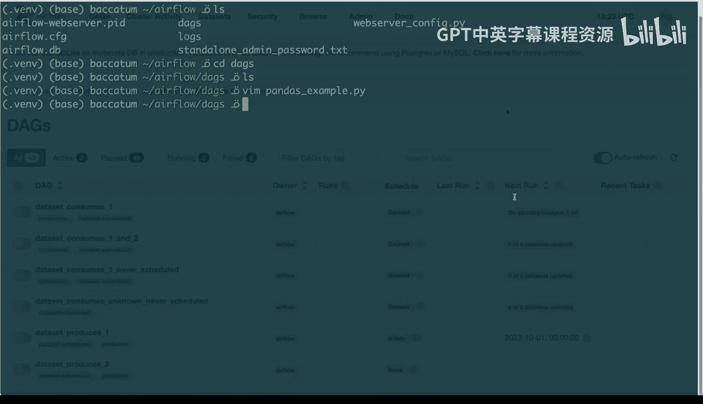
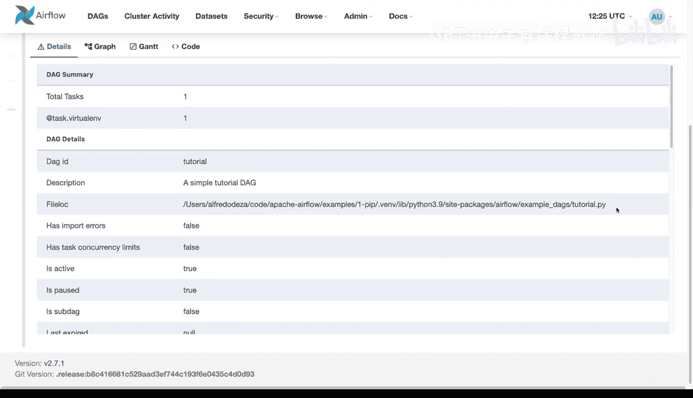
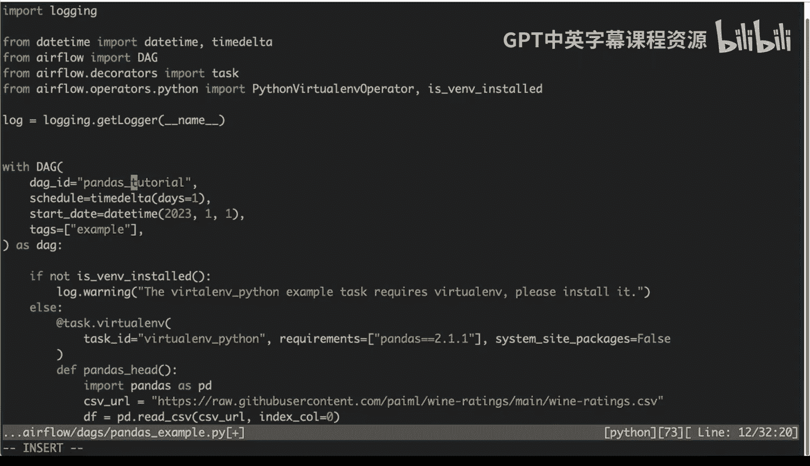
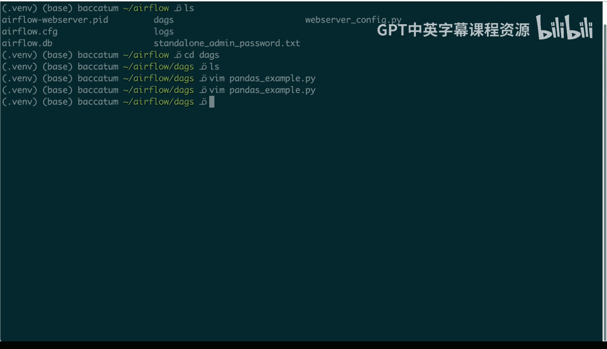
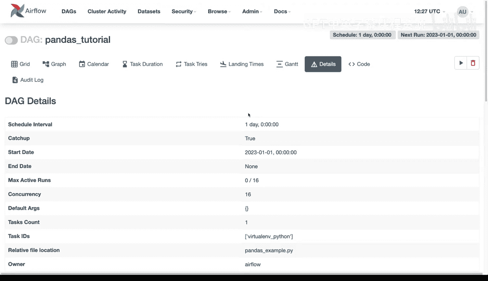

# 杜克大学《大型语言模型实践（高级数据工程、AWS、Databricks和本地LLM）｜Large Language Model Operations 》 - P30：30_02_05_创建DAG.zh_en - GPT中英字幕课程资源 - BV1oi421Q7GT

Let's see how we can build a very simple and straightforward dag and to do that we're going to be reant on the folder structure that Apache airflow provides us and this is going to happen in the home directory on airflow you can definitely configure this to be in similar location but we're going to be consistent and try to keep with the initial recommendations which is on the home directory on airflow the airflow directory and inside here we have several different pieces of the airflow application So we're going to have the database in this case this is a non-production environment that's why you will have a database file over here。

 this is if I'm not mistaken going to be a SQL light embedded database again this is not production and you'll have things like this text file that has the standalone admin password。

Alright， to add a daAg what we're going to do is going into the DAGs subdirecty right here。

 so let's go and do that。 This is going to be empty and this is where I am going to or you are going to be adding all of your DAs All right so the first step is to create a file and we're going to add one that is called a pandas example。

 we're going to do something with pandas so I'm going to open up of a new filem going to create a new file and you can use any text datar here I'm using a terminal text datar。

 but you could use either a terminal text datar like V or Vm like in my case or use something like a fully fledged out text datar like Vi Studio code。

Alright， so I'm not going to go into the details of the text data of course。

 but I'm just going to paste this whole chunk of code that I have here and I'm going to walk you through everything that is going on。

At the very top， we're going to start by importing logging。

 We're going to use time delta to use some time operations。

 We as always going to have to import dag from airflow。 we're going to define our task。

 So we need to import that and we're going to be using the Python virtual M operator and that is theM installed helper function。

're going to instantiate the login so that we can start producing log output when we're running this task and we're going to start by running our D。

 now， on purpose， I have a bug in here， something that is going to prevent us from having this Dg available in Apache airflow and but well walk walk you through what is exactly going on once we start trying to run it。

 So we define a Dg。 We have our I and we have the schedule and the start date and tag the tag is optional I decided to keep it as example and this will make it easier in the UI to。

Find it later All right as we've seen before EVM installed will'll check if this if actually the virtual environment library is available so that Apache airflow can help us or it will go and assume that we can actually do something with Python right here and the requirements is going to be pandas and I'm going to be using 2。

1。1 I'm going to pin meaning I'm going to use an exact version that is also called pinning and I'm not going to use system side packages。

 I'm just going to use any everything from the virtual environment and what I'm going to do is I'm going to have this function right here。

And I'm going to import pandas and I'm going to retrieve a CSB URL。

 and then I'm going to do some operations， and I'm going to return the CSV results of the first 10 items in that CSV。

And at the very end， I'm going to say pandas task， I'm going to define this variable is going to be this one。

 so this is not exactly required， but you have to you have to call these whenever you're especially when you're associating tasks together when you want to chain one task to some other task。

So this is how we do this and we' to save it。And I'm going to do that。

 and then what's going to happen is that I need to go back to the UI to see if that pandas example is in there。

 So let's go back to the pandas to the actual Apache airflow UI So I'm on the Apache airflow UI and I'm going to search by example。

 remember the tag we had， and this are all the examples that I have all of the ones that I have the example tag this list is pretty big So I'm going to now search for my tutorial one。

And tutorial seems like there's only one。 So let's check at this one。

 We're going to check the code and what's going on here。

We are going to have now a exactly what we wanted there in our D。

 so this is a very highly automatic we were able to get all of these pretty nicely done and installed now the one thing that I mentioned was that there was a bug now it is a potential bug if you don't have an ID that is 100% unique if you don't have something unique。

 you will get into trouble and this automatic import will not happen。

Now did you see that I didn't have to run any special commands。

 Apache Airflow was smart enough to be able to slurp these and detect this new file in the in the DAG directory for airflow in my home directory and import it as is。

So this is essentially how you would be able to get all of these imported into Apache airflow and you can see here that this is the file location and and this is actually not 100% correct because it thinks that the file is it has overwritten the tutorial one so this is causing a conflict because there is actually something else called tutorial so we need to make that ID unique so let's actually go and change it and get this go back to the terminal to change that so here in the terminal we're going to change these and I'm going to say tutorial pandas tutorial I'm going to right with that and I'm going to go back to the UI so I'm back on the UI remember I change the ID so I'm going to say pandas and now pandas tutorial will show up and this is actually the correct。

One， if I go here， we'll see the actual log。 This is the actual output of of the Python file pandaas tutorial is going to be there。

 and we're going to be able to see exactly where that is coming from。

 Now you can see that the file location is correctly pointing a pandaas example pi it is no longer overriding any that we were having before the file location this time is correct because we're not overriding the tutorial。

 So something to keep in mind when you're building and creating these new Ds And that is how you add a new Dg to Apache airflow。

