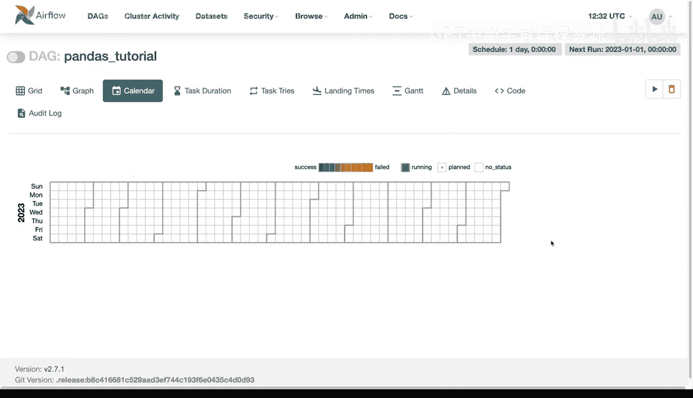
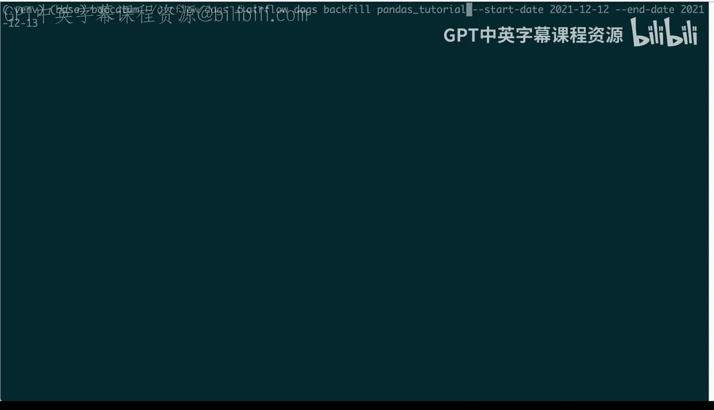
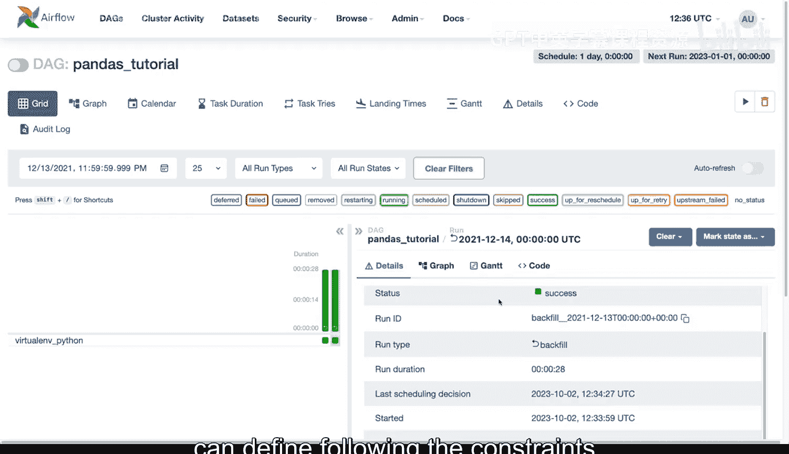

# 杜克大学《大型语言模型实践（高级数据工程、AWS、Databricks和本地LLM）｜Large Language Model Operations 》 - P31：31_02_07_运行回填.zh_en - GPT中英字幕课程资源 - BV1oi421Q7GT

One of the important concepts of Apache airflow is the scheduling and figuring out the date portions when we're working with tasks and in this case。

 these start dates and these schedule it doesn't necessarily meaning start at a specific date。

 but start for a specific date so what does that really mean well when we're dealing with these tasks and dates it means that you can have things like the execution can happen in a calendar so if I go back to the calendar view。

 if you say something for example， for 2023 to happen in April so exactly this month right here。

 you can actually run tasks that can fill right here even though we are no longer in April for 2023。

You could actually say we need to run these task for the days that happen in April and you can specify these Now whenever you have a task that defines this dates and these schedules for schedule will be for example how many times to run per day or what the interval you can actually define a time frame a timeline where these actions need to happen so when that happens the way to run this is with a backfi and what is a backfi is a way to instruct a daAg like in this case pandas underscore tutorial to run for a given period of time at the given schedule so let's go back to my terminal and actually see how that can be done so I have here the actual command I'm going run airflow is the CLI for a patchache airflow I'm going to use the DAGs subcomd I'm going to use the backfield subcom for DAs。

I'm going to use pandas underscore airflow， which is the unique ID for my Dg and I'm going to pass a start date of 2021 and an end date of 2021。

 So let's see what happens if I execute this So that happens because this is not unique。

 So I'm going to clear these and I'm going to remove airflow and'm going to say pandas tutorial which is the actual the actual correct use the correct Uid for the Dg that we were going to work with seeing these errors and seeing these trace boxs is useful because it allows us to feel more comfortable when things are not working。

 So let's actually try to run this once again。

And now we're going to see some things that are going to happen。

 we're going to get output from some other tasks as well because Apache airflow is going to try to figure out what is happening all with everything that is happening but we're going to see now panda tutorial is going to be running and you can see right here it is actually cud now you couldn't import you couldn't import pandas for some other tasks that is fine but we are actually pans example the pi it is actually going to work correctly。

 do you see this DAX folder， they use these so that it is kind of like replace in or getting inferred as to what exactly is that location because that location can be anything is configurable in our case where using airflow。

The homeome directory and then the DAG subdirecty inside airflow。So that has completed。

 let's go over to the Web Ui and see what happens here I'm in the calendar view and I'm going to refresh。

And now you can see that because I specified 2021 now a 2021 schedule will appear and because I specified for two days now and once a day you have these two runs and you can see one success for 2021 12 12 so December 12 and one for December 13 so if I click on one of these you will see that these actually succeeded so you can see here that the run run type bus a backfill and then you have the ability to do backfilling operations this is how you would do backfil and for a very specific timeframe that you can define following the constraints that were defined in the actual DAG。

