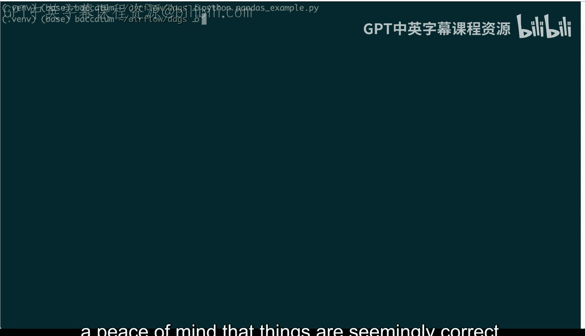
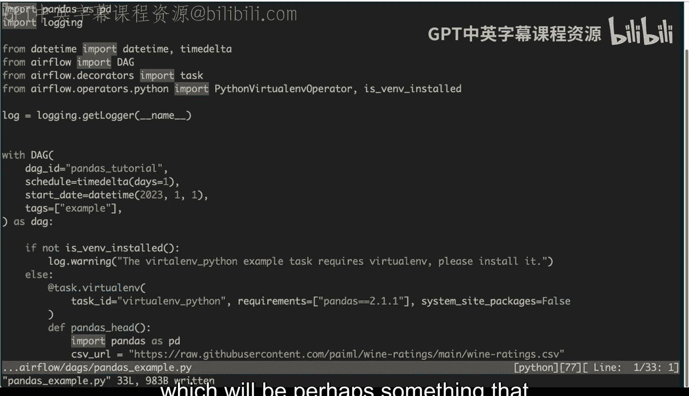
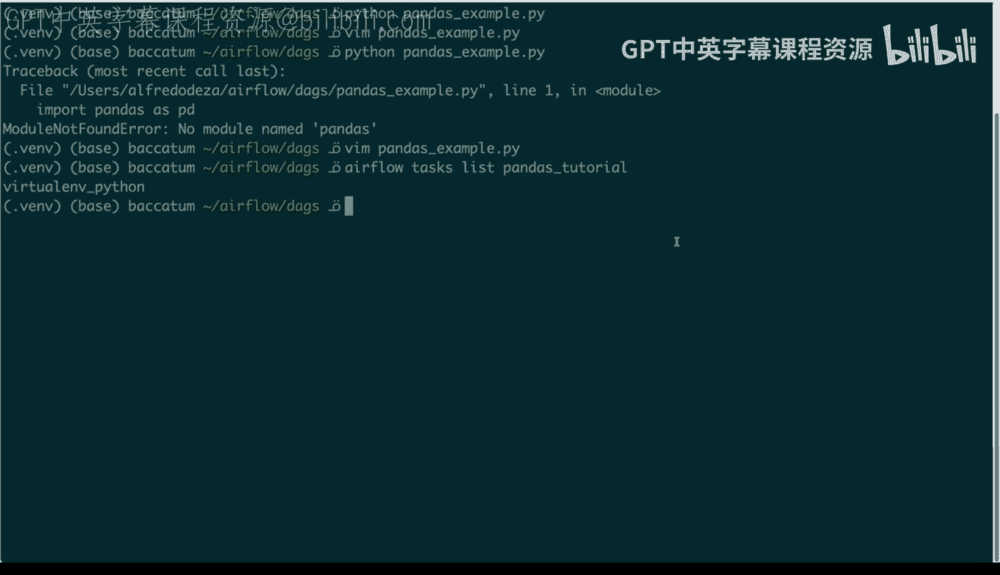
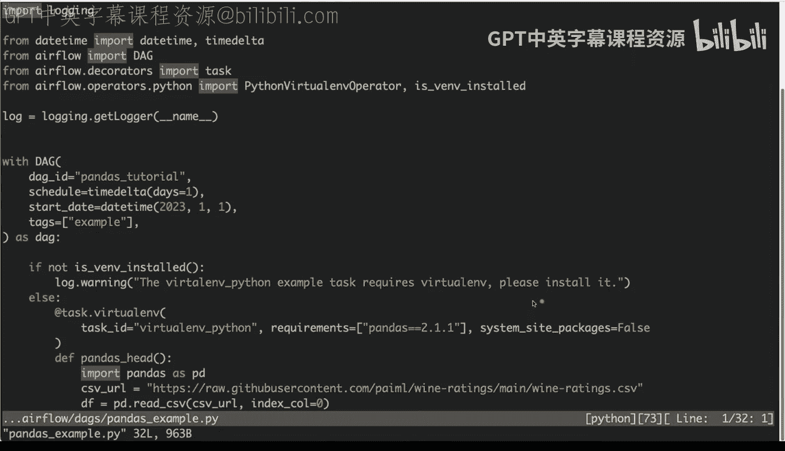
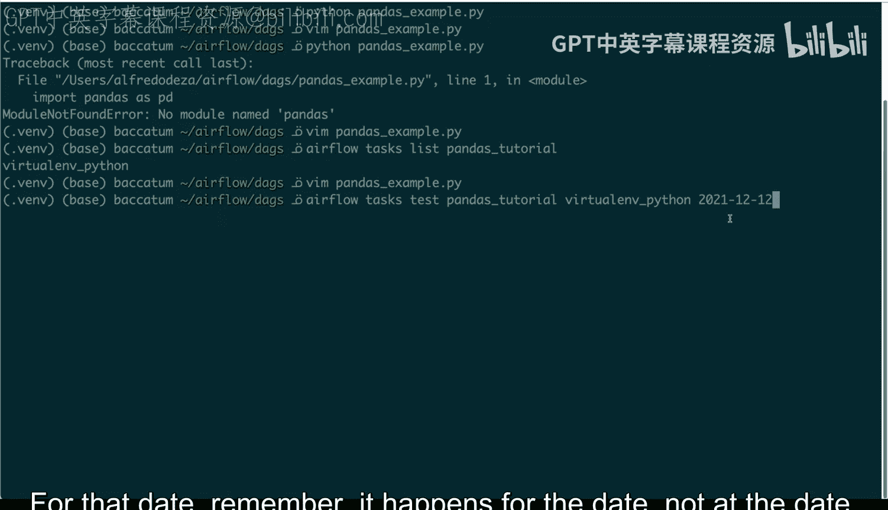
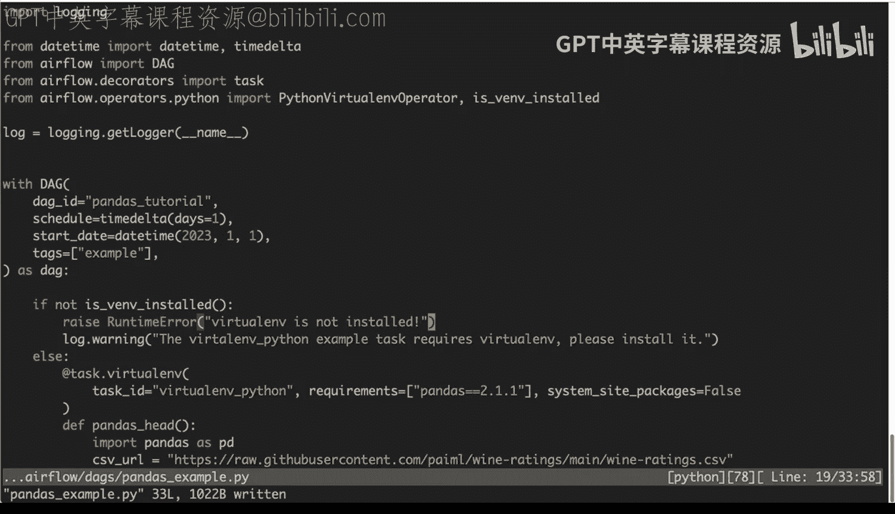
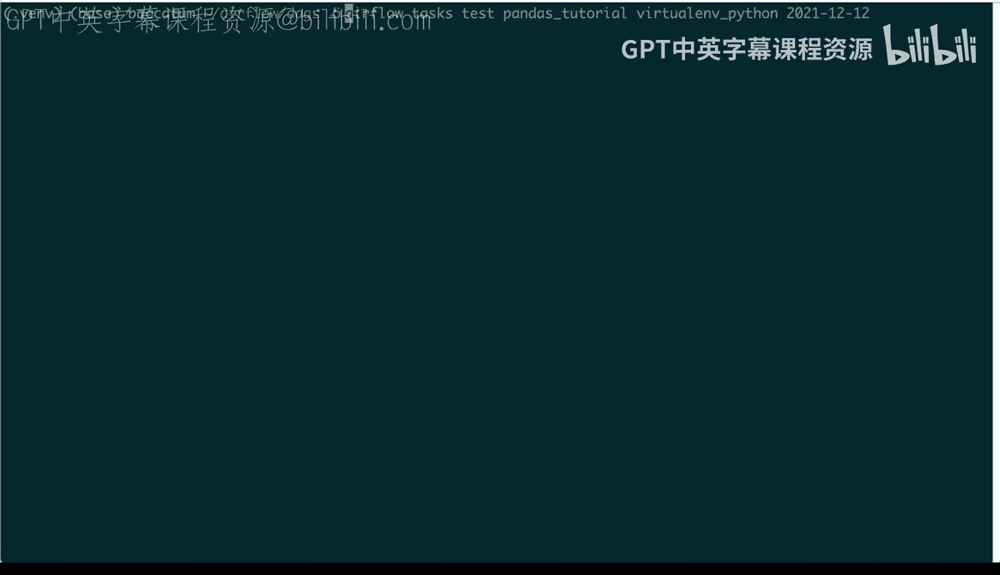

# 杜克大学《大型语言模型实践（高级数据工程、AWS、Databricks和本地LLM）｜Large Language Model Operations 》 - P32：32_02_08_测试与验证.zh_en - GPT中英字幕课程资源 - BV1oi421Q7GT

I am back in my terminal in the DAGs subdirecty for the airflow directory， in my home directory。

 so that we're going to do some testing and validation things that we need to do for our little DAG that we created or panda underscore example up pie。

So if if we check at the ID， one thing to keep in mind and I haven't followed my own advice here is that usually the ID。

 the DAg ID in this case is pandas tutorial， and this is something that has cost me a little bit of confusion before。

 it's not similar to the name of the file that goes into the DAGs directory so in this case I name these pandas example。

 but this is the pandas tutorial， so one thing to keep in mind is that if you're keeping things consistent it' going to be much more easier to try to understand what's going on and what file goes where and what ID belongs to what task in this case pandas tutorial。

 well it should have been easier if I name the pandas example， or if the pandas example。

 the pi file would have been pandas underscore tutorial。

 this is not a requirement but normalizing things definitely makes things easier。

Alright so there's a few things that we need to do and is recommended by Apache Airflow when you're trying to validate and when you're trying to make sure things are working correctly so let me clear these and let me do let me run one thing that our airflow says that this is a good thing is actually calling the pandas example with Python so this will give you executing this in this way will give you a little bit a little bit of like a peace of mind that things are seemingly correct if we were to add something to pandas example that was say for example adding the importing pandas at the very top which will be perhaps something that you might be tempted to do if I do that then if I run Python it will itll get a module now found error because pandas is not installed remember we're installing up as。

Of the task itself So let's go ahead and remove that。

 So things like that would be able to pop up when you are running or executing with Python All right so the next thing that you can do is use airflow itself to list that your task is actually present in airflow as well so you can do pandas underscore tutorial and then you run these and you should be able to see what our tasks that are listed inside pandas tutorial in this case we only have the virtual M Python and again if we see our pandas example up our task remember is called this one is we defined that in the task IV so virtual M Python and this could be named something else now in this case this one task is and we can have many different task for this single D。

In this case we only have one and that's virtual M Python。

 so that verifies that our task is correct and it is showing that virtual M Python is actually there。

 the next thing that we can do is airflow， we can say tasks and we can execute tasks directly and we can say we want to test a task and in this case is going to be pandas underscore tutorial。

Now， the Panas Sc tutorial is not the task， but is the parent of the task in this case is the Dg。

 and when I say a virtual M。Python and we're going to pass 20211212 and what we're doing here is we're gonna to say the panestial D and the virtual M Python task of the penestial D is going to make a test for that that date for that date remember it happens for the date not at the date we're definitely not on 2021 anymore and when I run this and you're gonna to see a lot of things happening here。

 and all of these output is actually the things that we were doing we were defining your task so lets let me scroll very quickly all the way to the top and the first thing that happens is that it creates the virtual environment This is perhaps a little bit hard to see It is right there。

 create the virtual environment and it starts to try to install all of the dependencies but in this case it is just pandas to point。

。1。1 that you can see right here， so this is actually very useful because then you can see wow。

 like this is actually doing exactly what I wanted。

 it's going to install all of the dependencies and once it's done it's going to execute our command。

And our command will actually do this pandas manipulation on a data and remember anything that is returned will be part of the logs。

 So in this case the log output will be the CSB output that we have for that wine dataset that we're retrieving。

So marking the task as success for the start date and the end date which was actually the same day and it it gives you the panda tutorial。

 the Dg ID and the task ID being the virtual M Python now remember remember that we have these going back to our file here we have if not is VM installed we're going to get a log warning so what happens if I do uninstall virtual M。

So if I remove that and I say， yes， I want to make sure that I remove it and I run our test。

We should be getting into trouble because virtual M is not installed Now， in this case， it tells you。

 hey， the task is not found， but this is sort of deceiving because it is since it is available is just that we have here。

 right here， a warning， big warning， virtual M Python example task requires virtual M please installed it。

 Now what I really prefer in this type of situation is actually raising a runtime error。

 So in this case， if I say race runtime error， virtual M is not installed。

If I do that and try to do the test again， I will get the exceptionion and I actually prefer these these exception right here in very pronounced color red with the air instead of logging that might be kind of get lost。

 So those are very good solid techniques that you can try when you're testing and validating your Ds as you're working with airflow。

