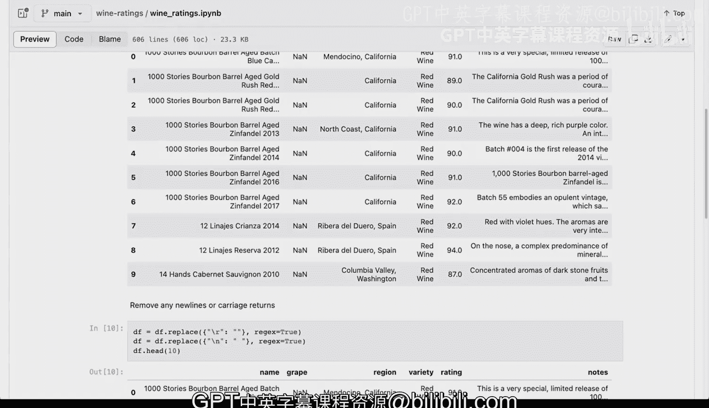

# 杜克大学《大型语言模型实践（高级数据工程、AWS、Databricks和本地LLM）｜Large Language Model Operations 》 - P35：35_02_05_识别构建DAG的任务.zh_en - GPT中英字幕课程资源 - BV1oi421Q7GT

Identifying a task to use with Apache airflow is critical and we'll check here an example repository that I have that can shine some light into what are some those some of those things that might be interesting when we're trying to determine what can we do with Apache airflow What is a good fit for Apache airflow Ds and green pipeline。

 So these repository has collected a data set， which is wine ratings that CSV is a CSV file and it has a Jupyter notebook。

So the ratings CSB is pretty straightforward， it is kind of big for GiHub so it doesn't allow us to show it it's full it's 13 megabytes we can try to take a look at it raw and essentially what it is it provides a few columns name grape region variety rating and nodes these are wine ratings and node and names based on data that we can we can find here so we have here's the names so this form for example is 1000 stories it comes from Mendocino California it is a red wine and it' 91 points and it has some nodes right here so that is kind of like the structure but that doesn't tell us everything we need in order to try to see if it's a good fit so what I want to show you here it is actually。

So the Jupyter notebook if I open these will try to load everything in this case。

 it's installing pandas， but let's poke around what we have here。

So this is actually consuming the the wine ratings that CSB file and giving you here like a good overview of what we have so right of the bat we have certain certain problems here you might notice that the grape is not actually captured so we have not a number full of not a number values。

 so potentially we could drop the grape。And the other thing is that if you don't specify with pandas the index column in this case zero pandas would be actually creating an R index column so the indexes already there and we need to make sure thats that's good enough there's another problem with this that will show you that I'll show you later that can be highly problematic so we've already identify one and the other one is this one right here。

 removing new lines or carriage returns is critical because some services will cause will have issues when you're having carriage returns or new lines in certain parts of your data in this case the new lines are only coming when in the portions of data that are part of node so every road has a node can potentially have new lines and when new line。

So carriage returns are introduced there， some services will interpret that as a new row。

 essentially making a mess out of like a highly structured data like this one and breaking it up and then suddenly columns wouldn't be able to align properly so removing those is critical and replacing those with actually new lines with with nothing with empty with an empty space there would make sense so those tasks are very good in order to actually try to create a pipeline and these are things that you wouldn't necessarily I mean you can do them in a Jupyter notebook of course you can do them in a script as well but Apache airflow can help us here in providing a way of applying these transformations to our data and see them through while we're creating a pipeline with several different。

StSo how do we identify these， well when we see that there are certain tasks that need to be applied for a data set or manipulating some sort of data that we want to have an end result based on an initial type of data that we have so we're going to see how we can apply these later as an Apache airflow pipeline。

