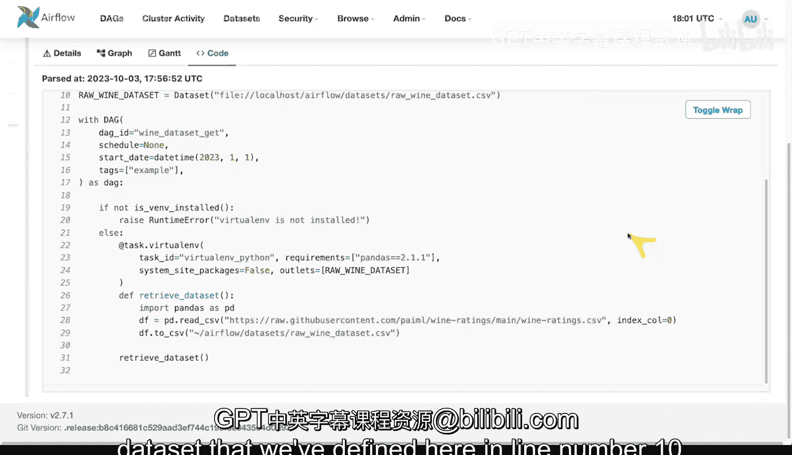

# 杜克大学《大型语言模型实践（高级数据工程、AWS、Databricks和本地LLM）｜Large Language Model Operations 》 - P36：36_02_06_检索远程数据.zh_en - GPT中英字幕课程资源 - BV1oi421Q7GT

In order to create our wine related da for the CSB that we were browsing before we need to retrieve that data。

 So let's take a look at how that works and we're going to go and scroll all the way down here on the web interface where we have this wine data underscore get so we're going to it doesn't have a schedule and we're going to click on this one so we haven't run that one yet and let's inspect the code to try to understand what exactly is going on and what do we have here now this is a slightly different from what we've seen before where we have or we're defining a data set and that data has one distinct thing that we' are going to be using for our pipeline for our workflow here to kind of like change this。

ToNow， a data set， when we call it like these， the contents can mean anything。

 You can actually put any type of string in there。 This is just serving as an identifier， so。

This is not an actionable thing， although I'm using file column/ s local hostst。

 there has no meaning to anything except for me， I am actually saying this is going to be a data set that is going to be stored locally and the string represents kind of like the location that I want to display so why is this important because by defining this rawwin data set that we're going to retrieve I'm going to set the expectations for other consumers for this data。

Alright， but the first step is to get this data。 So what is it that we're going to do？Well， first。

 as you know， we'll have this ID， this unique ID so that we have this one data set get is going to represent what we're going to try to do。

And then it doesn't going to have any schedule for us right now。

 so we're going to be able to manually trigger these this is going to rely on a virtual environment。

 so if virtual M is not installed this is going to have a runtime error if it does have virtual installed we're going to use pandas 2。

1。1 and we are going to have something else here that you haven't seen before that I haven't demonstrated before we are going to use this argument here saying that the outlets the outlets is going to be a list that is going to contain a single item and what that item is is the wrong rawwin dataset set and this is a reference for our data right here online number 10。

Why is this important Because if the task completes correctly？

We are going to be able to say that the rawwine dataset has been affected。

 so it is a convention by Apache airflow to determine when an outlet is going to be modified or change so that others can rely on that for triggering an action we won't see right now what that action is going to be but you can imagine that we're going to be doing some processing so in the actual function itself we are going to read the remote CSB and note that I'm using actually the full URL to get that CSB file and I am going to save that file to the file system I'm going to use a normalized path here and it's going to be in my home directory airflow and I've prereated these datasets directory in a production environment you would probably not be saving datasets in this way。

I would actually recommend using a cloud provider that could allow you to work with this and send these over the network to some other specified location。

 but in essence for the demonstration we only need to retrieve the dataset and store it locally so that we can process it later。

 so that it this is how I would structure the first step in this processing of this remote data and so that we can process it later and the most important thing is to define the outlets in this case is going to be the rawW data that we've defined here in line number 10。

