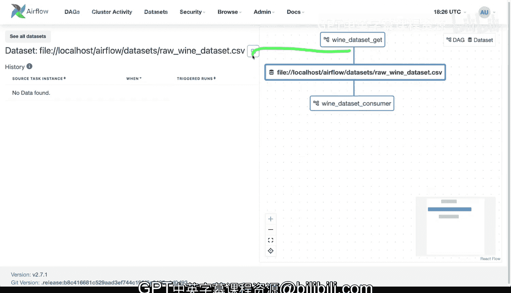

# 杜克大学《大型语言模型实践（高级数据工程、AWS、Databricks和本地LLM）｜Large Language Model Operations 》 - P37：37_02_07_清洗与规范化数据.zh_en - GPT中英字幕课程资源 - BV1oi421Q7GT

Alright， we're back into the Apache airflow user interface。

 so let's scroll down over to our wine consumer So when I have before we're looking at the wine dataset get and now we're going to take a look at the wine consumer so this is going to be slightly different right away you can see here that I have a data label that was automatically applied and if I hover here it will say schedule triggered by data So let's see how that works and why that is important and I click here and go to the code and let's poke around here these details right away we are also defining our data here on line 10 and this is going to be slightly different now the schedule is going to be defined from the raw wine dataset。

What does this mean？That by saying that the schedule is the rawwin data set in a list。

 that item in a list means that whenever that data changes。

 this is going to get execute is going to get triggered so perfect we're going to be able to depend on that action from the producer of the data to take a look and produce that and once that's there then we can rely on this one perfect so we're going to now again rely on virtual environment and install pandas and we're going to start doing the processing so what are the things that we want to process well。

We were no longer retrieving the data from the network。

 We're not going to go to the location and the network where the raw wine data exists。

 we are going to go local so because we can rely on the fact that the raw wine dataset has been retrieved now we can start processing it So what are the transformations that we're going to be doing。

 we are going to remove the carriage returns and we're going to remove the new lines。

 all of those characters are going to go away and we are going to drop the grape column that it was full of not a number so that Ns are going to go away and that whole column is going to get dropped and once that's dropped we are also going to save that locally and that is going to go into the clean data that CSP on the local file。

System。So and at the very end， of course you're gonna define。

 you know make that call there so that it registers correctly with a dataset。

 so that is how it would work by the processing and one last thing that I want to show you is going here to the dataset。

 remember these are if I scroll here， this rawwin dataset this doesn't a string doesn't mean anything is mostly like an identifier so I'm going to click on datasets I'm going to show you something here。

So the most important thing here is that we're going to have these right here and this allows you to have a visual visual representation on how this works because you're going to get the one dataset get task that is going to produce this data set right here and it is going to be consumed by this task over there。

 so you can click on this task and you can tell one to view a Dg or you can click this one and view that Dg or you can click on this one and make sure to see what was triggered and what happened in this case I haven't triggered anything this is why this one empty and that one is empty as well。

So there you go， those are the components on the consumer side and how you tie them together by using a data set as a trigger。

