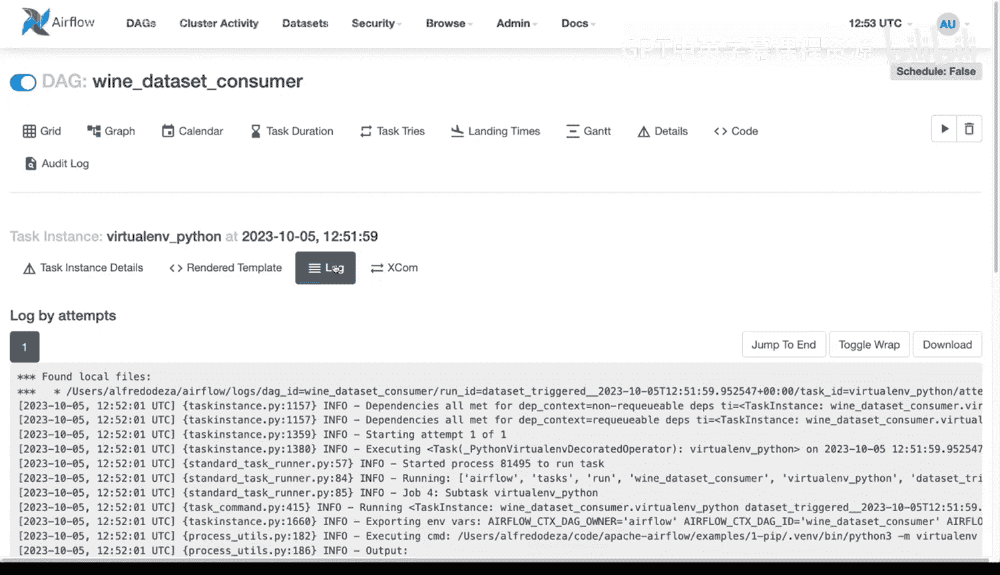
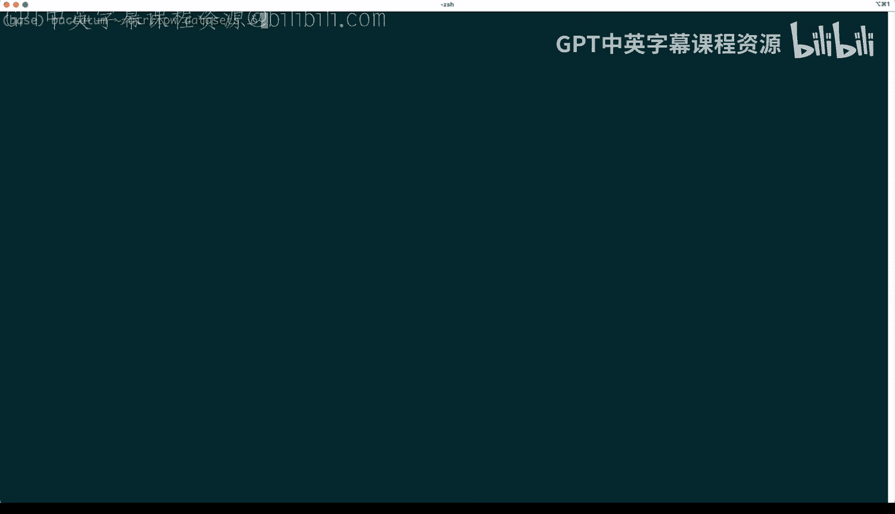

# 杜克大学《大型语言模型实践（高级数据工程、AWS、Databricks和本地LLM）｜Large Language Model Operations 》 - P38：38_02_08_在用户界面中检查结果.zh_en - GPT中英字幕课程资源 - BV1oi421Q7GT

Now that we have all of our pieces together， let's start triggering。

 we're going to again be working with the consumer and get the wine dataset get。

 sometimes also refer to as a producer this will produce the data that we want to work with and the consumer will well exactly consume the output of the dataset get so let let's enable the consumer which will not get triggered because the trigger again is a dataset right so we're going to enable it to opa and we're going to go to the wine dataset。

 which we can also enable and then we're going to go here and we're going to trigger that da and when it's triggering you will see now that this is running it's just the first the first run of it ever and well be able。

To click on here， it's been a success， so now we should be able to take a look at the other Ds。

 especially。This one we're here going to scroll very quickly you can see that the consumer is now getting triggered and now went from running to complete it so essentially what happened here is we triggered the get and the wine dataset consumer was was able to trigger based on the data set that we've defined before All right。

 let's take a look our wine dataset consumer。This one work correctly。

 let's take a look at the details。It was a success， perfect， things were working correctly。

 and let's try to take a look at the audit log。That looks okay too。

 and essentially it seems like this this was able to complete correctly so the way to look at the actual execution logs is by going to the actual task a dag might have multiple different tasks and in this case I want to check this one。

If I click on log here。Then I'll see the actual full logs and we'll see that collecting pandas there。

 So we're inspecting if things were correctly done。 and it seemed like， well in this case we didn't。

 we didn't return any output So that looked correct。

 I'm going to switch very quickly to my terminal to inspect some of the files that were produced So I mean my terminal right here I'm going to list the contents of airflow。

 this is where I was if you remember correctly where I was going to save some of the output。

 So I'm going to go into data sets and'm going to type in data sets and I'm going to list the contents。

 And now I will have two CSP files。 one is the clean dataset and the R1 is the raw wine dataset and both will be similar。

 So if I do ahead to poke around the first 20 lines of the raw wine dataset or actually let's just do one。

Once so that it looks， I'm going to clear this and do this again。

 Well it is it is a it is a lot of it is a lot of content regardless So name graybri。

 And if you remember the raw wine data set， what it will have。

 it will have not a number for this one right here。

 do you see that there's there's between the two commas， there's nothing in there。

 So if we take a a poke around the clean data set。

And we say clean dataset set， we'll see that is being dropped and if I'll go here， name。

 region variety ratings and notes are there， but the grape is not there which is dropped if I scroll away to the top here so that you can see the R1 grape is there。

 it does exist and that gets dropped if you remember when we were cleaning cleaning these data sets so that is effectively how you poke around the UI。

 you inspect the results and in this case we were saving the resulting data sets on disk for a production environment。

 you would probably be registering these data sets in a cloud environment or somewhere else remote。

 not necessarily on the file system like I'm doing here for demonstration purposes。

