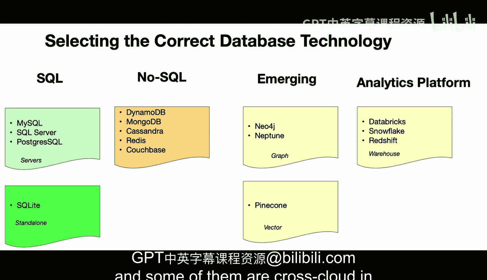

# 杜克大学《大型语言模型实践（高级数据工程、AWS、Databricks和本地LLM）｜Large Language Model Operations 》 - P40：40_03_02_选择合适数据库.zh_en - GPT中英字幕课程资源 - BV1oi421Q7GT

One of the most important things to do when building on top of a new system is to consider the correct database technology。

 We have many different categories from SQL。

To nosQL to emerging to analytics platforms， let's first take a look here at SQL。

 the idea here is that you have a relational model with fixed schemas， you can do acid transactions。

 So the idea here is that you do care about consistency and you have complex joins in aggregation。

 Some of the examples here are MysQL Postgress SQL server。

 Now a little bit of a wild card here to SQL light。

 which is a standalone database that can handle huge data， a third of a petabyte of data。

 and it's often used in mobile apps as well。 And it could be really useful for data scientists to do standalone projects。

 Next up here， we have nosQL databases， they're flexible。 you don't have to worry about the schema。

 They're also focused on availability and scalability。

 So in the cap theorem where we have some tradeoffs right between consistency and availability。

 In this case we care about availability more。 And so these are eventually。Consistent data sources。

 and there are various data models like。The key value model or the document model or the columnar model。

 and they depend a little bit on which database， some of the examples here， Mongo， Cassandra， Redis。

Now we also have these emerging databases that are very interesting because they give you new properties。

 So a graph database is one of the forms of new databases here and you can see here that you can store data in nodes connected by edges you also have the ability to do optimizations for connected data like social networks and you also have very powerful traversal queries。

 some of the examples are neoo4j Neptune and what I think is personally a very exciting part of them is this new kind of descriptive statistics like centrality page rank you're able to look at different ways of communicating about data because it's in a graph form just like youd have descriptive statistics like the median in a traditional data when you look at a graph database things are much different We also have vector databases and vector databases are very interesting and that they have the ability to。

You know really dive into different kinds of data sets so for example。

 if you wanted to do a recommendation engine this could be a great choice because you could instantly figure out the correlations between all of the features you have also if you wanted to do things around any kind of machine learning problem you could use these things to know optimize some of the workflows so they're also an emerging you know option for many new machine learning use cases and then finally we have analytics workflows and with this we have you know really the two big contenders or databricks and snowflake and if we look at what they do。

 it's columnar storage that's optimized for analytics in memory caching speeds and queries。

 also advanced analytic functions and some of the examples again are snowflake and Bigque and redshift they all have these capabilities of doing know analytics as a platform and some of them are crosscloud in the case of databricks。

Or snowflake。