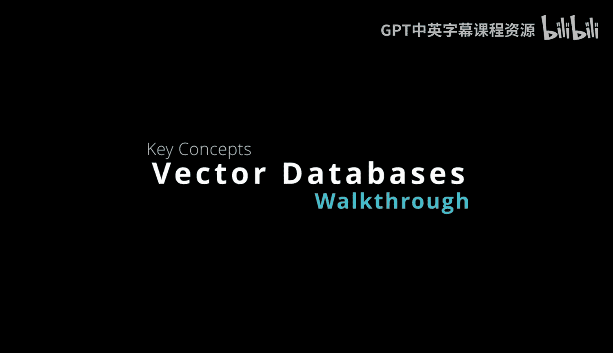
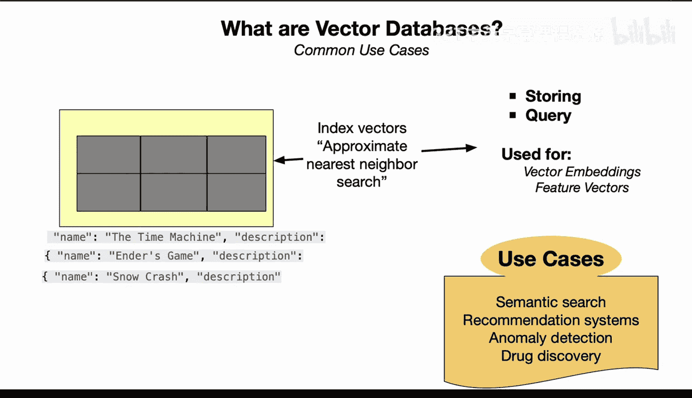
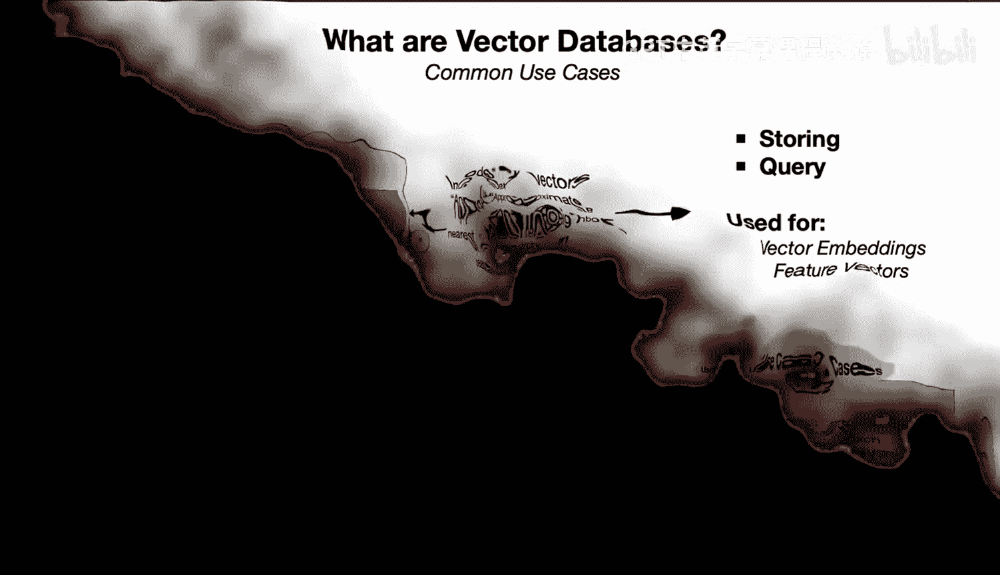

# 杜克大学《大型语言模型实践（高级数据工程、AWS、Databricks和本地LLM）｜Large Language Model Operations 》 - P41：41_03_03_什么是向量数据库及其工作原理.zh_en - GPT中英字幕课程资源 - BV1oi421Q7GT

What are vector databases and some of the common use cases that arise from using them。

 Let's go ahead and walk through what that means。 First up。

 we have storing and querying across index vector。 So you would do an approximate nearest neighbor search for certain things that are inside of the vector database。

 and the reason you would do this is that you can figure out the most similar vectors to query the vector based on a metric like cosine or inner product。

 And this allows the storing of metadata alongside the vectors and gives you the ability to filter results。

 And this can handle high dimensionmenional and large datas and you can also leverage distributed storage and processing。

 And this enables new kinds of applications like semantic search recommendations engines。

 generative AI etc cetera that have a vector based approach。

 So if we look at some of the use cases here。 let's dive into semantic search here first。

 this would be using。Qury for a natural language and then return the relevant document。

 certain products， and this is based on semantic similarity of embedding query document vectors in the case of recommendation engines。

 you could find similar users or items based on learned vector representations of behavior and attributes。

 you could also do anomaly detection so you could identify outliers based on a deviation from nearest neighbors in the vector space。

 drug discovery as well， you could find molecules with similar vector representations for drug candidates。

 amid search so you could return similar images based on visual vector embeddings。

 chatbots so you could store the conversation history and personalize and also you could look into really the kinds of databases that are emerging and these could include P cone quadrants。

 gene etc。 there's a lot of activity in this vector database space especially in the world that were。

Moving into which is the large language model world。

