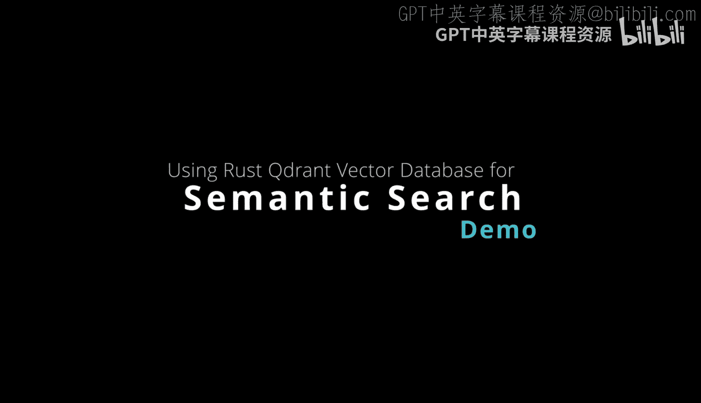
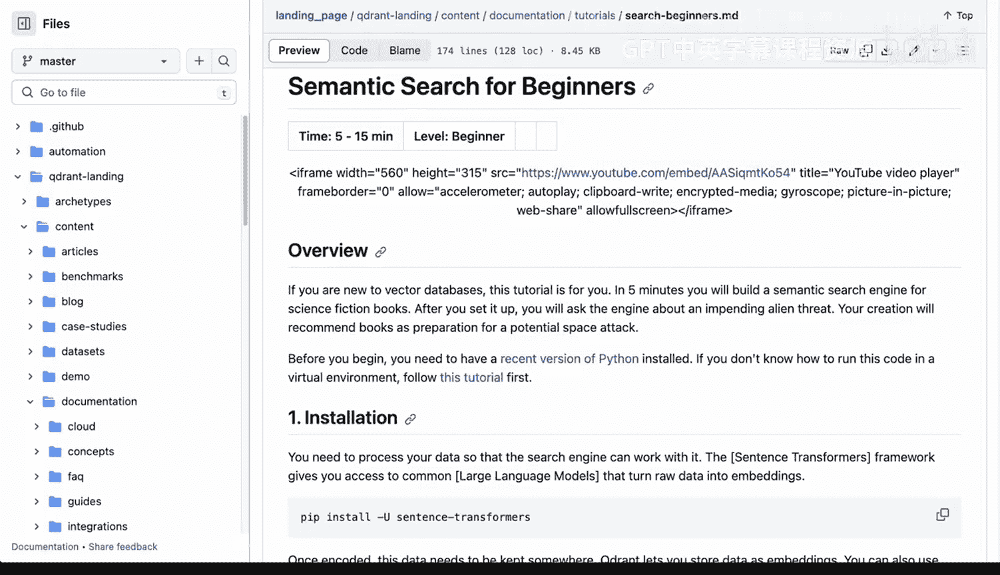
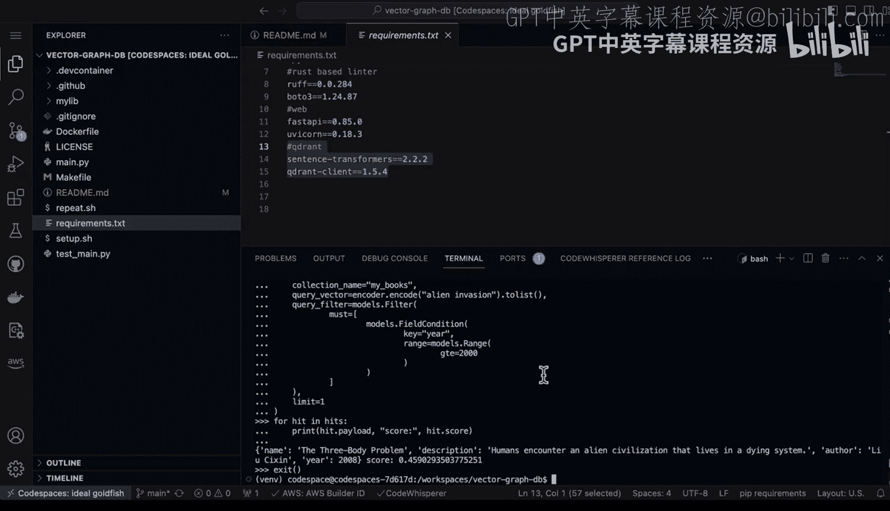

# 杜克大学《大型语言模型实践（高级数据工程、AWS、Databricks和本地LLM）｜Large Language Model Operations 》 - P42：42_03_04_实现语义搜索.zh_en - GPT中英字幕课程资源 - BV1oi421Q7GT

Here we have semantic search for beginners from Quadrant。

 and this is a simple tutorial that goes through people that are new to vector databases。

 It's really quick。 So I'm going to go ahead and walk through this tutorial。

 So first up here we're gonna make sure that we have the installations necessary So what I've done is if I go over to this codespaces environment here notice that I've actually got this installed by a requirements Txt file。

 so I even have pin this as well， which is great。 and then I like to do installations by doing make install。

 So if we say make install here it'll actually get those pinned requirements。

 So now all I need to do is actually use the Python shell itself to actually work with this particular problem。

 So first up what I would do is I would import the model so we can actually go through here first and get the clients。

 So we'll go ahead and paste that in perfect next step I will go through here and I'll say let's import sentence transformers。

And then what I'll do is I will work with the embedding model。

Because what we're going to embed things into this vector database。

 then all I need to do here is add the data itself。 and so in this case I'll have a book， metadata。

 a name， author， publication year， and a short description。

 So let's go ahead and paste all this into this particular terminal there we go。Perfect。

 and now all we have to do is decide what the storage location is。

 because this is a interactive demo。 We can actually pull the。The storage location here。

which is in memory and then we'll want to create a collection and so all the data in a quadrant is organized by collections and because we're storing a book。

 we're going to go ahead and call this thing my book soll go ahead and write a function for this so let's go ahead and past this in。

There we go， we see quadrant。t recreate collection， collection name is my books。

 and then we're going to pass it in so that it's able to create it。Now。

 what we'll do is that we'll notice that recreate collection is used if you're experimenting and running the script multiple times。

 and this will try to remove an existing collection and the vector size parameter will define the size of the vectors for the collection。

And the distance parameter would specify the function used to measure the distance between two points。

 So this is the advantage right of vector databases that you can figure out the distance between different vectors。

 So now all we have to do is upload data to the collection。 And so what we'll do is we'll copy this。

 And we'll go ahead and put the data that we had earlier inside of here。

And let's go ahead and do that。Great， and now we can go ahead and ask a question。And so we can。

 for example， look at the hits， so let's go ahead and make a hits variable。There we go。

 and then we can actually just go ahead and iterate through the hit so we can say for hit in hits。

We'll go ahead and print the payload and the score。

There we go and we're able to see here that the search engine shows three of the most likely responses have to do with an alien invasion and each of the responses is assigned a score to show how close the responses to the original query here so if we go ahead and we narrow down it even more。

 we can look at the most recent books from the early 2000s， so let's go ahead and do it again。

Un let's paste in hits here that does another query。 and now we can also say for hit。In hits。

And we can go here。And we can actually print this out。

There we go and now we see the three body problem and so in general here this is a great way to play around with the quadrant database。

 it has clients for Python， it has clients for rust。

 it's written itself in rust so it's super super fast and from here you can go ahead and check in your work。

