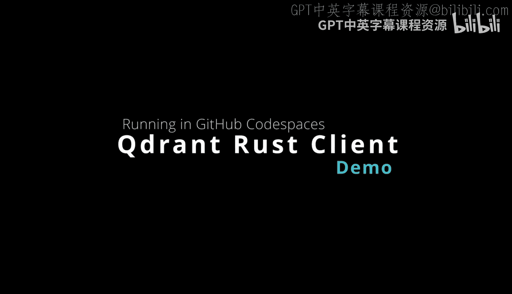
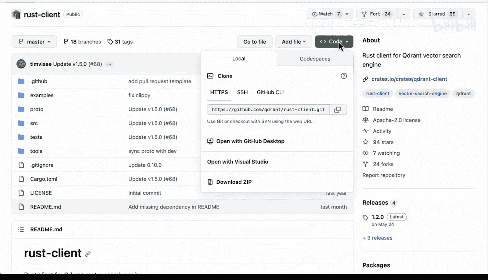
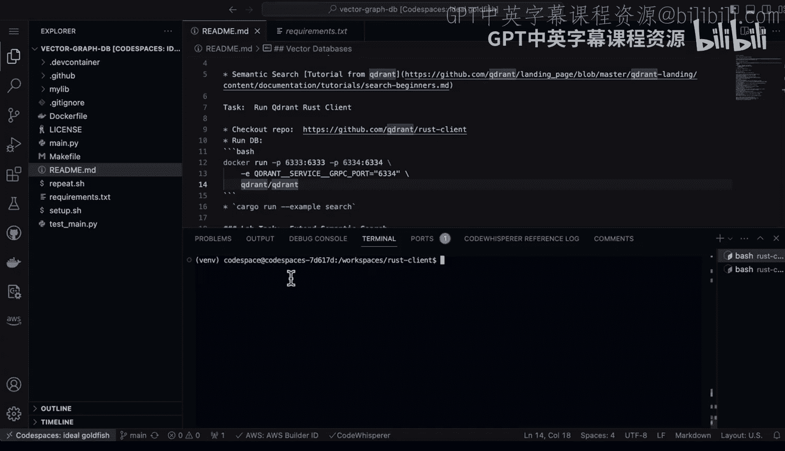
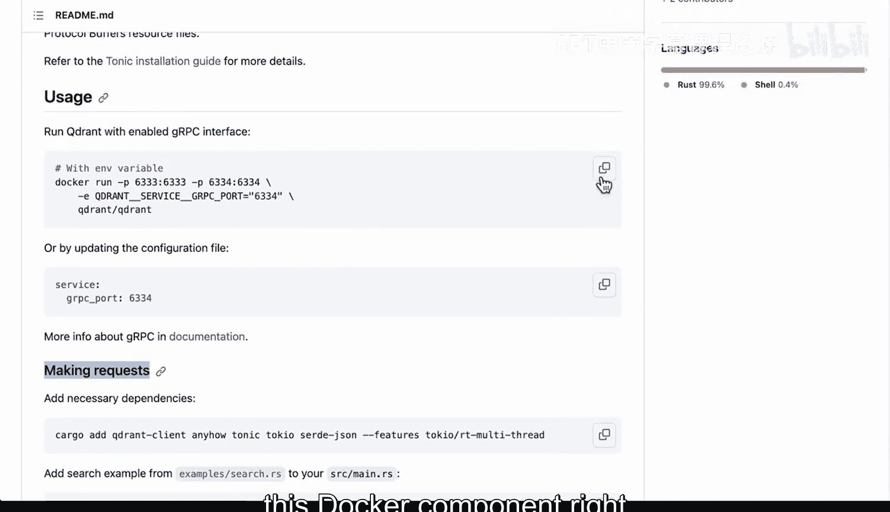
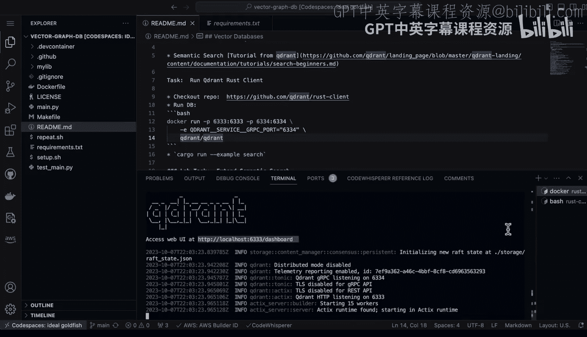
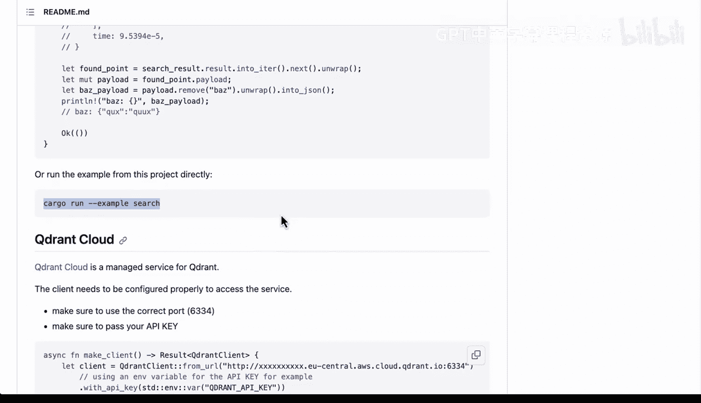
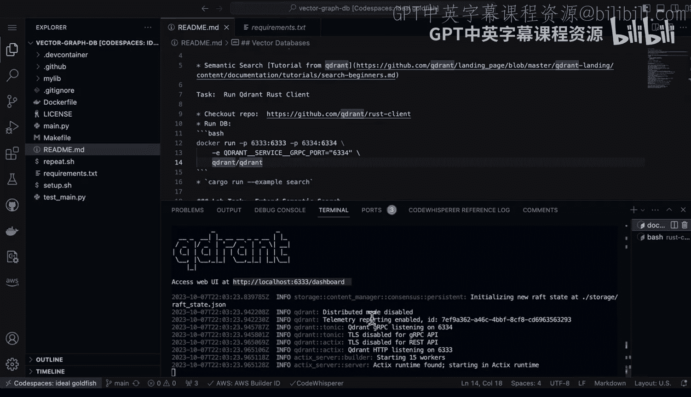

# 杜克大学《大型语言模型实践（高级数据工程、AWS、Databricks和本地LLM）｜Large Language Model Operations 》 - P44：44_03_06_Qdrant Rust客户端.zh_en - GPT中英字幕课程资源 - BV1oi421Q7GT

对。Here we have the Ru client for quadrant， which is a vector search engine and fortunately。

 because it's written in rust， it's going to also have great rust support for a client and all you need to do is do cargo add quadrant client if we look at the dependencies here as well。

 you can see that there's a very small amount of dependencies like the tonic library and in order for us to use this all we need to do is to clone the repo first and then also run this so that we can get the backend working as well。

 So what I'm going to do is I'm going to first double check that I have the path to this repo。

 So if I select code。

You want to clone the HPS repo， So I've already got that inside of here if we go into Ru client and we can do Gi remote。

Dash fee， there we go。 and now once I'm in here。Because it's a cargo project。

 I can actually easily run the the client by the example， which I'll show in a second。

 So if we go down here， I can grab this。

Docker。

Component right here， which will start the database。Let's go in and piece that in。

And you'll see here that it says Docker run。And this is gonna get this thing running locally inside of GiHub codespaces。

 what's really cool about Github spaces for this kind of stuff is that you can actually launch this right here and in fact if I wanted to I could also look at the dashboard。

 all kinds of stuff if I needed to look at more things but in my case。

 all I want to do is just dive right into the client and it's pretty easy with a rust project because all I need to do is do the example syntax and so how do I do this well we can look at the code first which is an examples search Rs which is you have the client here we have a main function which is asynchronous because it uses Tokyo and it has a async keyword here and then it goes through and it does a search over a collection but if we go to the very bottom。

 one of the really nice things about doing a gi clone for a rustpro is all you have to do to run an example is do cargo space run。

Space dash has example search， so let's go ahead and copy that。 We go back here。

Notice again， Dockers running in foreground mode， we can go to another terminal， just paste this in。

And now we're actually going to be able to run that query so you can see over and over again we're doing this query and all it's doing is actually using the local Docker interface here and it actually has a ActX runtime as well and it's listeninging on HP so in order to get the rust client going for quadrant。

 pretty straightforward， clone it， run Docker， do a cargo run example and you're good to go。

