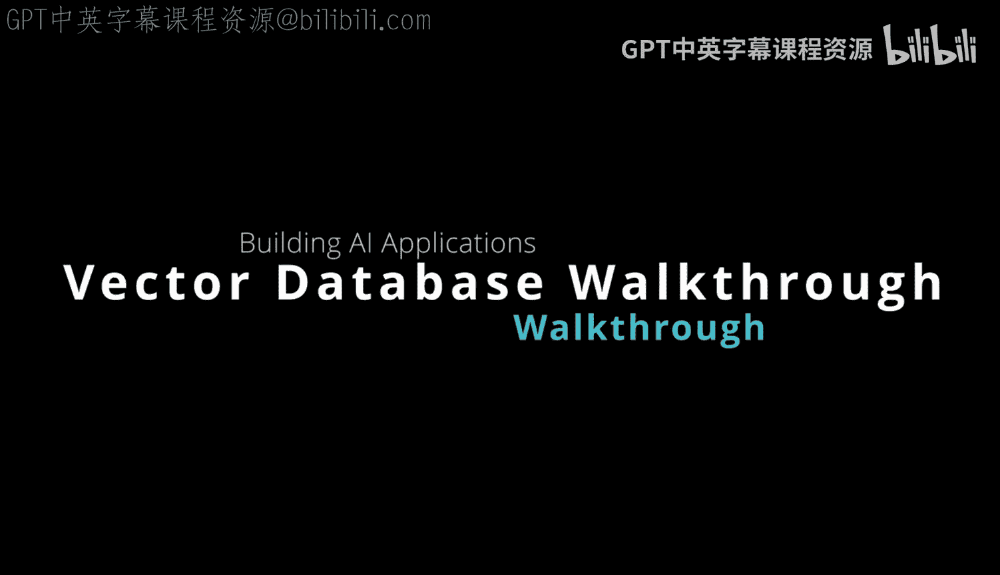
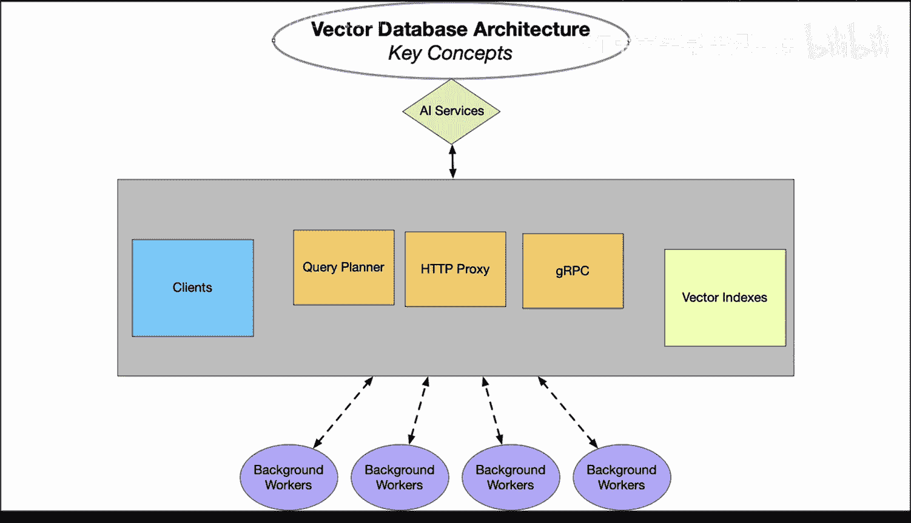
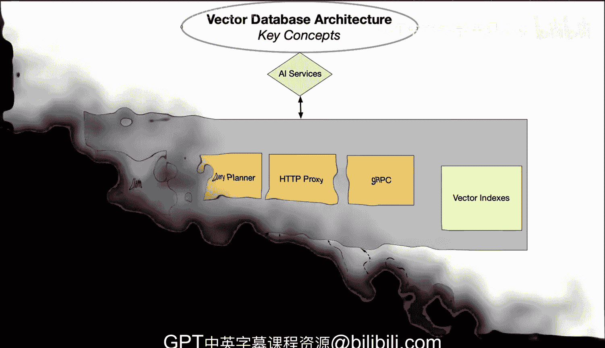

# 杜克大学《大型语言模型实践（高级数据工程、AWS、Databricks和本地LLM）｜Large Language Model Operations 》 - P45：45_03_07_向量数据库架构.zh_en - GPT中英字幕课程资源 - BV1oi421Q7GT

Yeah。Let's walk through the key components that make up a vector database architecture possible on the left here we have various client applications that users interact with to access functionality this could include the SDK for languages like Python go rust as well as a CLI and a webui these clients then connect to an HP proxy layer that handles request routing that proxy would for the API request to the GRPC service and then that GRPC service is the core API endpoint that exposes the vector database systems capabilities over RRPC it handles things like create search。

 insert etc when a search request comes in the GP service employs a query planner to optimize and dispatch the search across all relevant vector indexes and data shards and the vector indexes are where the magic happens and this allows ultrafat similarity search use。

Algorithms like HNSW or PQ。And those indexes are shard sharded across the nodes。

 So what this sharding does is it allows the indexes to scale horizontally as the data grows and then the index relies on something like let's say。

 rocks Db for storage。 and then these background worker processes would handle the data ingestion。

 the index builds and the replication shards across the nodes and then finally to synchronize the states across the nodes。

 there could be a consensus protocol like raft， and this would ensure eventual consistency。

 So with the data replicated across the nodes， you have high availability and you have fault tolerance and the system would stay operational。

 So this is a new style of system that is designed to work with AI services。

 recommendation engines also rag for doing large language model services。

 and it's important to understand the key concepts so you can deploy this for your organization。

