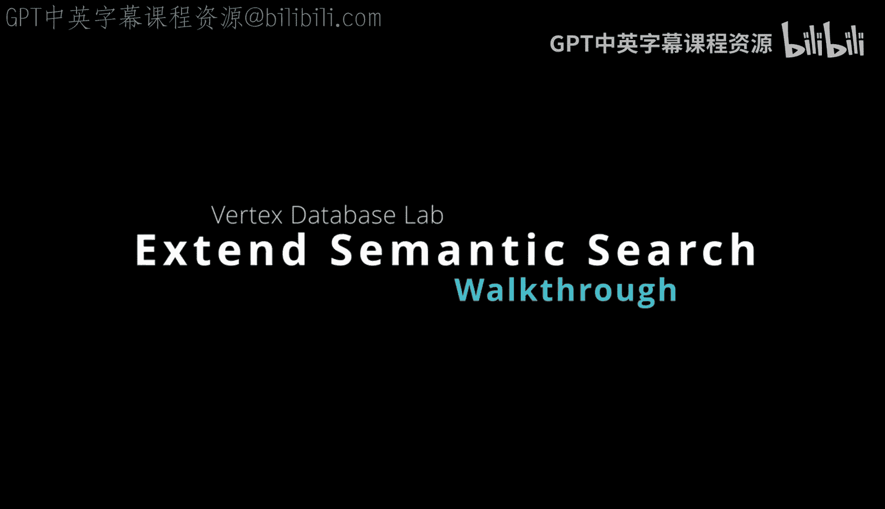
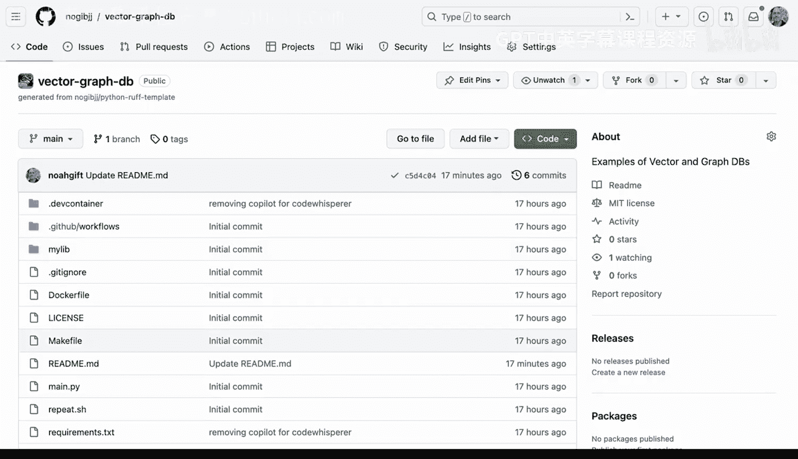

# 杜克大学《大型语言模型实践（高级数据工程、AWS、Databricks和本地LLM）｜Large Language Model Operations 》 - P46：46_03_08_动手实验：增强语义搜索.zh_en - GPT中英字幕课程资源 - BV1oi421Q7GT

Here we have a lab task， which is to extend the semantic search for a vector database。

 So by the into this lab， you'll be able to launch a Github codespace with a lab environment setup。

 install quadrant and sentence transformers packages load the sample book metadata create a quadrant collection and indexbooked vectors query the collection semantically based on book descriptions and then filter results by the publication here。

 So how would we do this first step you would launch the codespace here and follow the link provided to launch the codespace on Gitthub。

 So first， let's take a look at this one。 If we go here。

 you can see that this environment has something called a dev container If you go into it。

 it has a Docker file and it has a dev container Jason what this means is that inside this Docker file。

 it's got everything set up for Python virtual environment。

 the dev container is also configured so that it's already for you to go and further what that means is that if I ever want to launch it。

 I can just select right。Here， go ahead and launch with codespaces and this is one of the nice things about working with a complex setup like a vector database is I could just select it and the environment is already preconfigured Now if we go down here to the next step which should be make sure that the packages are set up and this is a installation step that you can run by doing the requirements file so inside this requirements file we see that quadrant is already set up for this tutorial and if we go to the make file here you can see that you can just do a make install and it'll install everything for this particular project so there's not much to do other the launching and then doing a make install next up here。

 what you would want to do is put your data inside of a books Py file。

And how would we actually know how that works so if we go back here to the tutorial。

You can take a look at the official tutorial here and notice that if we scroll down here。

 there's a documents setup that has a list of dictionaries inside of it， you could make this a books。

pyy file and then that will get you set up。Further。

 if we go down here and we do create a quadrant collection。

 you would just install according to the instructions and inmemory database and then finally you would do the sentence transformers。

 execute a query and then add the filter modify to query to only return recent books Now once you've got that done the final challenge activities would be to try to find a larger data。

 for example， like Wikipedia summaries， benchmark the performance for different vector sizes。

 add multiple filters on the metadata， for example， like author name。

 and then you could even visualize the vectors using something like principal component analysis。

 so this is a great setup here， it's all configured ready for you to go and it's up to you to kind of take it to the next level。

 but go ahead and get started and learn about vector databases。

