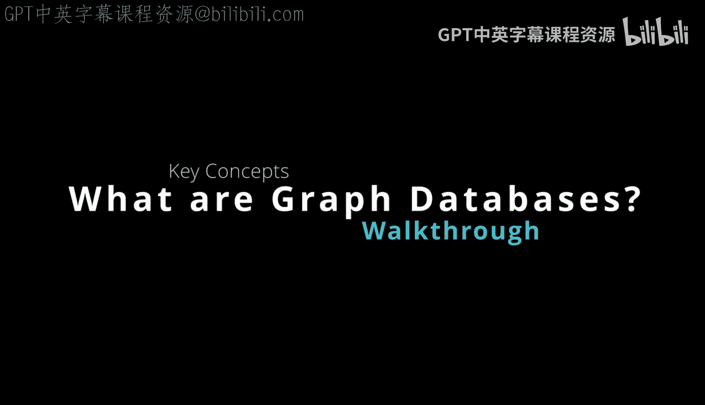
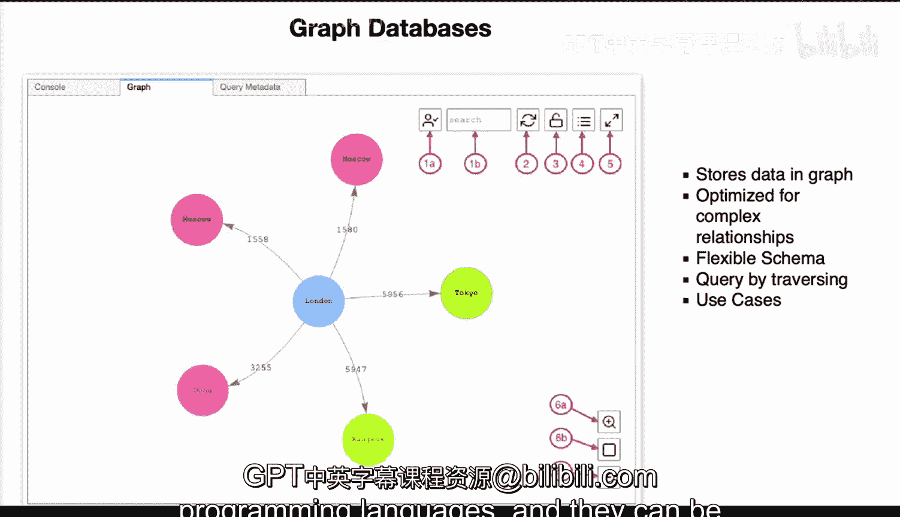

# 杜克大学《大型语言模型实践（高级数据工程、AWS、Databricks和本地LLM）｜Large Language Model Operations 》 - P47：47_03_02_图数据模型与数据库概念.zh_en - GPT中英字幕课程资源 - BV1oi421Q7GT

These are five key points to discover when you're thinking about a graph database。

 This is a Neptune database from Amazon and you can see here that you have these relationships between these different cities and this is a network tool that allows you to discover hidden patterns like communities or do recommendations or shortest path etc。

 So if we look through some of the characteristics here that are most important First up we have storage data in a graph format。

 So this graph structure has nodes， it has edges and it has properties So you can do different kinds of descriptive statistics that are not available with traditional data for example。

 centrality For example， would be a great example， what is the most central component of this particular structure or what is the shortest path or what is the page rank which is one of the algorithms that has typically been used for search engines Next up we have optimized for highly interconnected data and complex relationships So this is one of the things that you can do if you want。

Ask lots of really interesting questions like of the second people that are associated with this person。

 you know who are the people that are most likely to you know do this other action right you can ask these questions that are very complex Next up we have the flexible schema components of a graph database so you don't have this fixed structure where you have to know everything upfront like a SQL database you can dynamically change things and and really optimize for the query that you're trying to do we also have the ability to query by traversing the relationships between different nodes and this again gives us all those really cool descriptive statistics So why would you user a graph database well the traditional use cases are analyzing a social network building knowledge graphs doing recommendations a few other things to point out are that the nodes represent entities this could be people。

 places and things the edges represent the relationships between the nodes the nodes in the。

Edges have properties so this is the data and queries we use a graph traversal to gather connected data。

 and there are languages like cipher for querying and there's APIs for programming languages and they can be deployed either standalone or distributed。

