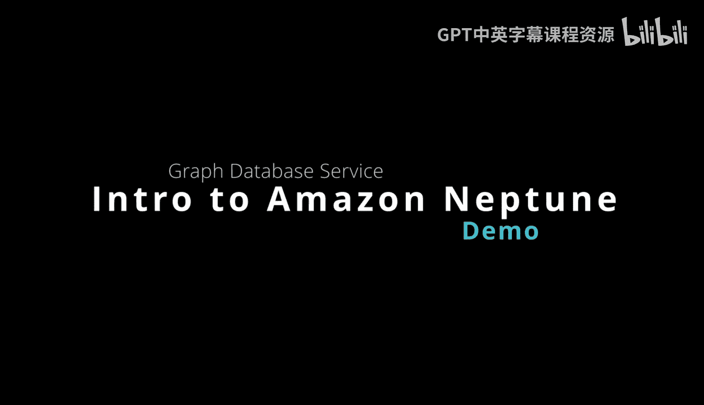
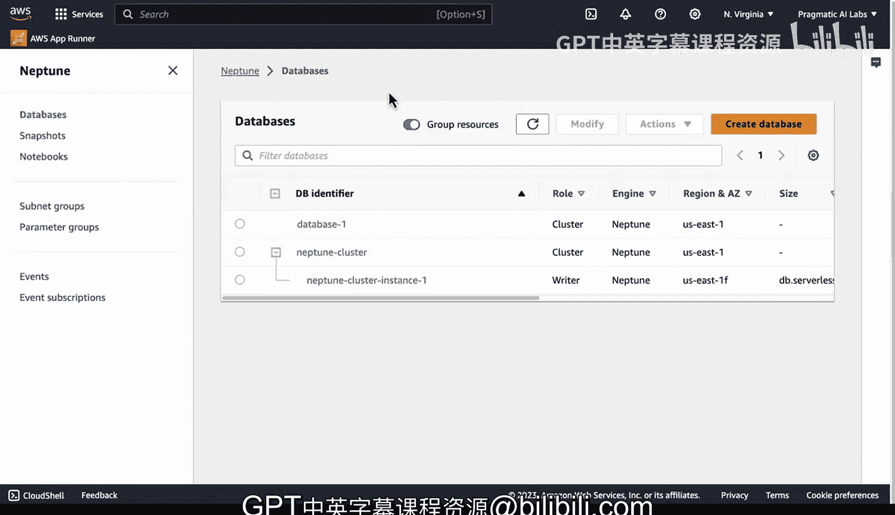

# 杜克大学《大型语言模型实践（高级数据工程、AWS、Databricks和本地LLM）｜Large Language Model Operations 》 - P48：48_03_03_Amazon Neptune简介.zh_en - GPT中英字幕课程资源 - BV1oi421Q7GT

Let's take a look here at Amazon Neptune， which is a fast and reliable database built inside of the AWS ecosystem here。

 and it has a lot of really interesting things that are normally potentially multiple steps and if we go ahead and take a look here at how this works first up we have database and we have notebook so let's go ahead and launch the Neptune interface here and when we dive in you can see that you can build a provision one or you could also build a serverless and what's interesting about serverless here is that you wouldn't have to actually manage a cluster yourself which could be a huge win we also have the development testing and we have the production availability here。

 so notice in production is going to by default credit read replica in a different zone so you may not want that if you're just going to play around with it and also in terms of connectivity here that is going to select what kind of VpC that you're going to want to connect to as well。

And additionally some of the things you can do is you can actually use an existing VPC security group or create a new VPC security group so once you've got all that stuff set up and you've configured it what the thing we'll do next here is take a look at how notebooks work。

A notebook here is going to allow you to connect to the graph database and in this particular scenario here I have a notebook set up。

 so it's running on its own ecosystem here and if we click on this you can see that it's actually hooked into SageMaker and if we want to actually open it up notice here we've got Jupiter。

 we have Jupiter labb and we also have G Exper so let's go ahead and take a look at Jupiter here first and if we open up Jupiter。

 we can go to Neptune。It it'll give us a bunch of notebooks here on how to get started So you know really the hello world would be know the first one to do and notice here that it actually gives us some great stuff about how you can actually do spark will you can do Gremlin open cipher so there's all these ways to communicate with it and you can also do a status call as well and see what the status of the cluster is。

 Interqueries， etc ce and even do these graph database type Gremlin queries Now if we go back over to this interface as well there's also graph Explorer and if we go to graph Explorer here what's nice about this is it gives us a different kind of view into what's happening and you can actually do a visualization once you get this connected to your your database So in a nutshell here you can see that Neptune is a graph database that's hosted on AWS there have traditional things like Jupyter notebooks as well as graph Exprs and it's a great way。

Get started if you're already on the AWS platform。

