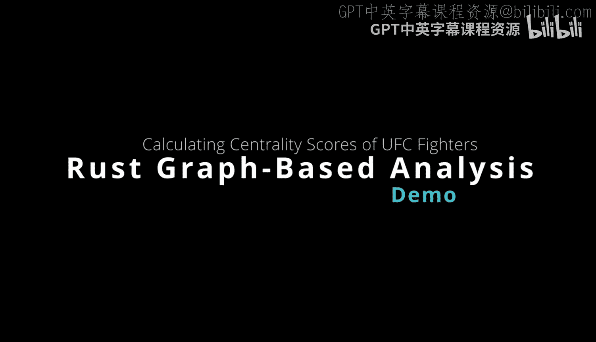
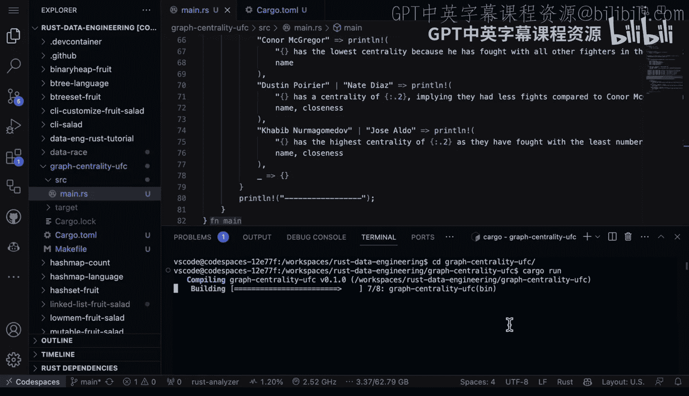

# 杜克大学《大型语言模型实践（高级数据工程、AWS、Databricks和本地LLM）｜Large Language Model Operations 》 - P49：49_03_04_图算法：UFC图中的中心性（Rust实现）.zh_en - GPT中英字幕课程资源 - BV1oi421Q7GT

Many people involved with data science know about descriptive statistics。

 it's a way of looking at data and getting things like the median， for example。

 or outliers or the men or the Mac， you can also do similar things with graphs which have very different metrics in this case we're going to look at centrality and in fact we're going to look at something called closeness centrality which is a measure that indicates the average distance between a node in all the other nodes in the network in this case。

 I'm going to make it kind of fun and use the UFC here。

 and it's going to be able to provide insights about a fighterer's engagement with others。

And the distance is the shortest path between two nodes。 So in this context。

 the number of fights between two fighters。 So let's go ahead and take a look at this library first here。

 it's called petgraph。 And if I go over to cargo。 you can see I've got this imported。 Now。

 if we take a look at next here， I define a struct。

 And this can be a little bit confusing at first when you see something like a struck and this implementation here as well。

 but it's actually identical to the Python code as follows right， if you're going to add you know。

 a name attribute to an object in Python， it's similar here。 I'm adding the fighter name。

 Now I also want to have some display things that I'll do as well。

 then I have some code that adds the edge。 So in this case， it's able to add that to the graph。

 and then finally， I put it all together。 So in this case， we've got a main function。

 I create a mutable graph data structure here。 and then I add the fighters inside。 So these are。

Very popular UFC fighters， Dustin Poer， Kabe， Jose Aldo， Conor Mc Gor， Nate Diaz。

 these are all people that have some relationship in terms of fighting。 I then go through。

 and I iterate on them and add them to the nodes， and then I add the relationship。 So in this case。

 again， this would be similar to any kind of network analysis involving social media or real worldld relationships。

 We have Dustin Poer versus Kabeeb that was one UFC fight。

 There's also Kabeib versus Conor Connor versus Dustin。

 Connor versus Jose Conor versus Nate Dustin versus Nate Jose versus Nate。

 So we have these relationships defined right here。And then this particular for loop。

 what it does is it figures out the name， the degree， the closeness。

 and then prints out the closeness centrality。Now I go through it and I add some explanations here as well so again。

 if you're a data engineer， machine learning engineer， data scientist。

 this could be something that would be very common if you were wanted to create。

 let's say a custom metric or a charge in this case I match on the word Conor Mc Gor and we can see that he's going have the lowest centrality because he's fought with the other fighters etca。

 etctera， so I print out the explanations based on the centrality score so let's go ahead and run this to see actually an action so if I type in cargo run。

It's going to go through and it's going to print out the results。 So if we go through here。

 we can see that the closeness centrality of Dustin Poier is 0。33。

 But if we look at the highest here， which is Conor Mc Gor。 He has the lowest centrality。 So it's 0。

25。 Now， the reason why his centrality is the lowest。

 It means that he's fought with all of the other fighters in the network And so a lower centrality means a higher number of fights。

 So this is really the best score here in terms of the people in this particular relationship。

 we can see that the worst score is Kabe and Jose Aldo， And you can see here that they both have a 0。

5。 So kind of double the score of Conor Mc Gor。 And then we see that Dustin and Nate。

Are equally tied for second place here。 So this is a great way to figure out custom metrics that are really unique to either in world relationships or sports relationships or social networks。

 And， of course， you can do it very easily with rust。😊。

