# 杜克大学《大型语言模型实践（高级数据工程、AWS、Databricks和本地LLM）｜Large Language Model Operations 》 - P4：04_01_03_队列概述.zh_en - GPT中英字幕课程资源 - BV1oi421Q7GT

Let's go over some of the facts on cues so that we can get a little bit of an idea on how we're going to work with something like RaitMQ later in this lesson so what we're going to do here is well cues are effectively a place where we can put items of work and in this case we're going to start here at the very top with these bag of items all of these represent units of work so you have units of work you have things that need to happen need to be processed they need to something needs to happen with these pieces of items so these could be data this could be sending an email this could be anything really that needs to happen at some point so these units of work will get produced somehow and then they need to go into sort of like what we have here which is kind of like a conveyor belt and this conveyor belt we take the units of work and it will。

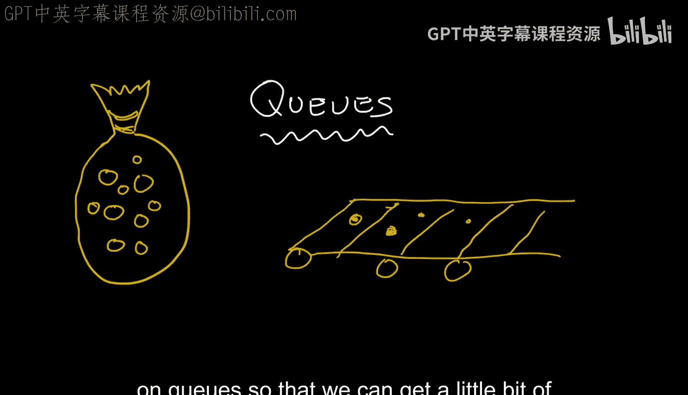

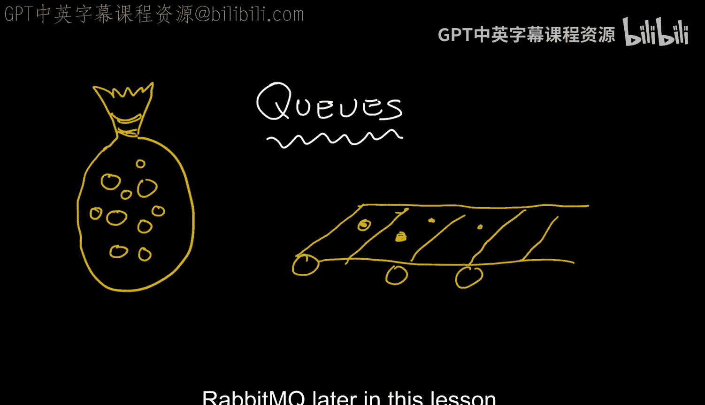

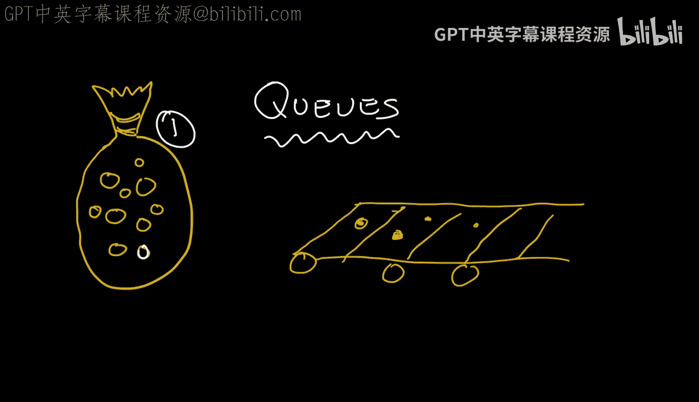

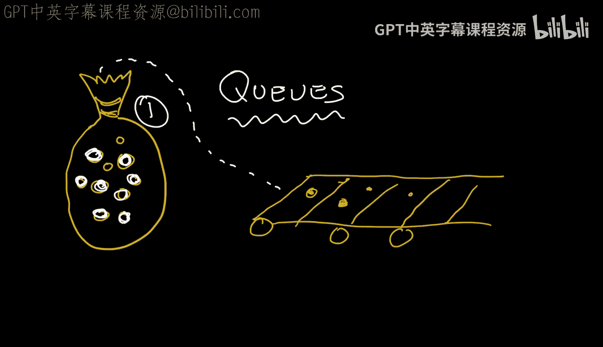

do the processing and something else will probably over here will be processing those units of work and do something with them and again we have many different things that that you can think about so for example。

 email or anything similar to that where some action is to happen with these things that are getting produced。

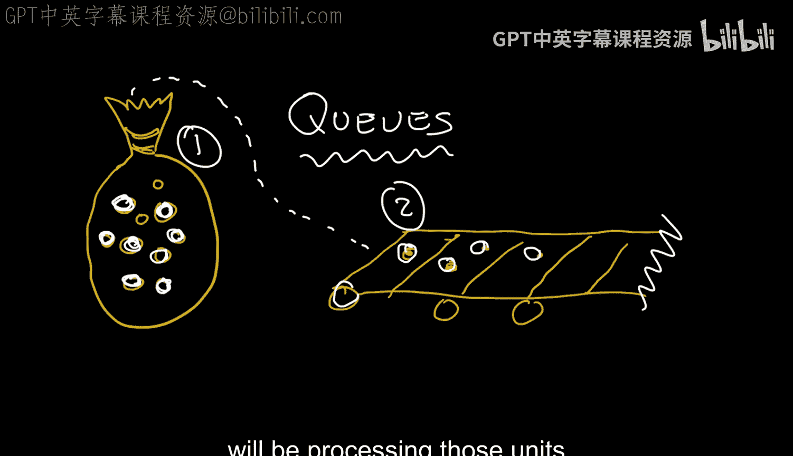

So in essence that's a little bit a rough very quick overview units of work are being produced and the queue is managing that that work as as it's getting produced All right so then the other thing I want to mention here is that sometimes cus so these would represent a queue here cus have many different ways of working。

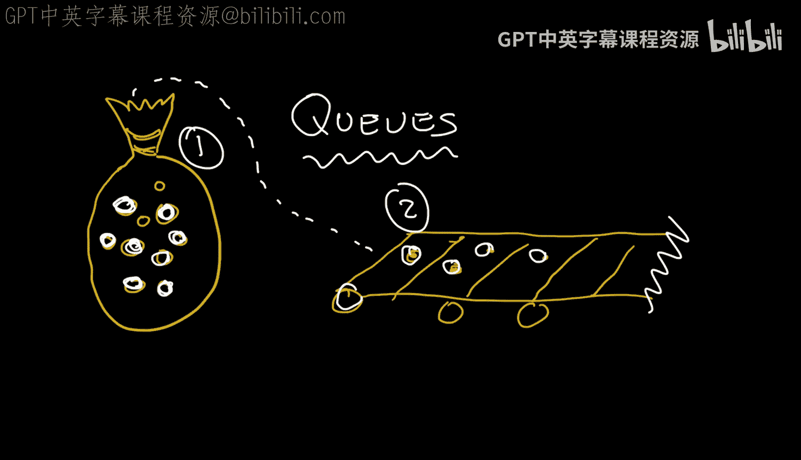

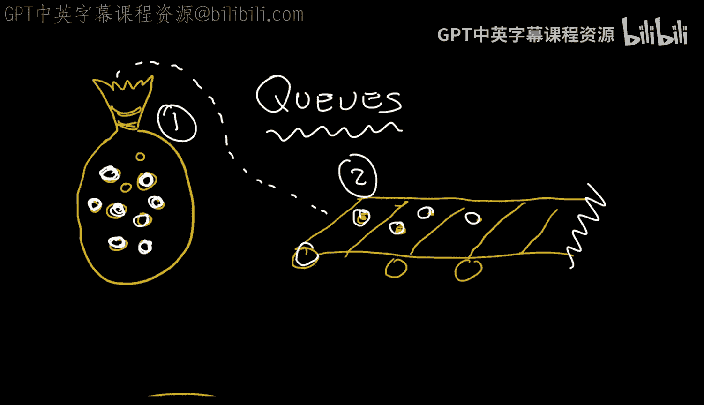

So one pattern for example， for Qs or way of working is to have first thing first style so here we have several different items。

 so let's just assume that what we have here is these items that have been produced and let's assume that the F item here was was the last one was the last one to get piled in so a was the first one B was the second one and so and so forth and f was the last one so one is last one last one in first one out so that would mean is if a was put like a while ago and all of these items got stocked in then the next time that something needs to consume something from the queue then the letter F would be the first the first to go so the next thing that would need to happen here or the other。

Pattern that could happen is the first in first out。

 So in the case of let's just imagine for a second that F doesn't does no longer exist and we change the pattern for first in。

First first out so in that case if a was the first one in。

 it doesn't matter how many other items are here， so say for example。

 if we have X here the last one then the Q would would prioritize a to being in consumed first because that was the first one put in and so on and so forth so like a goes away then B would be next and it will follow a that logical order so we had first one in first one out but we had also last one last one in first one out right so the last one in is going to be the first one out or the first one that came in is going to be the first one to go out。

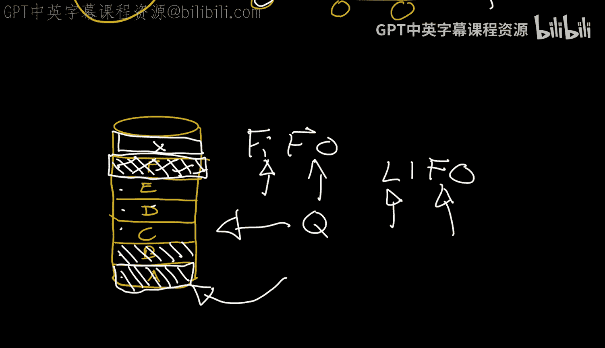

All right， so moving on。And this is kind of like to wrap up here。

 we're always going to have something that produces items of work and we're going to have something that is going to produce items of work in this producer is going to put things into the queue and before we're seeing letters。

 so say for example， A and then B and these units of work are going to go into the Q the Q here can be something like raitim Q。

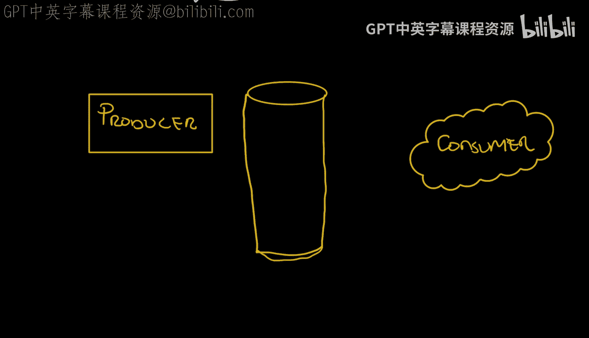

And in RabbitMQ as RaitMQ there are many different types of cues as well。

 but these producer would be putting items there and then a consumer which is a separate process。

 something else would be looking into the queue and saying， hey。

 give me the next item that I need to work with。So this type of architecture。

 this type of work is what you should be looking at when implementing cues and working with cues and all of these things will work in unison a producer and the consumer that the consumer doesn't have anything to do then it's just going to stay idle until until it exists that the queue has something This pattern of working is very useful because the producer can keep putting things into the queue filling that queue while the consumer picks it up at its own pace。

 so this separation of concern allows the consumer to operate independently from the producer and these systems can scale differently depending on the type of workloads that you're working with。

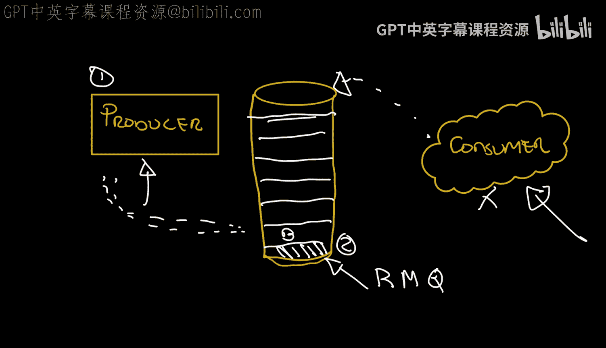

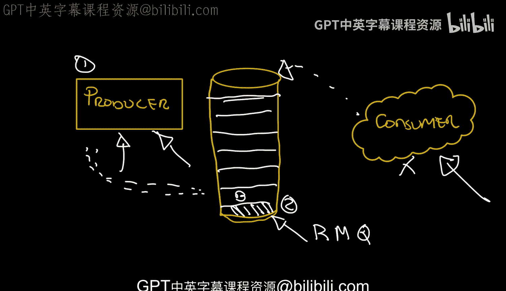