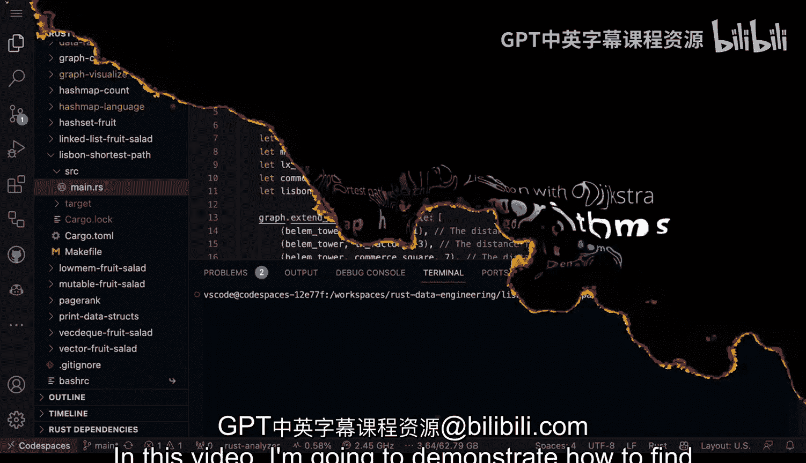
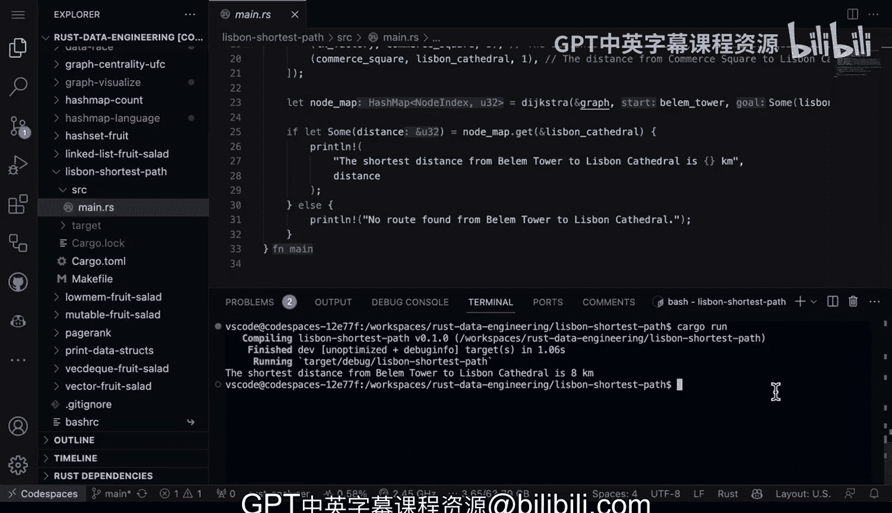

# 杜克大学《大型语言模型实践（高级数据工程、AWS、Databricks和本地LLM）｜Large Language Model Operations 》 - P51：51_03_06_图的最短路径.zh_en - GPT中英字幕课程资源 - BV1oi421Q7GT

All right， in this video， I'm going to demonstrate how to find the shortest path between two landmarks in Lisbon。

 Portugal， one of my favorite locations in Europe， and I'm going to use Dextra's algorithm here。

 Dextra's algorithm is a classic graph traversal technique for finding the shortest path from a single source node to all the other nodes in the graph。

 So this would mean， for example， if we have lots of different locations that you could traverse to what would be the shortest series of nodes to traverse and then what is that actual distance。

 in this case， I'm going to be finding the shortest path between Bellham Tower。

 which is right by the water in Lisbon and Lisbon cathedral。 So first up。

 I'm going to use this pet graph here， which is a nice graphene library and I've installed it right here inside of cargo and what also is cool is that I'm going to look。

an undirected graph by using graph initially right here。 So right here's the undirected graph here。

 And again， because of Ru's excellent typing system。

 I don't have to worry about you know lots of errors that could occur。

 I've got this strategy all laid out for me exactly what's going to be included inside of this graph。

 And then in terms of adding the nodes here first up， we just say let Bellham Tower。

 and I just add that node， I say let monastery I add that node and then finally I can even extend the graph by going through here and adding the distance。

 So I can say Bellham Tower to the monastery is going to be one beham Tower to the L Factories 3。

 etc ce etc ce。 and then what's nice about this is I can put this into the node map and notice how it says diyketra right here。

 Well， this is included inside of the pet graph library here So I don't even have to write up that algorithm it's able to do it for me。

 And then finally I can say。you know， basically give me the shortest distance between these monuments inside of Lisbon or。

 you know， key tourist sites inside of Lisbon and let's go ahead and run it。

 So if I go ahead and I run this I type in cargo run。Here we go。

 We can see the shortest distance from Bellham Tower to Lisbon Cathedral is going to be 8 km， right。

 So this is what's really nice about。You know， building out something with a well-known algorithm is that I'm able to solve real world problems with this。

 So this could be something again， that someone that was a data engineer or machine learning engineer or maybe doing something with logistics that could build this out themselves。

 they could count on the fact that they're going to get incredibly good performance And again。

 to deploy it。 It's going to be trivial because I would just take this binary push it somewhere and it could run with extremely low amount of memory。

 And again， it's an optimized algorithm。 So there's a lot to like about building these really classic problems。

 and solving them inside of a rust solution and then dising it with a binary that is extremely efficient with sea level type performance。

 but yet safe because it has all of these built in safety features with the modern rust language。

 which is you know a very new modern compiled language。

