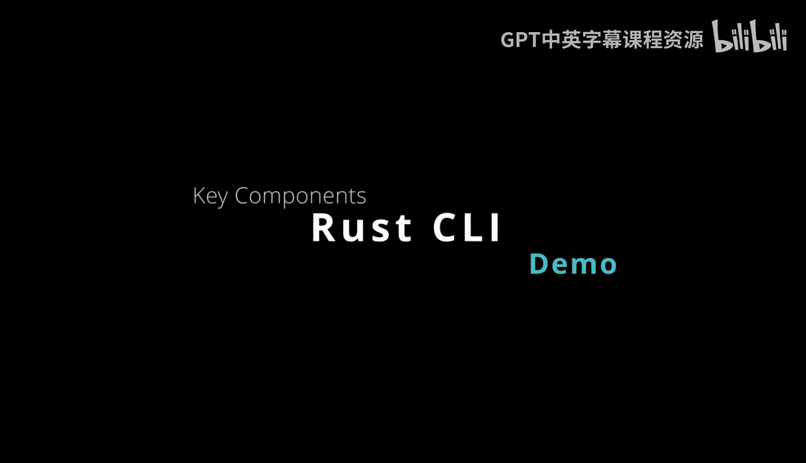
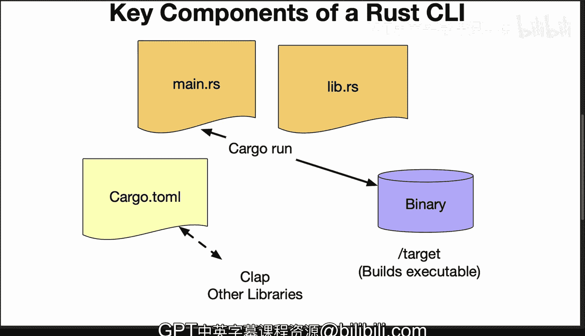

# 杜克大学《大型语言模型实践（高级数据工程、AWS、Databricks和本地LLM）｜Large Language Model Operations 》 - P52：52_03_07_Rust CLI工具的关键组件.zh_en - GPT中英字幕课程资源 - BV1oi421Q7GT

This diagram shows how the clap Cate can be used to build a command line interface or CI and rust。

 and CLI apps allow users to run commands and pass options。

 Cap provides an easy way to define the commands arguments， options， etc ce。

 that your program will accept， and this is done through rust code that sets up clap。

The CI definition gets compiled into the finished program executable that users can run。

 So when a user runs the CI application， they pass in commands。

 options as text and clap pares these and in turn makes them structure data your code can use。

 so your main Ru code gets the parsed arguments from clap and performs the intended actions based on what the user passes in。

A men clap will remove a lot of the boilerplate that would normally be needed to parse text input。

 handle help messages and do error checking。 So the end result is that users will have a nice interface to control an application via the terminal and rust code can focus on core logic instead of CI passing。

 And when you look at the diagram， you can see a simple flow here。In fact。

 ClaLap has lots of options and you could even build subcommands and nested options as well and then finally the binary that gets built in a target directory can be passed along to the user。

