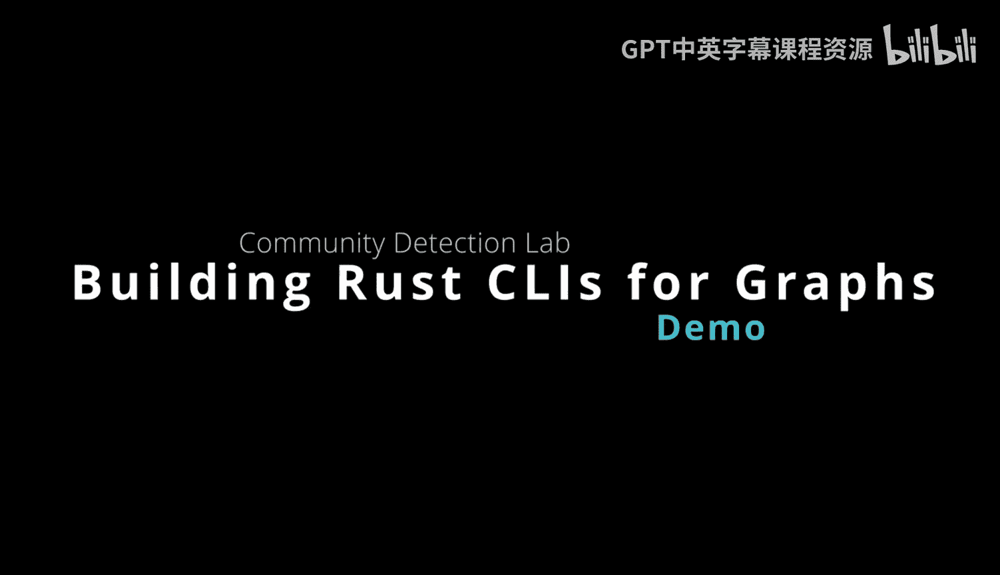
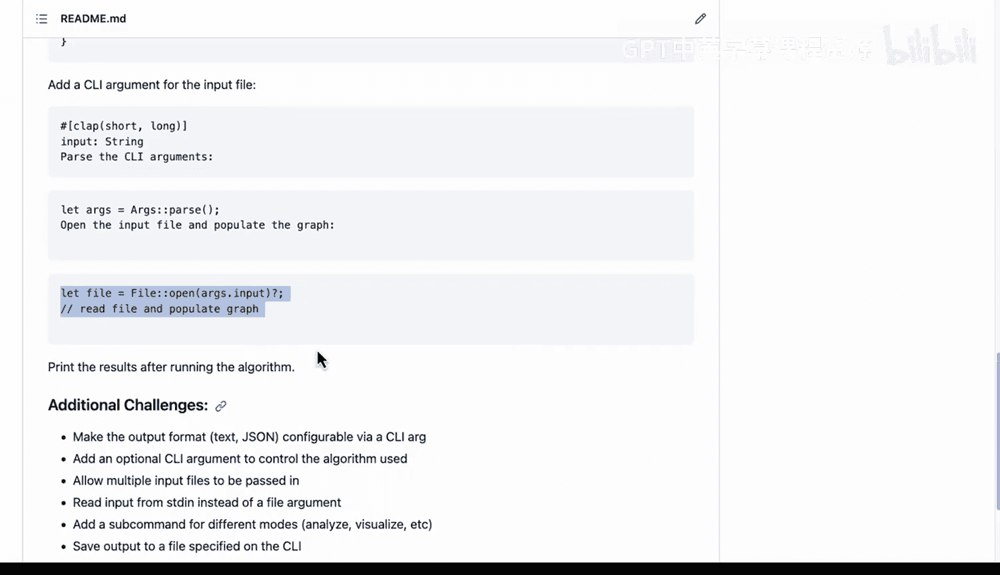
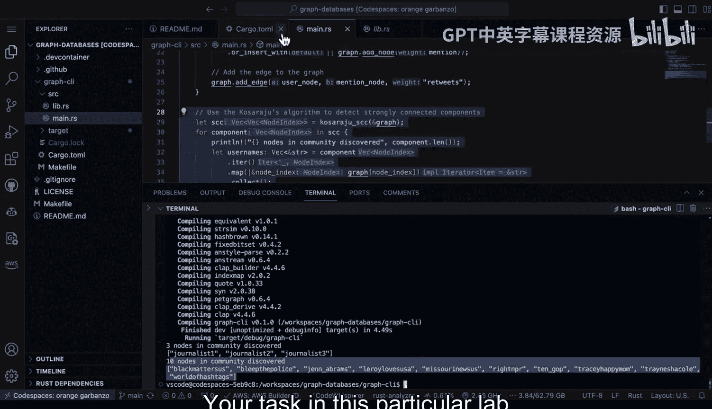
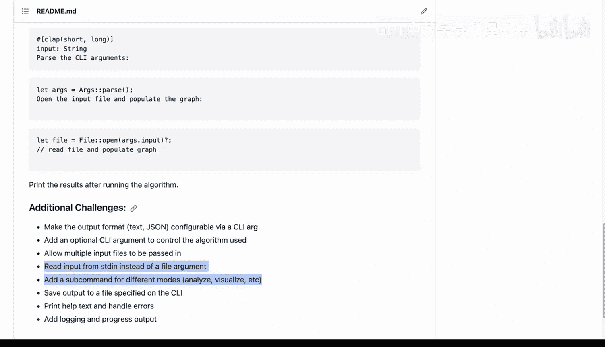

# 杜克大学《大型语言模型实践（高级数据工程、AWS、Databricks和本地LLM）｜Large Language Model Operations 》 - P53：53_03_08_实验演练：构建Rust图CLI工具.zh_en - GPT中英字幕课程资源 - BV1oi421Q7GT

All right， so we have this project here， graph databases that's a lab that has a nice algorithm that detects communities。

 but in this particular repo， what we're going to do is convert this into a commandlan tool。

 So this is very common when you're working with a project in another language including languages like rust where you actually want to take your core algorithm and make it more portable。

 more flexible by adding some commandlan tool interfaces on top of it。

 So if we take a look at this right here， you'd want to go through here and add the clap tool。

 whatever the latest version is， go ahead and add a parser， add some arguments。

 parse it and then go ahead and read the file and populate the graph。

 So this could be any external graph where you're going to go through and find some type of community。

 So if we go back here and look at the code here。

Let's go ahead and see this how this works in the Lib directory。

 we have some data from a well known actual troll interface on Twitter where we were able to figure out just a selection of people that we wanted to identify and create a community with next step inside of here。

We actually have the ability to create a new directed graph， to a hash map。

 iterate over the data to populated graph， add the users to the graph。

 and then finally figure out how to detect strongly connected components。 So again。

 this could be any data set that you wanted to populate in here and this is why a command tool would be great。

 So how do we run this Well first up， we would have to seed into that directory。

And then we can use cargo and we can just type in cargo run and this will actually go through and compile it and then at the very end it'll print out a static version of this code。

 So we see this three nodes in community discovered journalist1， Journal2。

 Journal3 and we can say 10 nodes in community discovered so it's able to figure out two different types of communities here and then sort that all together So your task in this particular lab would be to go through here and make it more portable so that you can flex out different kinds of options。

 you can put in potentially new algorithms or you could also figure out how to put in new datas and then finally when you're done go ahead and make the output。

 text or J add an optional CI argument， allow multiple inputs， read input from standard in。

 add a subcommand， let's say analyze， visualize， etc。

 save the output to a specific file or even add logging in progress output All right good luck。

