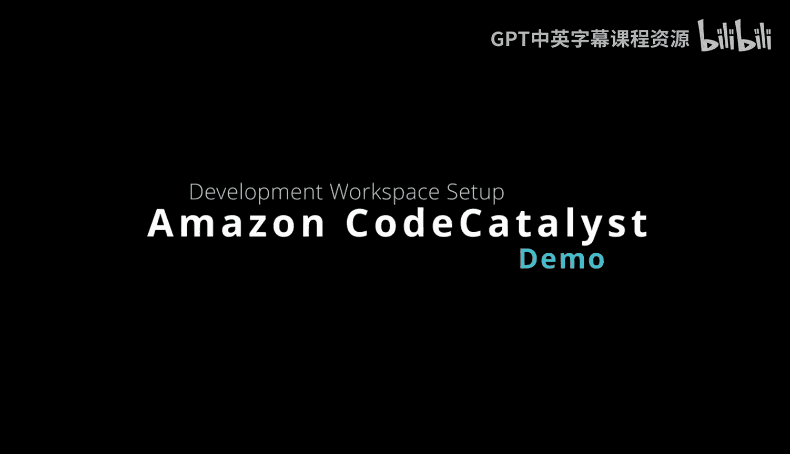
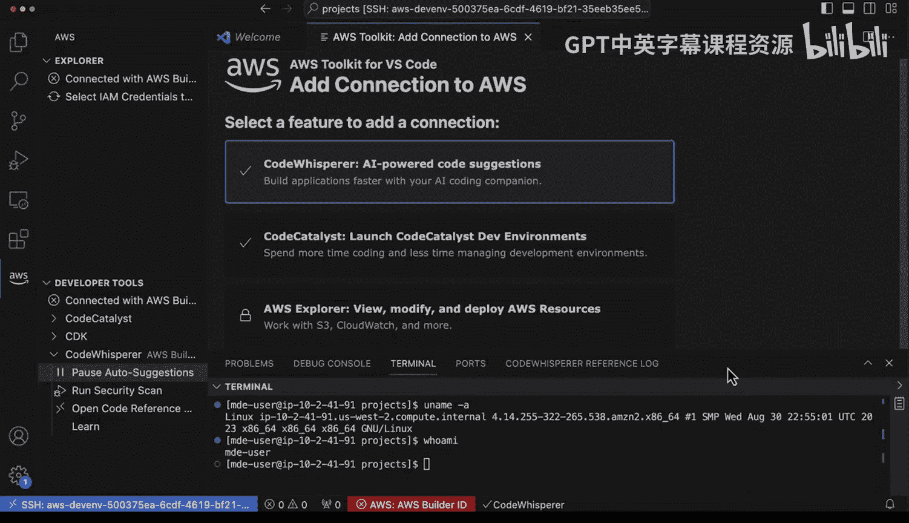
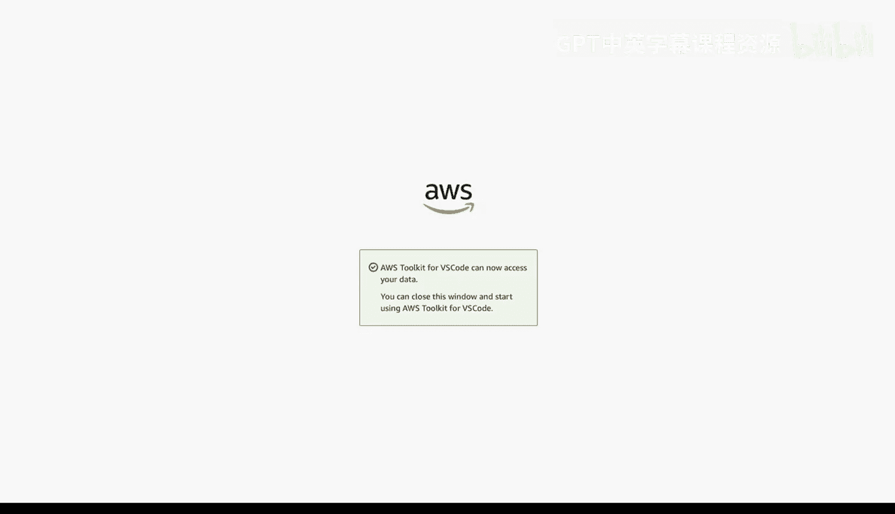
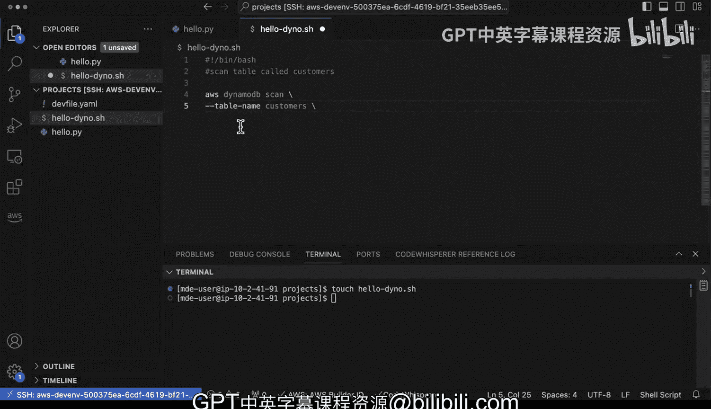

# 杜克大学《大型语言模型实践（高级数据工程、AWS、Databricks和本地LLM）｜Large Language Model Operations 》 - P55：55_04_04_学习用于Dynamo开发的AWS CodeCatalyst.zh_en - GPT中英字幕课程资源 - BV1oi421Q7GT

。Let's take a look at an exciting development tool available from AWS called Code Catalyst。

 We see here that inside of the AWS toolkit， we have several things including CDK codeWhis。

 and also code catalyst。 So if I select this start。😊。

What I need to do is actually log into my builder account。

 So we'll go through here and we'll say connect AWs builder Id with code Ca。 All right。

 let's go ahead and do that。So it's going to open up a profile here that will allow us to check it out and we'll go ahead and open this in our toolkit perfect now that I've logged in what I can do here is I can clone a repository。

 I can open a development environment or I can actually create one let's go ahead and create a new development environment in AWS so if I select this button。

Look at the options that are available here。 So first up it says you can use an existing code catalyst repository or you can create an empty dev environment。

 which is typically a good place to start with if you're going explore it and then it's going to use a space that I actually have available here and also a project available as well。

 we'll just use this as a scratch project and then we could actually put an alias for this as well like for example。

 delete me which is a good sign to delete this later。 And then by default here。

 you get free to these CPUs and four gig of Ram and an automatic time out of 15 minutes and 16 gigs of storage。

 So this is really designed in a thoughtful way so that automatic times out if you select this here though notice that I also can spin up monster environment as well if you enable billing for your。

Catalyst account。 So I'm going to go ahead and spin up a bigger one here just for fun。

 So let's go ahead and select that。 And then let's go ahead and say， create development environment。

What it's going to do here is it's actually going to pop up a new visual Studio code window。

And this window will have SS access to the machine。 So it's kind of an interesting concept here。

 noticeice here that it's actually setting up the SSsH connection automatically for me。

 And then I'm going to say， yeah， I trust the authors for this。

 So pretty quick actually and actually very amazing and seamless in order to get this cooking Now the next thing to do to start developing in my opinion would be to always open up a new terminal soll open up a terminal here and what we can do is just type in you name a and we can see。

 look at this。 this is running Amazon Linux we can see that from this particular information and we also could say you know who am I right so we can see that this is a different user than my local OS 10 machine Now in order to start developing here a couple things I would point out would be I would again go to this version of the AWS toolkit。

And we can see code catalystta is working， but I want to use codeWhis。

 so I'm going to select this button here。And what's going to happen is that it's going to have me go through here and log in。

 So let's go ahead and go here， connect AWS builder Id with code Whi。 So let's go ahead and do that。

And once we do this， it's going to prompt me to open it in a browser， confirm。Allow access。

And we can close this window Now that I've got that set up， look。

 we see the code whisperhi is actually selected。

In order to use this now， fortunately， all I need to do is just create an empty file。

 So let's go ahead and say like hello。That Py。And if we go over here。

 we can actually start writing some Python code。And if we wanted to install some extensions for it。

 but I'm going to go ahead and just say here a hello world Python。Hlow world， Python。

And that should be all I need for code whisperhi to start helping me out here。 So if I say deaf。

Hello。There we go a hello world。 We've actually got a nice little hello world example right。

 and we can get this cooking Also， if I wanted to do some bash work for dynamo Db， for example。

 I could just say hello Dino。Here。😔，And we can also put some context in here， for example， bin bash。

 and we could just say scan table。Called customers。And again， we go through here。

And it will actually help us out， we can type in AWS。Dynamo skin。

It's going to let us go through and get more and more suggestions so you can see here that actually the code catalyst plus code Whiser is a killer combo and it's trivial to set it up and it's free for the free tier。

 but you can also spin up larger machines if you want to do development in a bigger environment。

