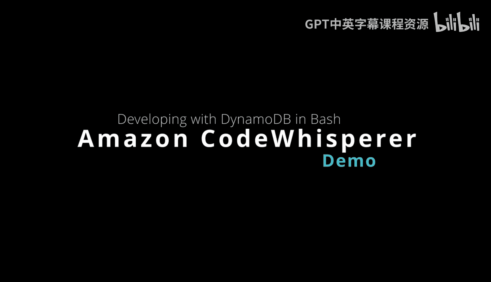
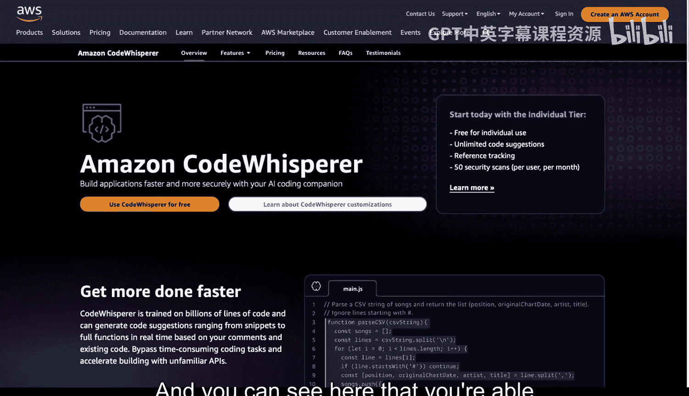
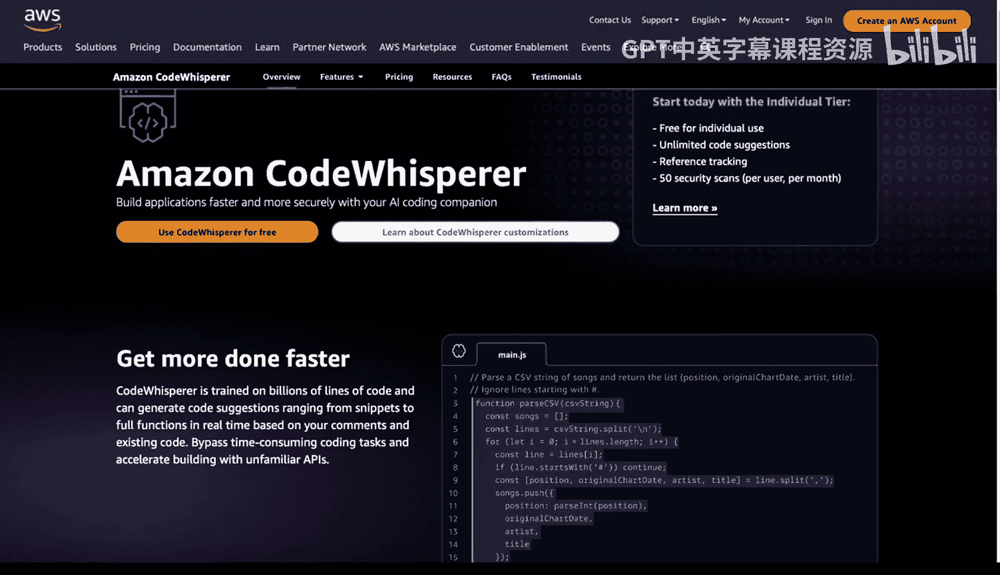
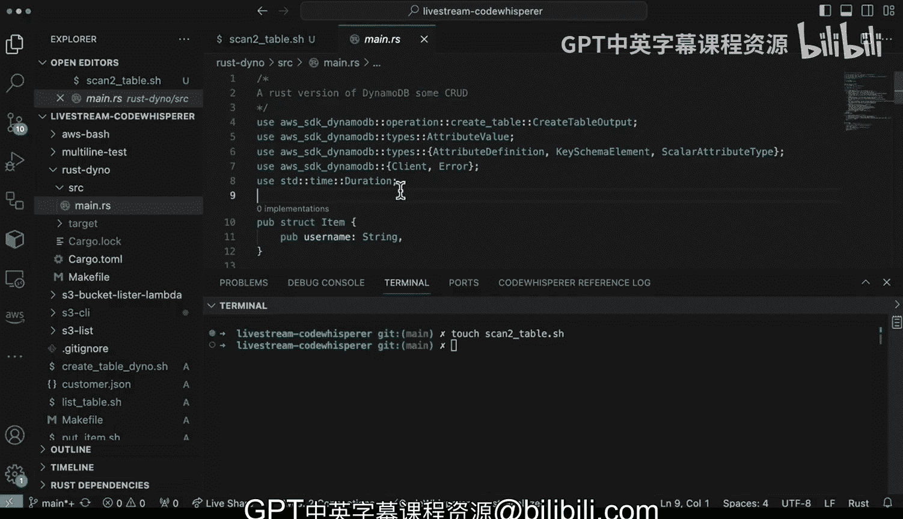

# 杜克大学《大型语言模型实践（高级数据工程、AWS、Databricks和本地LLM）｜Large Language Model Operations 》 - P56：56_04_05_利用AWS CodeWhisperer进行Dynamo开发.zh_en - GPT中英字幕课程资源 - BV1oi421Q7GT

。Amazon CodeWhisper is a great way to enhance your dynamo Db programming skills。

 and you can see here that you're able to have unlimited code suggestions。

 It's free and also it's trained on billions of lines of code and this code has an optimization for Aws workflow。

 So really it's a great tool to use to make yourself more productive and it supports many languages including Python Ru bash So if we go into this environment here with visual Studio code。

 How do you actually get started here。 Well， if you go over to the extensions here。

 it's inside of AWs toolkit。 So if we go ahead and hover over it。

 we can see it says code whisperhis code catalyst and support for Lambda S3 etc。

 So it's awesome about this is that I can actually get right inside of this environment here and I can toggle different settings。

 So if we go through here you can see that I've got code whisperhis installed and it shows me some suggestions as well like how to actually。

😊。

Use it， etc ce and if we want to double check that it's installed， if I go down here。

 we can see that code whisperhis is actually selected now if I go to this menu and I select on AWS。

If I hover over this， also this is where you can see that it's actually been selected。

 if I want to stop the suggestions， I can stop them there。 if I want to run them。

 I can actually run them there， and it also has the ability to do security scans which can be very helpful to look for security bugs and also for code reference as well which is pretty cool because it shows you where the code actually came from so maybe you want to look at more of the code if it's a really cool example for some of the things you're working on。

 so let's go ahead and see how I would actually use this in terms of a bashbased workflow So in order to get started here。

 one of the things that might be fun to play around with is to actually create a new bash file So if we go ahead and we just say get pull here I can get the latest changes and then I can actually say touch and we can just recreate a system that I've already created earlier which is we can call scan2。

Table dot S H。 And if we go ahead and we look at this。

 the first thing I would do is put the Shiang line。 Now。

 what's really cool is that it already knows what I'm going to write and actually helps me complete it。

 and it also can help me write documentation as well。 So if I put the documentation， you know this。😊。

Scrt。Will scan。The table， customers。And then if I wanted to。There we go。

 It could even give me some suggestions about more results。

 And now what's nice about putting the documentation here first is that here we see that automatically gives me the right command for what it is I want to do and it shows me that I can actually do this scanable operation So this is actually one of the I think easier ways to get started with code whisper is to actually dive into bash and actually use it to help you do code completions。

 etc and this will actually give you probably the best bang for your buck initially is that if there is a service on the UWs that supports a command line interface like this build some small little bas scripts here。

 have it autocomplete for you and you can see that it can be a massive win in terms of productivity you also can see that you can build other languages as well so I have some rust projects here that we have some code and you could obviously use it inside of a rust language you could also use it for Python etc。

So the big takeaway here is that if you're building。EWS code。

 it really is a huge win to use the code whisperhier auto completion。

 and it also has many features that are unique， including security scanning。

 as well as the reference to where the code actually lives from。

