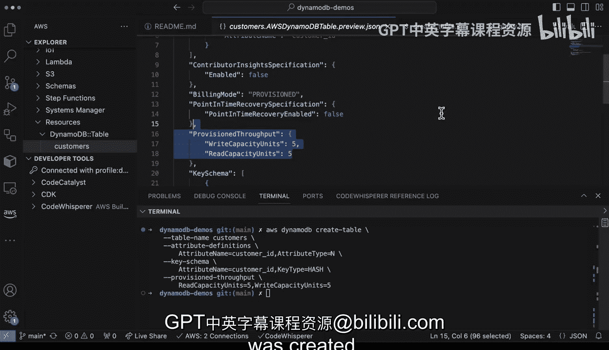

# 杜克大学《大型语言模型实践（高级数据工程、AWS、Databricks和本地LLM）｜Large Language Model Operations 》 - P57：57_04_06_使用CLI创建表.zh_en - GPT中英字幕课程资源 - BV1oi421Q7GT

In order to create a table， you can use the AWS CI for dynamo DB and we can see here the command is first up AWS dynamo DB Next we put in the option Cate hyphen table and this is what we need to do to create the table here you would then put in what the name of the table would be So dash table name customers also put what you're going to need the structure to be so this would be the attribute in this case it would be customer ID。

The key schema， in this case， the key schema would include the customer ID。

 and then what is the provisioned throughput。 So let's go ahead and grab this whole command。

Put this in。Paste it。And now we can see that it was actually successfully created。

 One of the things you can do as well is go to your EWS toolkit， which is right here。

If we go down to resources。We can see Dynamo Db。And we now have this customer table right here。

 and you can see that it is doing all of the things that we told it to do when it was created。

