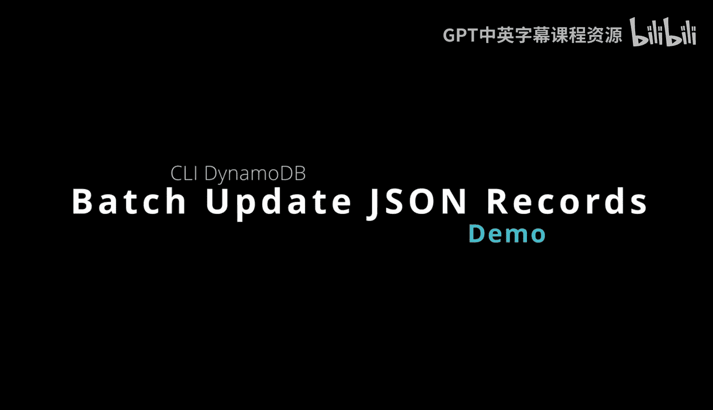
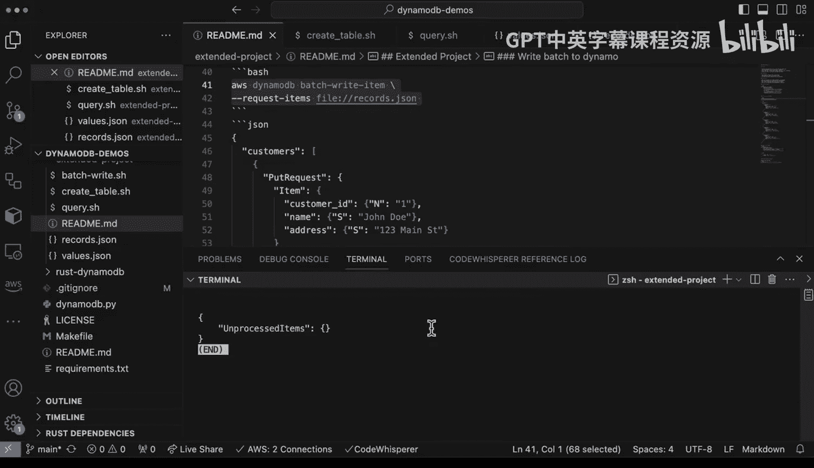
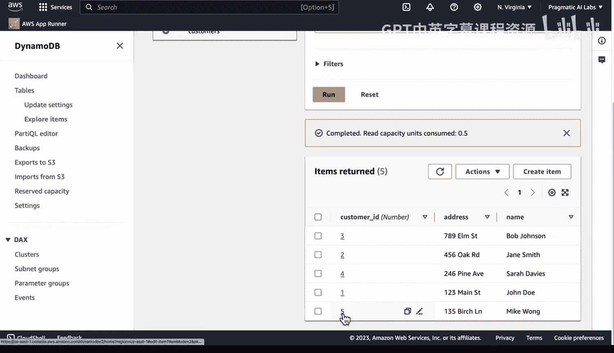

# 杜克大学《大型语言模型实践（高级数据工程、AWS、Databricks和本地LLM）｜Large Language Model Operations 》 - P58：58_04_07_批量记录填充表.zh_en - GPT中英字幕课程资源 - BV1oi421Q7GT

Here we have a bit of BaS code here that shows how you can use the command AWS。Dnamo Db。

Bat's right and then pass in dash dash request hyphen items and then a J file。

 Now if we look here at this J file， we can see that it's got a record J structure。

And what's nice about this style is it makes it very straightforward for you to do a lint。

 for example， of the JSN to make sure that the structure is correct。

 but also upload a very large amount of JSN all at once so that you're able to update multiple records so let's go ahead and run this operation。

In order to do that， I'm going to go to the readme and just grab this particular command。

And if we pasteed in， we can see it says AWS dynamo Db batch right item and then the dash dash request items will actually feed it this JS file there we go So it's actually very quick as well and then if we go over to dynamoDb。

We can see here that in fact， we've got all of those records here as well， the customer ID。

 the address and the name。

