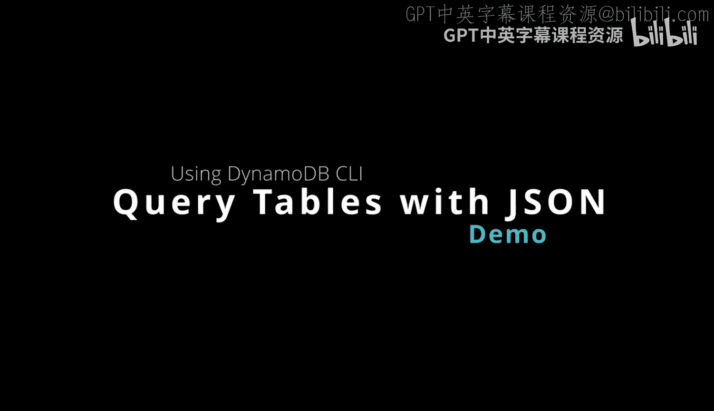
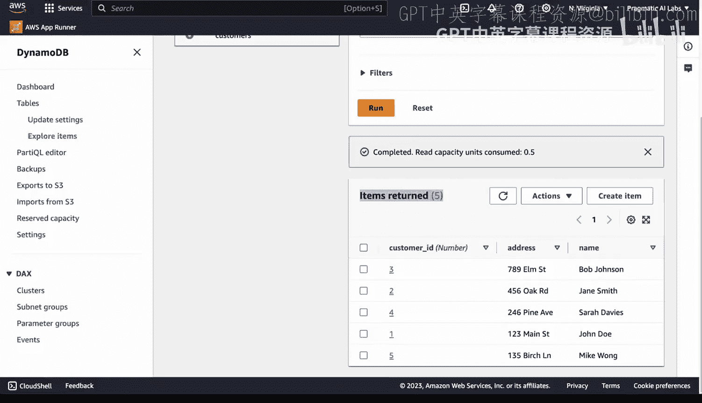
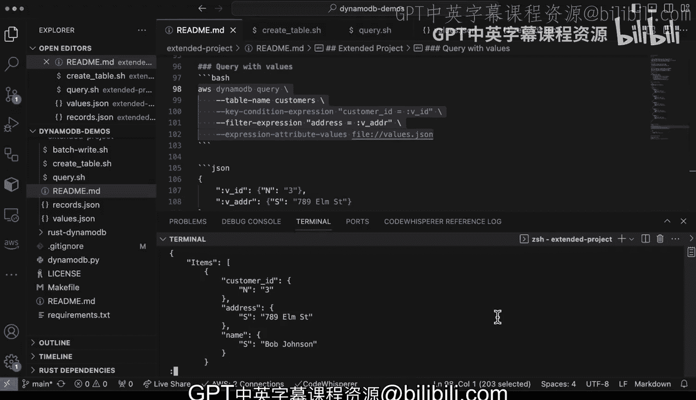

# 杜克大学《大型语言模型实践（高级数据工程、AWS、Databricks和本地LLM）｜Large Language Model Operations 》 - P59：59_04_08_查询表中的记录.zh_en - GPT中英字幕课程资源 - BV1oi421Q7GT

Yeah。Here in Dynamo Db， we have a table for customers。

 and if we look inside of this if we explore the table items。

 look at this item's return here 5 we have all the different customers。

 the different addresses and the names and what we're going to do now is query based on a particular set of parameters。

 So in order to do that。 What I will do is actually go back into my Vi Studio code editor。

 and I'm going to go ahead and put in a query using AWS Dynamo Db query。

Next up I pass in the table name， which is dashio's table name customers。

 I pass in the expression in this case， where the customer ID is equal to a particular ID。

 the filter expression where the address equals a particular address。

 and then I pass in the expression attribute values file。

 So this is a bit interesting in that what we can do is put those values in a file here。

 So what'll happen is it will actually swap these out。

 So for the VID is going to say where North is 3 or V address it'll be S here which is 78。

9 Elm Street and then if we go back。To this readme file。

 you can see that it'll pass this into the query。 So let's go ahead and do this and drill down here。

There we go。 Now I'm able to retrieve back exactly the record that matches that query。

 So this is one of the powerful things as well as you could save this JO file and it could be a particular type of query that matches some thing that you're doing and this makes it very straightforward to actually have checked into code exactly the kind of query that you need and this could be the basis of let's say。

 a data engineering system， for example， a dashboard or some machine learning application。😊。

