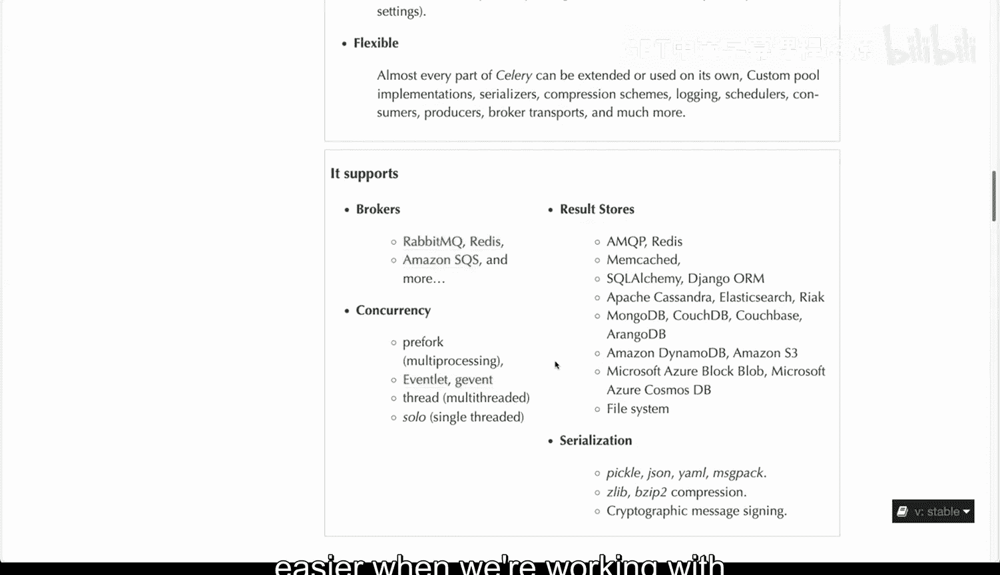
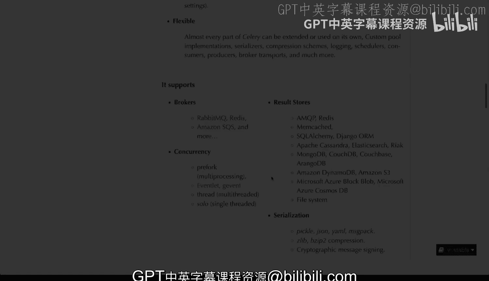

# 杜克大学《大型语言模型实践（高级数据工程、AWS、Databricks和本地LLM）｜Large Language Model Operations 》 - P5：05_01_04_什么是Celery.zh_en - GPT中英字幕课程资源 - BV1oi421Q7GT

Salry is a Python package， it is something that works with Python in Python with many different frameworks and many different cus or brokers like RaitMQ what is exactly salary what are we talking about here salary is the middleman it is what allows you to work with within Python and produce works items of work in Python and put them somewhere else and that's somewhere else and in this case what we're going to be showing is Rabiit MQ which is aQ and in here in the documentation well it goes through through specifics of what is a task queue we've already seen a little bit on what that is but what I want to show you here is I'm going to scroll here all the way and you can hear AMQP is the protocol for for ra。

MQ and you can see here that it definitely supports that。

 I believe it actually started by supporting Rabbit and Q first when it was first available。

 but what I want to show you here， it's this what it supports So the brokers。

 you can use Rait and Q which is what we're gonna focus on it supports Redis Amazon and many more。

 you can actually use something like a database as well as a Q like I personally think that Rabbit and Q is very good but what does that mean that your Python application will be producing works of items。

 it will those will get connected to salary and then salary will put them somewhere else like in this case Rabbit and Q So it acts as the middleman imagine like I tend to see salary as postman is sending all of these messages back and forth you the producer。

 the Python application。Just like someone that is writing a letter and salary is like the postman that is sending a letter somewhere else is taking charge of delivering and the post office is rabbit and Q is essentially figuring out how to get all those messages out All right so here you have some stores for the results so what does that mean well when there's a result when there's something that has been not only but produced but has been processed and you can capture those results and be able to get them back in What does that mean that salary allows you to consume some of these messages and be able to store them back Of course it of course concurrency and serialization you can see pickle Jason Yao message back we're not going to be doing a ton of those but we're going to have like a quick overview so what does that mean？

Well， in essence， that salary is definitely needed because it makes our lives easier when we're working with Python and we want to do something like RabbitMQ。

